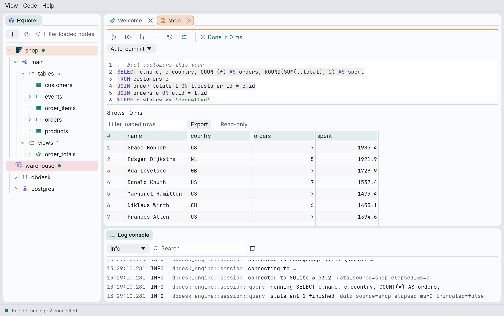
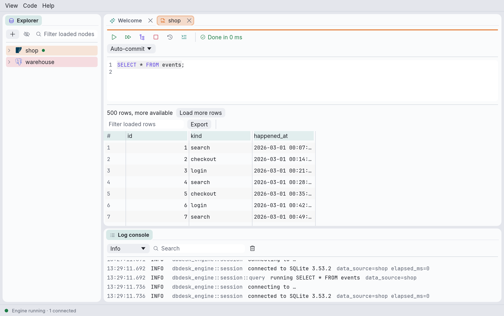
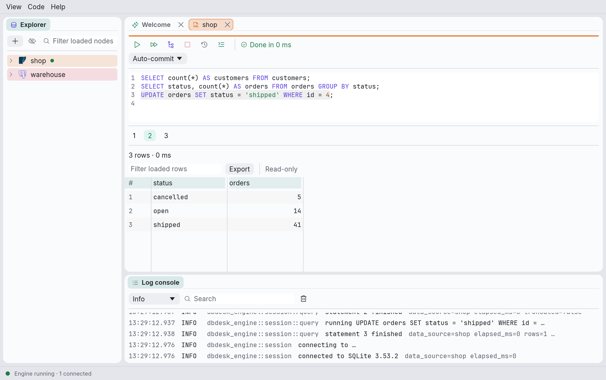
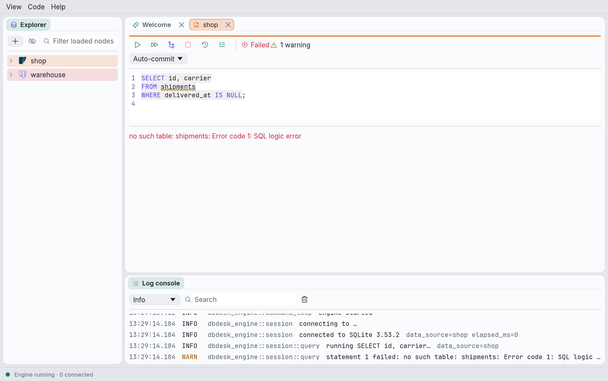
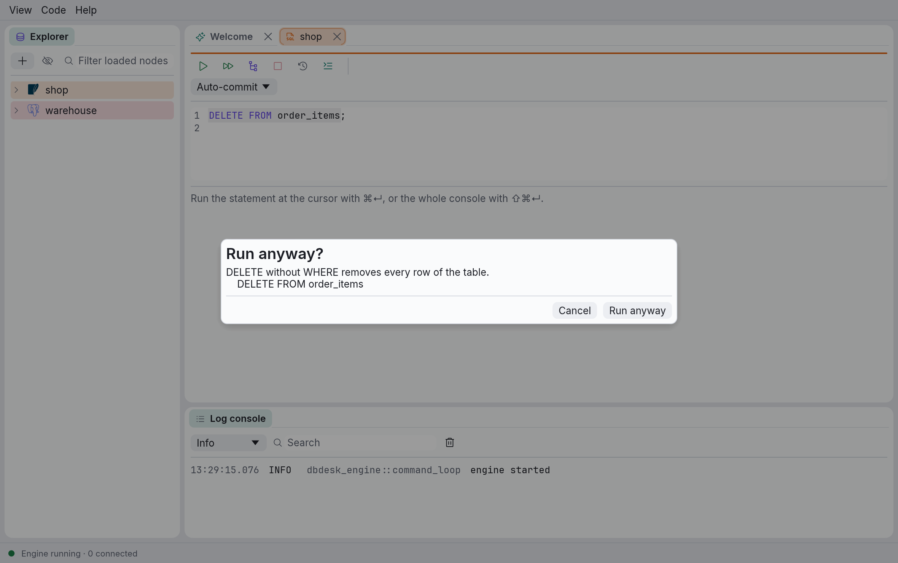

# Query consoles

A query console is a SQL editor tied to one data source, with the results of its latest run
underneath.

## Opening a console

- Right-click a data source in the explorer and choose **New query console**, or use the
  **New query console** card on the Welcome tab.
- Right-click a table, view or materialized view and choose **Open data**: this opens a console
  with `SELECT * FROM` that object and runs it straight away.
- Right-click a data source and choose **Open saved console** to reopen one you closed (see
  below).

Consoles open as tabs next to the Welcome tab, named after their data source. A second console
on the same data source is named `shop (2)`, and so on. If the data source has a colour, the tab
and a band along the top of the console carry it.

Each console has **its own connection**, separate from the explorer's and from other consoles',
so a long query in one tab never blocks another. It connects the first time you run something
("Connecting…" in the toolbar), and closing the console's tab closes the connection.

## Consoles are saved

Every console is a file, `consoles/<data source id>/console.sql` (then `console_2.sql`, and so
on; see [Where dbdesk keeps its files](files.md)). dbdesk writes your text a second after you
stop typing, and when you quit. Open consoles reopen with their text the next time you start
dbdesk.

Closing a console keeps its file if you typed anything in it, and deletes it otherwise (an empty
console, or one opened by **Open data** and left as it was). Kept consoles are listed under
**Open saved console** in their data source's context menu. If a console can't be saved, its
toolbar says **Not saved**, with the reason on hover.

## The editor

The editor highlights SQL keywords, strings, numbers, comments and quoted names, numbers the
lines, and gives the statement that **Run** would run a faint background.

**Completion.** Typing a name, or a `.`, opens a list of suggestions at the cursor; ⌃Space opens
it anywhere. Use ↑ and ↓ to pick, Enter or Tab to accept, Esc to close. It suggests:

- after `alias.` or `table.`, that table's columns; after `schema.`, that schema's tables;
- otherwise, the columns of the tables the statement names, then tables and views, schemas and
  SQL keywords.

Names come from what the explorer has loaded for the data source. When a suggestion needs a
part that isn't loaded yet, dbdesk loads it in the background (the list says "Loading the
catalog…"), which connects the explorer if it wasn't.

**Formatting.** ⌥⌘L (or **Format** in the toolbar, or **Code → Format**) lays out the selected
text, or the statement at the cursor; ⇧⌥⌘L (**Code → Format all**) formats every statement in
the console:

```sql
SELECT
    id,
    name
FROM users u
JOIN orders o ON o.user_id = u.id
WHERE u.active
    AND o.total > 10
ORDER BY name
```

Each clause starts a line, lists of several items put one per line, and every `AND` or `OR` of
a `WHERE` starts a line. Subqueries are indented inside their parentheses. Statements that
aren't queries, such as `CREATE FUNCTION`, keep their line breaks; a `CREATE TABLE` gets one
column per line.

Formatting only changes spaces, line breaks and the case of keywords. Strings, comments,
quoted names and function bodies between `$$` are never touched, and dbdesk checks the result
before using it: if it would read differently to the database, the text stays as it was and the
toolbar says **Not formatted**. The cursor stays where it was in the SQL, and ⌘Z undoes the
whole format at once.

**Problems while typing.** A moment after you stop typing, dbdesk underlines mistakes: a red
wave for errors (SQL the database can't read), an amber one for warnings (SQL that runs but
probably doesn't do what you meant). Hover over one to read it. The toolbar counts them; click
the count, or press F8 (⇧F8 for the previous one), to move the cursor to the next.

Warnings point out:

- `= NULL` or `<> NULL`, which are never true: write `IS NULL` or `IS NOT NULL`;
- `UPDATE` or `DELETE` without `WHERE`, which change every row;
- `INSERT … SELECT *`, which depends on the column order of the source;
- a table, or `alias.column`, the explorer has loaded and doesn't have. These only appear for
  parts of the catalog the explorer has already loaded, so expand the data source to get
  them.

Only queries and data changes (`SELECT`, `INSERT`, `UPDATE`, `DELETE`, `WITH`, `VALUES`) are
checked for syntax: dbdesk would rather miss an error in a `CREATE FUNCTION` than flag one that
isn't there. Once a console has run something, its own connection also asks the database
whether it would accept each statement, without running it, so the database's own messages
show up too ("The database says: …"). This never happens while results are still loading or a
transaction is open.

**View → Settings…** switches each kind of warning off, and asking the database too.

**View → Settings…** chooses how keywords are written (UPPER, lower, or as you typed them) and
how many spaces each level is indented. They're saved in `settings.toml` (see
[Where dbdesk keeps its files](files.md)).

## Running SQL



The toolbar's buttons, and their shortcuts while the editor has focus:

| Button | Shortcut | What it does |
| --- | --- | --- |
| **Run** (▷) | ⌘↵ | Runs the selected text if there is a selection, otherwise the statement at the cursor. |
| **Run all** (▷▷) | ⇧⌘↵ | Runs every statement in the console, in order, stopping at the first one that fails. |
| **Explain** | ⌥⌘E | Shows how the database would run the statement at the cursor: `EXPLAIN` on PostgreSQL, `EXPLAIN QUERY PLAN` on SQLite. |
| **Cancel** (□) | ⌘. | Stops the running statement, or discards rows not yet loaded. |
| **History** | — | Opens the data source's query history. |
| **Format** | ⌥⌘L | Formats the selected text, or the statement at the cursor (see [The editor](#the-editor)). |

On Linux and Windows, use Ctrl instead of ⌘. Hover over a button to see its current shortcut;
all of them can be changed (see [Keyboard shortcuts](shortcuts.md)).

**Which statement is "at the cursor"?** dbdesk splits the text into statements at semicolons,
the way the database would: semicolons inside strings, quoted names, comments, PostgreSQL's
dollar-quoted function bodies, and `BEGIN … END` or `CASE … END` blocks don't end a statement.
The statement at the cursor is the one the cursor is in, or the one just before it, so you can
press ⌘↵ with the cursor right after a semicolon.

The toolbar shows how the last run went: **Done in 12 ms**, **Failed** or **Cancelled**. While a
statement runs, Run, Run all and Explain are disabled.

## Transactions

Below the toolbar, each console has a transaction mode:

- **Auto-commit** (the default): every statement is committed as soon as it succeeds, unless you
  start a transaction yourself with `BEGIN`.
- **Manual commit**: dbdesk starts a transaction before your first statement, and changes stay
  pending until you click **Commit** or **Rollback**.

While a transaction is open, the console says **● Transaction open**, in either mode, and you
can't switch modes. On PostgreSQL, a statement that fails inside a transaction leaves it
**● Transaction failed**: the database then only accepts a rollback.

Closing a console, disconnecting its data source or quitting dbdesk with a transaction open
asks whether to roll it back first. Closing the connection is what rolls it back.

## Results

Under the editor, a summary line describes the result, followed by the rows:

- `8 rows · 3 ms` for a query,
- `12 rows affected · 4 ms` for `INSERT`, `UPDATE`, `DELETE`, `MERGE`, `REPLACE` and `COPY`,
- `Done · 2 ms` for anything else, such as `CREATE TABLE`,
- or the error message, in red.

Drag the line between the editor and the results to give either more room.

In the grid, numbers are right-aligned and `NULL` is shown in grey italics, so it can't be
mistaken for the text "NULL". Drag the edges of a column header to resize it. Hovering over a
column header shows the column's type when the database reports it (SQLite does; PostgreSQL
doesn't, yet).

- **Selecting and copying.** Click a cell to select it; shift-click or drag to select a block.
  ⌘C (while no text field has focus) copies the selection, tab-separated, ready to paste into a
  spreadsheet. Right-click a cell for **Copy selection**, **Copy value**, **Copy row** and
  **View value**.
- **Viewing a long value.** Double-click a cell, or select it and press Space, to see the whole
  value in a window. JSON is shown indented; **Copy** copies it as stored.
- **Sorting and filtering.** Click a column header to sort by it (ascending, descending, off),
  and type in **Filter loaded rows** to keep the rows with a cell containing the text. Both
  work on the rows loaded so far, without asking the database again, and the grid says so.
- **Exporting.** **Export → CSV…** or **JSON…** saves the rows as shown, sorted and filtered, to
  a file you pick. Only loaded rows are exported.

### Large results

Rows arrive 500 at a time. When there are more, the summary says so, and you get the next 500
by clicking **Load more rows** or by scrolling to the bottom of the grid.



A query that is still sending rows keeps its connection busy. **Cancel** discards the rows that
haven't been loaded (the summary then says `rest discarded`), and so does running something
else in the same console.

### Several statements

When a run includes more than one statement, numbered tabs above the summary pick which
statement's result to show. dbdesk shows the latest one that returned rows, or the one that
failed; failed statements' tabs are red. Hover over a tab to see its statement.



## Editing data

You can change values in the grid when the result is a `SELECT` from a single table (no joins,
`GROUP BY` or `DISTINCT`), the table has a primary key, and the result includes the key's
columns. Otherwise the grid says **Read-only**; hover over it to see why.

- Double-click a cell, or select it and press F2 or Enter, to edit it. Enter or a click
  elsewhere keeps the new text; Esc drops it. **Set NULL** in the cell's menu sets `NULL`
  (emptying a cell gives an empty string, not `NULL`).
- Changed cells are tinted. **Submit** writes them, one `UPDATE` per changed row, all or none;
  **Revert** forgets them.
- If a row changed or disappeared since it was loaded, or a value doesn't fit its column,
  nothing is written, your changes stay, and the error names the row.
- In manual commit mode, submitted changes join the open transaction and stay pending until
  you commit.

Values are sent as text and converted by the database, so type them the way the grid shows
them (`t` for a PostgreSQL boolean, `{1,2}` for an array).

## History

Every statement a console runs is recorded with its time, duration, row count and outcome.
**History** in the toolbar lists the data source's statements, newest first; type to search
them, and click **Insert** (or double-click) to put one into the console on a line of its own.

## Errors

When a statement fails, its error appears in red in the summary line and in the log console.
If the database says where in the statement the error is, the editor underlines that spot in
red until you edit the text. PostgreSQL reports a position for most errors; SQLite only for
syntax errors.



With **Run all**, the statements before the failing one have already run (and, in auto-commit
mode, are committed); the ones after it don't run at all.

## Statements that change every row

Before running an `UPDATE` or a `DELETE` without a `WHERE`, dbdesk asks first:



Nothing in the run starts until you answer: **Run anyway** runs everything as asked, **Cancel**
runs nothing. The check looks at how each statement starts, so a `DELETE` inside a `WITH` query
isn't caught.
