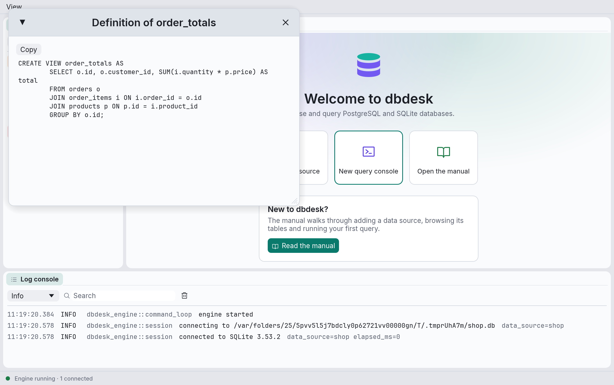
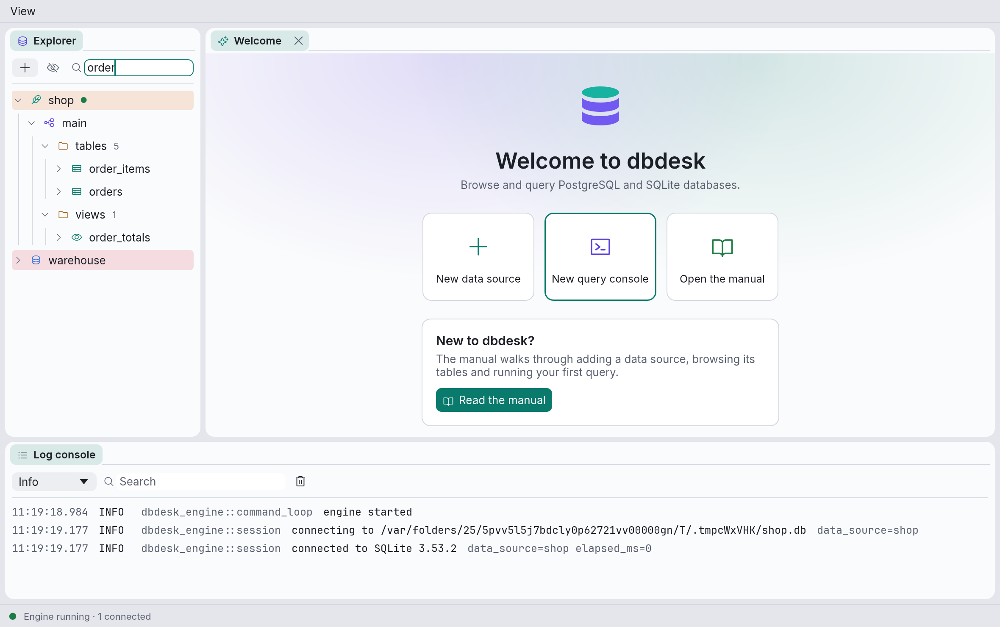

# The explorer

The explorer shows each data source as a tree. Nothing is loaded until you open it: expanding
a node asks the database for that node's children, and a spinner shows while it waits. Expanding
a data source that isn't connected connects it first.

Click the arrow before a node, or double-click its name, to expand or collapse it.

## What the tree contains

**PostgreSQL**

```text
data source
└─ database               every database on the server that accepts connections
   └─ schema
      ├─ tables
      │  └─ table
      │     ├─ columns    with their type, "not null" and "primary key"
      │     ├─ indexes
      │     ├─ constraints
      │     └─ triggers
      ├─ views
      ├─ materialized views
      ├─ functions        with their argument types, so overloads are told apart
      └─ sequences
```

**SQLite**

```text
data source
└─ main
   ├─ tables
   │  └─ table
   │     ├─ columns
   │     ├─ indexes
   │     ├─ constraints   primary and foreign keys
   │     └─ triggers
   └─ views
```

Each kind of object has its own icon and colour, and folders that have been loaded show how many
objects they hold (`tables 5`).

Browsing another PostgreSQL database than the one in the data source's settings opens a
separate connection to that database.

## The context menu

Right-click an object for what you can do with it:


| Menu item | Shown for | What it does |
| --- | --- | --- |
| **Open data** | Tables, views, materialized views | Opens a new console with `SELECT * FROM` the object and runs it. |
| **Copy name** | Objects inside a schema | Copies the name to use in SQL: schema-qualified for tables, views, sequences, indexes and functions (`main."Order Items"`), bare for columns, constraints and triggers. Quoted where needed. |
| **Show definition** | Objects whose source the database keeps (see below) | Opens the source in a window. |
| **Refresh** | Anything with children | Reloads the node's children and collapses everything below it. |

A data source's own menu (Connect, New query console, Open saved console, Edit, Delete and so
on) is described in [Data sources](data-sources.md#editing-connecting-and-deleting).

## Definitions

**Show definition** opens a window with the object's SQL, which you can select and copy with
the **Copy** button.



Which objects have one depends on the database:

- **PostgreSQL**: views, materialized views, functions, indexes, constraints and triggers.
- **SQLite**: tables, views, triggers, and indexes created with `CREATE INDEX` (not the ones
  SQLite makes for primary keys and unique constraints).

## Filtering

Type in the box at the top of the explorer to filter the tree by name, ignoring case. An object
that matches is shown with everything under it, and the nodes leading to it stay open even if
they don't match themselves.



The filter only searches what has already been loaded: it never asks the database for more.
Expand the parts you want to search first.

## System objects

PostgreSQL's `pg_catalog`, `information_schema` and temporary schemas, and SQLite's internal
`sqlite_` tables, are hidden. The eye button next to **+** shows or hides them, for every data
source at once.

## When the connection closes

Disconnecting, or losing the connection, forgets everything the explorer had loaded for that
data source. It is loaded again, fresh, the next time you expand it. **Refresh** does the same
for a single node while connected, which is how you see a table you just created.
