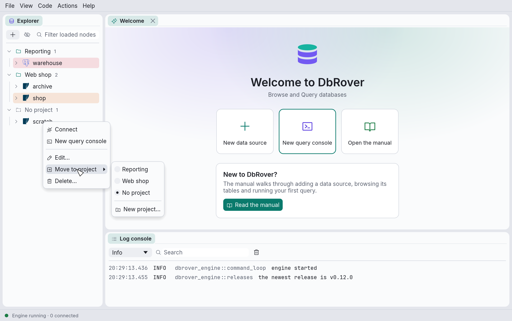

# The explorer

The explorer shows each data source as a tree. Nothing is loaded until you open it: expanding
a node asks the database for that node's children, and a spinner shows while it waits. Expanding
a data source that isn't connected connects it first.

Click the arrow before a node, or double-click its name, to expand or collapse it.

## Projects

Projects group data sources, say one per application you work on. Once there is at least one
project, the explorer shows each project as a header you can fold, with its data sources under
it, and the data sources in no project under **No project**. With no projects, it lists the data
sources on their own, as before.



- **New project…** is in the **+** menu, on every project header's menu, and at the bottom of
  **Move to project**. From **Move to project**, the data source moves into the new project.
- **Move to project ›** on a data source's menu lists the projects and **No project**; the one
  it is in now is marked.
- **Rename…** on a project changes only its name.
- **Delete…** on a project moves its data sources to **No project** first. No data source is
  deleted.

Each project also has a short **slug**, made from its first name: lower case, with hyphens for
spaces (`Web shop` becomes `web-shop`). Hover over a project to see it. Renaming a project keeps
its slug, so whatever refers to it by slug keeps working. A data source belongs to at most one
project, and a project may hold data sources of any colour and engine.

## What the tree contains

**PostgreSQL**

```text
data source
└─ database               every database on the server that accepts connections
   └─ schema
      ├─ tables
      │  └─ table
      │     ├─ columns    with their type, "not null" and "primary key"
      │     ├─ indexes
      │     ├─ constraints
      │     └─ triggers
      ├─ views
      ├─ materialized views
      ├─ functions        with their argument types, so overloads are told apart
      └─ sequences
```

**SQLite**

```text
data source
└─ main
   ├─ tables
   │  └─ table
   │     ├─ columns
   │     ├─ indexes
   │     ├─ constraints   primary and foreign keys
   │     └─ triggers
   └─ views
```

**MySQL and MariaDB**, where a database and a schema are the same thing:

```text
data source
└─ database               every database you may see, shown as a schema
   ├─ tables
   │  └─ table
   │     ├─ columns    with their type and "not null"
   │     ├─ indexes    with their columns, and whether they are unique
   │     ├─ constraints
   │     └─ triggers
   ├─ views
   ├─ functions
   ├─ procedures
   └─ events          scheduled with CREATE EVENT
```

**SQL Server**, which keeps schemas inside each database, as PostgreSQL does, and lets one
connection browse them all:

```text
data source
└─ database                 every database the login may open
   └─ schema
      ├─ tables
      │  └─ table
      │     ├─ columns      with their type, length and "not null"
      │     ├─ indexes      with their key columns, clustered or not, and whether unique
      │     ├─ constraints  primary key, unique, foreign key, check and default
      │     └─ triggers
      ├─ views
      ├─ functions
      ├─ procedures
      ├─ sequences
      └─ synonyms           with the object each one names
```

**DuckDB**, where the database opened (named after its file, or `memory`) is listed with any
attached with `ATTACH`:

```text
data source
└─ database                 the one opened, and attached ones
   └─ schema                main, and any you create
      ├─ tables
      │  └─ table
      │     ├─ columns      with their type and "not null"
      │     ├─ indexes
      │     └─ constraints  primary key, unique, foreign key and check
      ├─ views
      ├─ functions          macros made with CREATE MACRO
      └─ sequences
```

Each kind of object has its own icon and colour, and folders that have been loaded show how many
objects they hold (`tables 5`).

Browsing another PostgreSQL database than the one in the data source's settings opens a
separate connection to that database.

## The context menu

Right-click an object for what you can do with it:


| Menu item | Shown for | What it does |
| --- | --- | --- |
| **Open data** | Tables, views, materialized views | Opens a new console with `SELECT * FROM` the object and runs it. |
| **Copy name** | Objects inside a schema | Copies the name to use in SQL: schema-qualified for tables, views, sequences, indexes and functions (`main."Order Items"`), bare for columns, constraints and triggers. Quoted where needed. |
| **Show definition** | Objects whose source the database keeps (see below) | Opens the source in a window. |
| **Refresh** | Anything with children | Reloads the node's children and collapses everything below it. |

A data source's own menu (Connect, New query console, Open saved console, Edit, Delete and so
on) is described in [Data sources](data-sources.md#editing-connecting-and-deleting).

## Definitions

**Show definition** opens a window with the object's SQL, which you can select and copy with
the **Copy** button.


Which objects have one depends on the database:

- **PostgreSQL**: views, materialized views, functions, indexes, constraints and triggers.
- **SQLite**: tables, views, triggers, and indexes created with `CREATE INDEX` (not the ones
  SQLite makes for primary keys and unique constraints).
- **MySQL and MariaDB**: tables, views, functions, procedures, events and triggers, as
  `SHOW CREATE …` gives them. A routine whose source you may run but not read shows a message
  instead.
- **SQL Server**: views, functions, procedures and triggers, as SQL Server stores their source
  (what `OBJECT_DEFINITION` returns), and synonyms. One created `WITH ENCRYPTION`, or that your
  login may run but not read, shows a message instead.
- **DuckDB**: tables, views, macros, indexes and sequences, as DuckDB keeps them. A macro's
  definition is rebuilt from its parameters and body, one `CREATE MACRO` per parameter list.

## Filtering

Type in the box at the top of the explorer to filter the tree by name, ignoring case. An object
that matches is shown with everything under it, and the nodes leading to it stay open even if
they don't match themselves. Data sources and projects are matched by name too: a project
whose name matches shows all its data sources, and data sources and projects with nothing
matching are hidden while you type.


The filter only searches what has already been loaded: it never asks the database for more.
Expand the parts you want to search first.

## System objects

The explorer hides each database's own objects:

- PostgreSQL's `pg_catalog`, `information_schema` and temporary schemas;
- SQLite's internal `sqlite_` tables;
- MySQL's `mysql`, `information_schema`, `performance_schema` and `sys` databases;
- SQL Server's `master`, `model`, `msdb` and `tempdb` databases, and in every database the
  `sys`, `INFORMATION_SCHEMA` and `guest` schemas and those of the fixed database roles;
- DuckDB's `system` and `temp` databases, and its `information_schema` and `pg_catalog`
  schemas.

The eye button next to **+** shows or hides them, for every data source at once.

## When the connection closes

Disconnecting, or losing the connection, forgets everything the explorer had loaded for that
data source. It is loaded again, fresh, the next time you expand it. **Refresh** does the same
for a single node while connected, which is how you see a table you just created.
