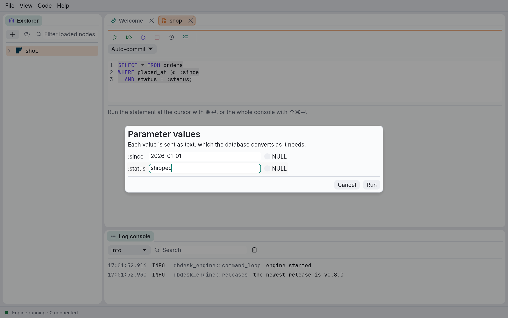
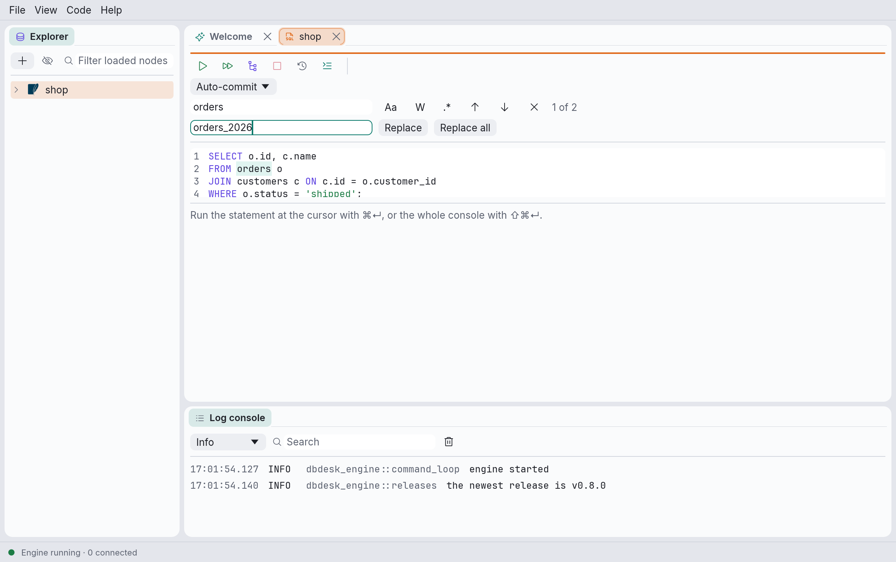

# Files, parameters and find

A console doesn't have to live in dbdesk's own folder: it can show a `.sql` file from a project,
which you save when you choose. Statements can take `:name` parameters, which dbdesk asks for
before they run. And the editor finds and replaces text.

## Opening a `.sql` file

- **File › Open…** (⌘O) asks for a file and opens it in a new console.
- **File › Open recent** lists the last ten files; **Clear recent files** empties the list.
- **Drop a file** on the window to open it.
- **From a terminal**, `dbdesk report.sql` starts dbdesk with the file open. Several files can
  be named.

A console runs on a data source, so the file opens on the one it was opened on last time. The
first time, if there is more than one data source, a small dialog asks which, starting from the
data source of the console you were in. A file that is already open isn't opened twice: its
tab comes to the front.

The console's tab is titled with the file's name, and hovering over the tab shows its path. The
file must be UTF-8 text; dbdesk refuses a file in another encoding rather than garbling it, and
says why.

## Saving

A console showing a file is saved only when you ask:

- **File › Save** (⌘S) writes it. While the console has changes the file doesn't, its tab title
  ends with `•`. Undoing back to what the file holds counts as saved.
- **File › Save as…** (⇧⌘S) writes it to another file, which the console shows from then on.

Closing the tab of a file with unsaved changes asks **Save the changes to report.sql?**:
**Save**, **Don't save**, or **Cancel** (Escape). Quitting asks the same about every file with
unsaved changes. If a save fails, the tab stays open, and its toolbar says **Not saved**, with
the reason on hover.

**Save** or **Save as…** on a console from dbdesk's own folder (see
[Consoles are saved](consoles.md#consoles-are-saved)) asks where to save it, and the console
moves there: it stops saving itself in dbdesk's folder, and its copy there is removed once the
file is written.

Tabs showing files reopen the next time you start dbdesk, with the file as it is then.

## When the file changes elsewhere

dbdesk looks at open files every two seconds, and as soon as its window comes back to the front,
so an edit made in another editor, or by `git checkout`, shows up:

- **No unsaved changes in the console:** it shows the file's new text. One undo goes back.
- **Unsaved changes:** the console keeps your text and says *report.sql changed on disk, and you
  have unsaved changes*. **Reload** shows the file's text instead; **Keep mine** keeps yours,
  and the next save replaces the file.
- **The file was deleted:** the console says so, and **Save** writes it again.

## Parameters

A statement can name values it needs with a colon, `:since`:

```sql
SELECT * FROM orders
WHERE placed_at >= :since
  AND status = :status;
```

Running it opens **Parameter values**, with a field for each parameter in the order they appear
(a parameter used twice is asked once). Type the values and press Enter or **Run**; Escape or
**Cancel** runs nothing. Tick **NULL** for a `NULL`; an empty field is an empty string.



The dialog starts from the values the console used last, so running a statement again is
Enter. Running a shown statement again without typing it, as when the grid reloads rows after
an insert, sorts and filters in the database, or exports every row, reuses the values without
asking.

What counts as a parameter: `:` followed at once by a name (letters, digits and `_`, not
starting with a digit), outside strings, comments and quoted names. These aren't parameters:

- casts, `x::int`, and `:=` assignments;
- a `:` written right after a name, a number or a closing bracket, as in a label (`retry:`) or
  DuckDB's `lambda x: x + 1` (after a keyword it is one: `BETWEEN:lo` works);
- anything inside `[…]` or `{…}`: array slices such as `a[1:n]`, DuckDB's struct and map
  literals, and ClickHouse's own `{name:Type}` parameters.

### How values reach the database

Each value is sent as text, which the database converts as it would a string: `:id` with `2`
compares with a number column, `:since` with `2026-01-01` with a date.

- **SQLite, DuckDB, MySQL and MariaDB, SQL Server:** the values are bound parameters, never
  part of the SQL. On SQL Server the statement runs through `sp_executesql`, so a temporary
  table it creates, or a `USE` or `SET` it runs, ends with it.
- **PostgreSQL and ClickHouse:** each value is written into the statement as a quoted string,
  `'2026-01-01'`, which the database reads from its context just as it would a bound parameter.
  (dbdesk's PostgreSQL consoles use the protocol that shows every value as `psql` does, and
  that protocol has no parameters.)
- **Explain** always writes the values into the statement.

A read-only data source checks the statement with its values in place, so it refuses exactly
what it would refuse typed out. An error's position points at the statement as you typed it.

The [history](consoles.md#history) records the statement as typed, followed by a comment with
its values:

```sql
SELECT * FROM orders WHERE placed_at >= :since
-- :since = '2026-01-01'
```

## Find and replace



| Shortcut | Action |
| --- | --- |
| ⌘F | Find; the selected text, if it is on one line, is searched for |
| ⌥⌘F | Find and replace |
| ⌘G, F3, or Enter in the find field | Go to the next match |
| ⇧⌘G, ⇧F3, or ⇧Enter in the find field | Go to the previous match |
| Escape | Close the find bar, back to the editor |

The bar searches the console's text as you type, highlights every match and the selected one
more strongly, and says *3 of 12*, *No results*, or why a regular expression is invalid.

- **Aa** matches case; without it, `orders` finds `ORDERS` too.
- **W** finds whole words only: `id` doesn't find the `id` in `order_id`.
- **.\*** reads the text as a regular expression, in
  [Rust's syntax](https://docs.rs/regex/1/regex/#syntax). In the replacement, `$1` (or
  `${name}`) stands for what a group matched.

**Replace** (or Enter in the replace field) replaces the selected match and goes to the next;
**Replace all** replaces every match and says how many. Each is one step for ⌘Z to undo.

All these shortcuts can be changed in `keymap.toml`; see
[Keyboard shortcuts](shortcuts.md#changing-them).
