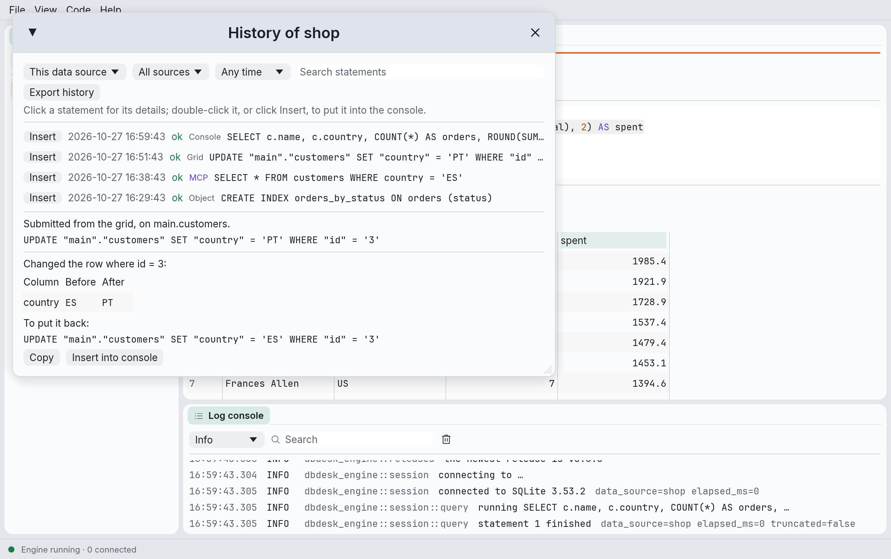
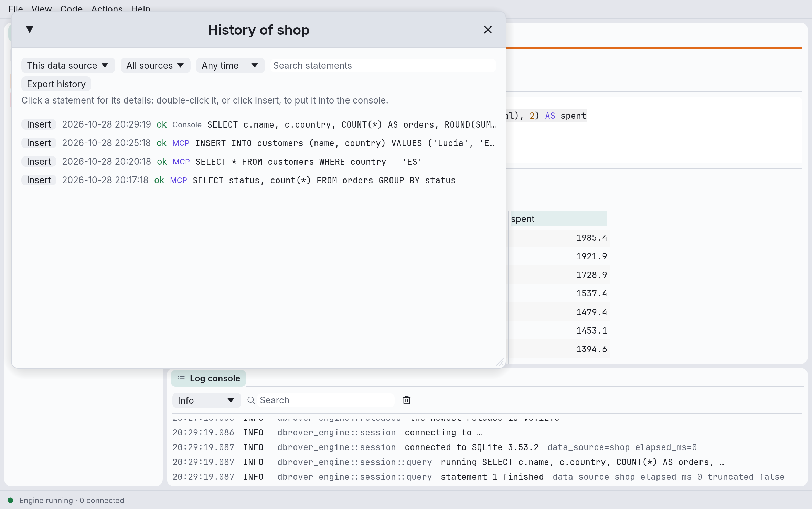

# The query history

DbRover keeps every statement it sends to a database: what you run in a console, what the grid
submits, what the explorer's helpers run, the statement behind an export, a CSV import, and
what an AI assistant runs through [`dbrover mcp`](mcp.md). Each is kept with its data source,
time, duration, row count and outcome, and with where it came from. Only the statements are
kept, never the rows they returned.

Open it with **History** in a console's toolbar. It lists the console's data source's
statements, newest first.



## Finding a statement

The row above the list narrows it down:

- **This data source / Every data source**: every data source's statements at once, each named
  beside its statement. A data source you have since removed shows as *Removed data source*.
- **All sources** or one kind: **Consoles**, **Grid edits**, **Object helpers**, **Imports**,
  **Exports**, **MCP clients**, or **Earlier DbRover** for statements recorded before DbRover
  kept where they came from.
- **Any time**, or the last hour, 24 hours, 7 days or 30 days.
- **Search statements**: any part of the statement, ignoring case.

The list shows the newest 500 matches; narrow the search to reach older ones. Each statement
has a tag saying where it came from. **MCP** stands out, since nobody at the keyboard ran
those; hover it for the assistant's name.



**Insert** (or a double-click) puts a statement into the console, on a line of its own.

## What a statement did

Click a statement to see it whole below the list, with where it came from: which assistant,
which file an import read, which table the grid changed.

For a change made in the grid, the details also show the row's key and each value **Before**
and **After**; for a deleted row, every value it had. **To put it back** is the statement that
would restore the row: an `UPDATE` with the old values, or an `INSERT` of the deleted row.
**Copy** it, or **Insert into console** to read it over and run it yourself. Nothing is undone
for you, and the row may have changed again since. A row added in the grid has none: the
database chose its key.

A CSV import is one entry, not one per row: the `INSERT` with the table's columns, how many
rows went in, and the file.

## Passwords stay out

Passwords never reach the history file, whoever sends the statement. In `CREATE ROLE …
PASSWORD '…'`, `CREATE LOGIN … WITH PASSWORD = '…'`, `CREATE USER … IDENTIFIED BY '…'`,
DuckDB's `CREATE SECRET`, foreign servers' user mappings, and connection strings (`password=…`,
`Pwd=…`, `postgresql://user:password@…`), the secret is stored as `'<redacted>'`, and the log
shows it the same way. A statement put back from the history then needs its password typed in
again.

DbRover errs on the side of hiding: after the word `PASSWORD` it hides every quoted value to the
end of that clause, so `VALID UNTIL '2027-01-01'` after a password shows as `'<redacted>'` too.

## Exporting

**Export history › As CSV…** or **As JSON…** writes everything the current search finds, not
just the 500 listed, with one record per statement: `executed_at` (UTC), `data_source`,
`data_source_id`, `source` (`console`, `grid`, `object`, `import`, `export`, `mcp`, or `app`
for earlier DbRover), `detail` (the assistant or the file), `outcome`, `duration_ms`, `rows`,
`sql`, and `change`, a grid edit's values as JSON.

## How long it is kept

By default the history keeps everything. **View › Settings… › Query history** limits it:

- **Keep statements for** 30 days, 90 days, a year or two years;
- **Keep per data source** the newest 10,000, 100,000 or 1,000,000 statements.

Older statements are deleted when DbRover starts and as soon as you change the setting, a little
at a time so a `dbrover mcp` writing the same file never waits. Other values can be set by hand
in `settings.toml`:

```toml
[history]
max_age_days = 180
max_per_data_source = 25000
```

## Not a tamper-proof audit

The history is a file in your settings folder (see
[Where DbRover keeps its files](files.md)): anyone who can open it can change or delete it, and
statements sent by other tools never reach it. When you need an audit you can rely on, set it up
on the server: `pgaudit` on PostgreSQL, SQL Server Audit, or the audit plugins of MySQL and
MariaDB.
