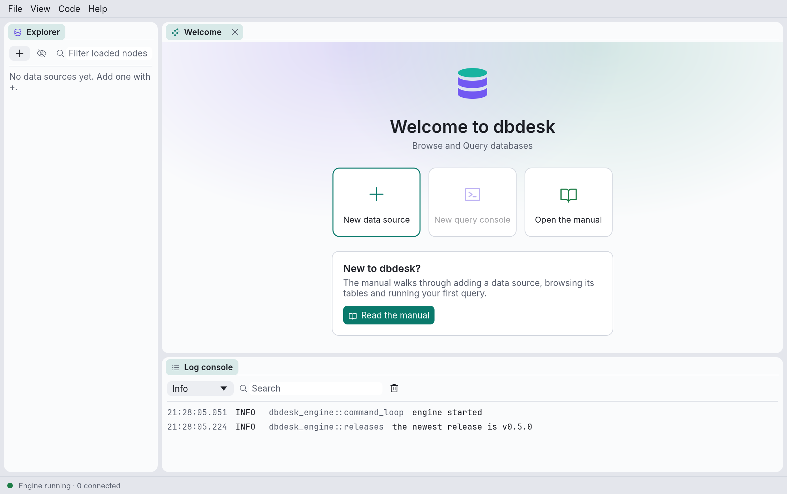

# Install and first launch

Download dbdesk from [dbdesk.org](https://dbdesk.org/#download), or from the
[releases page](https://github.com/navasvarela/dbdesk/releases): pick the file for your system
from the latest release's **Assets**.

| System | File |
| --- | --- |
| macOS 11 or later, Apple silicon or Intel | `dbdesk-<version>-macos-universal.dmg` |
| Linux x86_64, most distributions | `dbdesk-<version>-x86_64.AppImage` |
| Debian, Ubuntu and derivatives | `dbdesk_<version>_amd64.deb` |

Windows builds are on the way: they're built for every release but only offered once they've
been tried on a real Windows machine.

## macOS

1. Open the `.dmg` and drag **dbdesk** onto **Applications**.
2. Open dbdesk from Applications. These builds aren't signed by Apple yet, so the first launch
   is blocked with "Apple could not verify dbdesk".
3. Open **System Settings › Privacy & Security**, scroll down to the message about dbdesk, and
   click **Open Anyway**. macOS asks once more; confirm, and it opens normally from then on.

After each update, macOS asks again for access to each password dbdesk saved in the Keychain.
Choose **Always Allow**. This happens because the app's signature changes with every unsigned
build; signed builds, planned for a later release, will remove both steps.

## Linux

**AppImage**, on any distribution:

```bash
chmod +x dbdesk-*-x86_64.AppImage
./dbdesk-*-x86_64.AppImage
```

**.deb**, on Debian, Ubuntu and derivatives. This also adds dbdesk to the application menu:

```bash
sudo apt install ./dbdesk_*_amd64.deb
```

Saved passwords go to the Secret Service (GNOME Keyring, KWallet), which desktop environments
already run. On a bare window manager without one, see [Troubleshooting](troubleshooting.md).

## Check the download and the version

Each release has a `SHA256SUMS` file. In the folder with your download:

```bash
shasum -a 256 -c SHA256SUMS --ignore-missing
```

**Help › About dbdesk** shows the version and the commit it was built from, and **Copy
version** copies them for a bug report. From a terminal, `dbdesk --version` prints the same.

## Updates

When dbdesk starts, it asks GitHub whether a newer release is out. If one is, the status bar
says so, for example **dbdesk 0.5.0 is available**. Click it to open **Updates**; **Help ›
Check for updates…** asks at any time.

- **macOS, and the Linux AppImage:** click **Install and restart**. dbdesk downloads the new
  version, checks that it was signed by the dbdesk release process, and puts it in place of the
  one you are running. Click **Restart now** to start it, or carry on and it starts next time.
  If a console has a transaction open, quitting asks first, as it always does.
- **The `.deb`, Windows, and builds from source:** these can't replace themselves, and the
  dialog says why. **Open release page** leads to the download; install it as above.

An update that isn't signed with dbdesk's key is refused before anything is replaced. On macOS,
until dbdesk's builds are signed by Apple, the first launch after an update asks again for
access to each saved password; choose **Always Allow**.

The check sends nothing about you or your data: it reads the public list of releases. To stop
the check at start-up, untick **Check for a new release when dbdesk starts** in **View →
Settings…**.

## Build from source

For contributors, or to run the latest unreleased code. You need:

- **Rust 1.95 or newer**, installed with [rustup](https://rustup.rs). Check with
  `rustc --version`.
- **Git**, to fetch the source.
- On **Linux**, the development headers for the windowing system. On Debian or Ubuntu:

  ```bash
  sudo apt-get install libxcb-render0-dev libxcb-shape0-dev libxcb-xfixes0-dev libxkbcommon-dev libssl-dev
  ```

Then:

```bash
git clone https://github.com/navasvarela/dbdesk.git
cd dbdesk
cargo run --release -p dbdesk-app
```

To install the `dbdesk` command so you can start it from anywhere:

```bash
cargo install --path crates/dbdesk-app
```

## First launch



On first launch the explorer is empty ("No data sources yet") and the Welcome tab offers three
things to do:

- **New data source** — add a connection to a database. See [Data sources](data-sources.md).
- **New query console** — open a console on a data source. It is greyed out until you have
  one.
- **Open the manual** — opens this manual in your browser.

The log console under the Welcome tab shows `engine started`, and the status bar reads
`Engine running · 0 connected`. If it says the engine is stopped, see
[Troubleshooting](troubleshooting.md).

## Light and dark

dbdesk follows your system's light or dark setting. To choose one yourself, open
**View → Theme** and pick **Match system**, **Light** or **Dark**. The choice is remembered.

## The layout

dbdesk opens maximized the first time; after that it remembers the window's size and position.

Every panel is a tab you can drag: onto another panel's tab bar to join it, or onto the edge of
a panel to split it. Drag the gaps between panels to resize them. dbdesk remembers the layout
and the window size when you quit. **View → Reset layout** puts everything back where it
started.

## On a Mac

On macOS dbdesk's menus are in the menu bar at the top of the screen, like any Mac app's, and
the window has no separate title bar. On Linux and Windows the menus are in the window, under
its title bar, and this manual names them that way (**View → Settings…**). On a Mac a few of
them live where Mac apps keep them:

| In the window (Linux, Windows) | On a Mac |
| --- | --- |
| **Help → About dbdesk** | **dbdesk → About dbdesk** |
| **Help → Check for updates…** | **dbdesk → Check for updates…** |
| **View → Settings…** | **dbdesk → Settings…** (⌘,) |

The rest of the Mac's menu bar:

- **dbdesk → Quit dbdesk** (⌘Q) quits the way closing the window does: if a console has an open
  transaction or unsaved changes, dbdesk asks first. **Hide**, **Hide Others**, **Show All**
  and **Services** are the usual ones.
- **Edit** has **Undo**, **Redo**, **Cut**, **Copy**, **Paste** and **Select All** for whatever
  has focus: the SQL editor, a text field, or the results grid (**Copy** copies the selected
  cells).
- **View → Enter Full Screen** (⌃⌘F), and **Window** with **Minimize** (⌘M), **Zoom** and
  **Bring All to Front**.
- **Help → dbdesk manual** opens this manual, and the Help menu's search finds any menu item.

Items that need a console, such as **File → Save** or **Code → Format**, are greyed out until a
console's tab is selected, and every item shows its shortcut, including ones you changed in
`keymap.toml` (see [Keyboard shortcuts](shortcuts.md)).

The strip along the top of the window, beside the close, minimize and zoom buttons, works as a
title bar: drag it to move the window, and double-click it to zoom.

dbdesk also takes the Mac's look: text is in the system font, SF Pro (SF Mono for SQL and
results), and selected text, cells and rows are tinted with the accent colour chosen in
**System Settings → Appearance**. Change the accent colour and dbdesk follows it when you come
back to its window. The pictures in this manual were taken with dbdesk's own fonts and colours,
which it uses on Linux and Windows.
