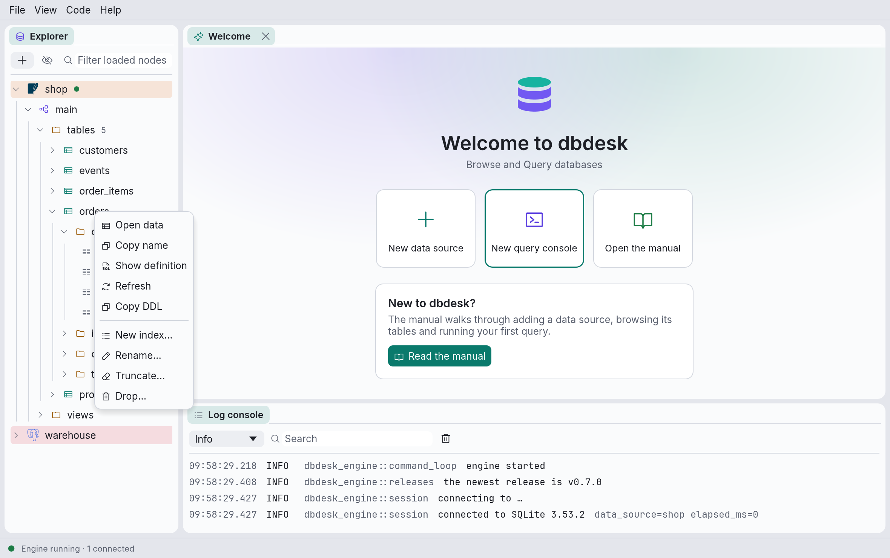
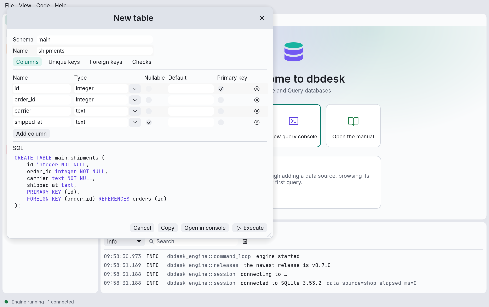
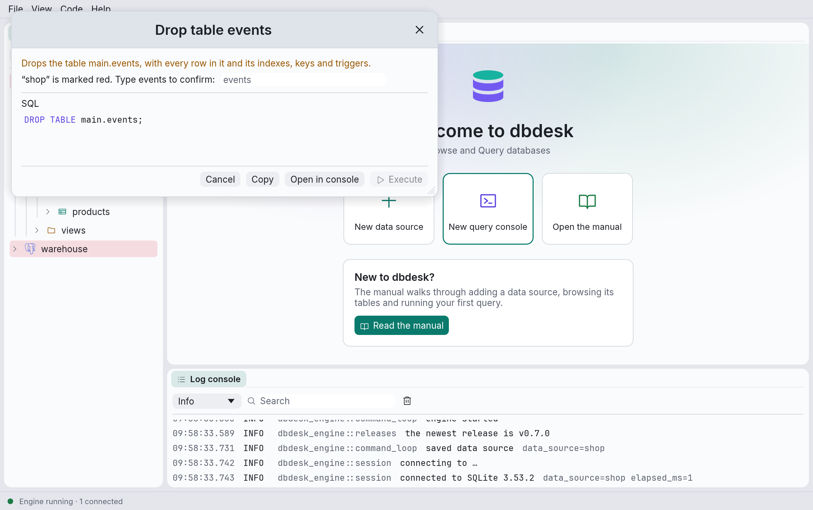

# Creating and changing tables

The explorer can create tables and indexes, and rename, empty and drop tables, without you
writing the SQL. Each of these helpers is a small dialog that writes the statement, **shows it
to you**, and runs it only when you click **Execute**. You can also take the SQL to a console
and change it there first, or just copy it: the helpers are a quick way to learn how each
database spells a statement.

## Where to find them

Right-click in the explorer. What the menu offers depends on what you clicked and on what the
database can do:

| Right-click on | Menu items |
| --- | --- |
| A schema, or its **tables** folder | **New › Table…** |
| A table | **New index…**, **Rename…**, **Copy DDL**, **Truncate…**, **Drop…** |
| A table's **indexes** folder | **New › Index…** |
| An index | **Drop index…** |

- **ClickHouse** has no index helpers: its data-skipping indexes need a type and a granularity,
  which a later version will ask for.
- **Copy DDL** is offered where there is a `CREATE TABLE` statement to copy (see
  [Copy DDL](#copy-ddl)). SQL Server doesn't have it yet.
- On PostgreSQL, SQL Server and DuckDB, the helpers appear only inside the database the data
  source connects to, which is where their statements run. Browse another database's objects
  freely, but change them from a data source that connects to it.

## Review and run

Every helper ends the same way, with the SQL it will run:

- **Execute** runs the statement. If the database refuses it, its error shows in red under the
  SQL and the dialog stays open, so you can fix what you typed and try again. Once it succeeds
  the dialog closes, and the explorer reloads the folder that changed and opens it, so you see
  the new table or index straight away.
- **Open in console** puts the SQL in a new console instead, to edit or run it there. The
  dialog closes.
- **Copy** copies the SQL.

The SQL changes as you fill in the dialog. While something is missing (a table name, a type,
the columns of a key) the dialog says what instead of showing SQL, and **Execute** waits.

Names are quoted only when they need to be: when they have capitals, spaces or other characters
a bare name can't have, or are a word any of the databases dbdesk supports reserves, such as
`order` or `user`. `customer_id` stays `customer_id`; `Order Items` becomes `"Order Items"`
(`` `Order Items` `` on MySQL and ClickHouse, `[Order Items]` on SQL Server).

### When a change does several things

Some changes take more than one statement. On **PostgreSQL**, **SQLite**, **SQL Server** and
**DuckDB** they run in one transaction: if one fails, the ones before it are undone and
nothing has changed. **MySQL**, **MariaDB** and **ClickHouse** commit each statement as it
runs, so the panel warns you before you run several, and after a failure says how many of
them stay applied.

### Safety levels and colours

Helpers follow the data source's [safety level](data-sources.md#safety-levels):

- **Read-only**: **Execute** is greyed out and the panel says why. **Open in console** and
  **Copy** still work, so you can take the SQL somewhere it may run.
- **Careful**: **Execute** asks once more, naming the data source, before anything runs.
- **Normal**: **Execute** runs at once.

Truncating or dropping something says exactly what goes: the table and every row in it, with
its indexes, keys and triggers. On a data source coloured **red**, the colour that marks
production, you also type the object's name before **Execute** can be clicked:

Every statement a helper runs is kept in the [query history](consoles.md#history), like those
you run in a console.

## New table

Right-click a schema, or its **tables** folder, then **New › Table…**. The dialog starts with
one column, `id`, of the database's most common type, as the primary key: change or remove it
as you like.

- **Schema** and **Name**: where the table goes, and what it is called. The schema is the one
  you clicked.
- **Columns**, one row each:
  - **Name**.
  - **Type**, typed as the database spells it, so arrays, domains and extension types work
    too. The ▾ beside it lists the database's common types (`integer`, `text`, `timestamptz`
    and so on on PostgreSQL; `UInt64`, `String`, `DateTime` on ClickHouse).
  - **Nullable**: whether the column may hold `NULL`. A primary key column never may.
  - **Default**: an SQL expression, written as it goes after `DEFAULT`: `0`, `'new'` (with
    quotes, for text), `now()`. SQLite and MySQL want parentheses around an expression that
    calls a function: `(datetime('now'))`.
  - **Primary key**: tick each column of the key. The key's columns are in table order.
  - **Add column** adds a row; the ✕ at the end of a row removes it.
- **Unique keys**: an optional name, and the columns that must be unique together, in the order
  you tick them.
- **Foreign keys**: an optional name, the columns, the table they point at, and that table's
  columns, in the same order. The table is picked from those the explorer has loaded: expand a
  schema's **tables** folder first to point at its tables, or pick **This table** for a key
  between the table's own rows. Its columns load once you pick it. **On delete** and **On
  update** say what happens to these rows when the row they point at goes or changes: refuse
  (`NO ACTION`, the default), `CASCADE`, `SET NULL` and so on, as the database offers them.
- **Checks**: an optional name and a condition every row must meet, such as `quantity > 0`.

What differs between databases:

- **ClickHouse** has no unique or foreign keys, so those tabs aren't shown. Its tables are
  created with the general-purpose `MergeTree` engine, sorted by the primary key's columns
  (`ORDER BY`), and a nullable column's type is wrapped in `Nullable(…)`.
- **DuckDB**'s foreign keys only refuse a change: there is no **On delete** or **On update**.
- **SQLite**'s foreign keys can only point at a table in the same schema (the same database
  file). SQLite checks them only on connections that switch them on with
  `PRAGMA foreign_keys = ON`.
- **SQL Server** gets an explicit `NULL` on nullable columns, since whether a column is
  nullable by default there depends on the connection's settings.

## New index

**New index…** on a table, or **New › Index…** on its **indexes** folder.

- **Columns**: tick them in the order the index should have them.
- **Unique**: the index also refuses two rows with the same values.
- **Method**, where the database lets you choose: on PostgreSQL B-tree (the default), Hash,
  GIN (for arrays, `jsonb` and full-text search), GiST and BRIN; on MySQL and MariaDB, B-tree
  or Hash.
- **Name**: filled in from the table and columns (`orders_customer_idx`) until you change it.

**Drop index…** on an index drops it, after saying so. The table and its rows stay. An index
that a primary key or unique constraint owns can't be dropped on its own; the database's error
says so.

## Rename, truncate and drop

- **Rename…** gives the table a new name in the same schema: `ALTER TABLE … RENAME TO …`, or
  `RENAME TABLE` on MySQL and ClickHouse, or `sp_rename` on SQL Server.
- **Truncate…** deletes every row and keeps the table. SQLite has no `TRUNCATE`, so it writes
  `DELETE FROM` the table, which does the same.
- **Drop…** drops the table. On PostgreSQL, **Also drop what depends on it (CASCADE)** drops
  the views that read the table and the foreign keys of other tables that point at it too;
  without it, PostgreSQL refuses while anything depends on the table.

## Copy DDL

**Copy DDL** on a table copies its `CREATE TABLE` statement.

- **SQLite**, **MySQL**, **MariaDB**, **DuckDB** and **ClickHouse** keep the statement, so
  dbdesk copies theirs, the same one **Show definition** shows.
- **PostgreSQL** keeps no such statement, so dbdesk writes one from the table's columns (their
  types, defaults and `NOT NULL`) and primary key, the same way New table does, followed by
  an `ALTER TABLE … ADD CONSTRAINT …` for each of its unique keys, foreign keys, checks and
  exclusion constraints, as PostgreSQL defines them. Running it recreates the table. What it
  leaves out: indexes that aren't constraints, comments, storage parameters, partitioning,
  and the `GENERATED … AS IDENTITY` of an identity column, which is written as a plain column.
