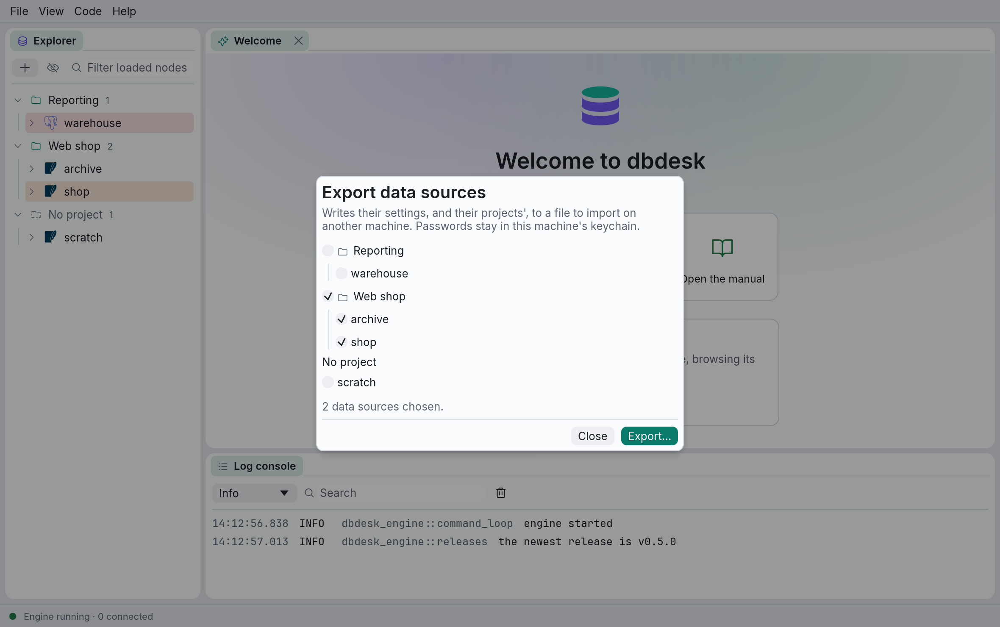
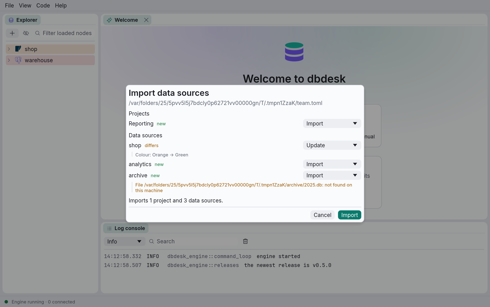

# Moving data sources to another machine

**File › Export data sources…** writes data sources, and the projects they are in, to one file.
**File › Import data sources…** adds them on another machine, or updates the ones it already
has. Use it to set up a new computer, or to share a team's databases. Passwords are never
exported: each data source asks for its own the first time it connects (see
[Passwords and the keychain](data-sources.md#passwords-and-the-keychain)).

## Exporting

Tick the data sources to export. Ticking a project ticks all of its data sources; a project is
also exported whenever one of its data sources is, so each lands in its project on the other
machine. Projects carry their MCP settings, and data sources their [MCP login](mcp.md#the-mcp-login)'s
user, but not its password (see [Connecting an AI assistant](mcp.md)).
**Export…** asks where to write the file.

The file is TOML, in the same format as your own `data_sources.toml` (see
[Where dbdesk keeps its files](files.md)), plus a `format_version` and the projects. It is
readable and diffable, so a team can keep it in a repository.

Paths travel with it: a SQLite or DuckDB file, or a CA file, **next to the exported file** (or
in a folder under it) is written relative to it, and one **in your home folder** as `~/…`. Both
are turned back into full paths on import, so a repository holding the export and its databases works
wherever it is checked out. Paths with a [placeholder](data-sources.md#placeholders-variable)
are kept as they are.

## Importing

**Import data sources…** asks for a file, then shows what importing it would change before
anything is saved:

- Each project and data source is **new**, **unchanged**, or **differs**, with each setting that
  differs shown as *this machine's value → the file's*.
- Entries are matched by their id, which every export keeps, so importing a file twice never
  duplicates anything. Projects are matched by id, and then by their slug.
- A database or CA file this machine doesn't have is shown in amber. Import it anyway, and change
  the path afterwards with **Edit…**.
- Choose, for each entry:

  | Choice | What it does |
  | --- | --- |
  | **Import** / **Update** | Adds it, or makes this machine's entry match the file. A project keeps its slug, so MCP clients set up with it keep working. |
  | **Skip** | Leaves this machine as it is. A data source in a skipped new project is imported in **No project**. |
  | **Import as a copy** | Adds it next to this machine's entry, under a new id, with "(copy)" after its name. A copied project gets a slug of its own. |

New and changed entries start on **Import** or **Update**, unchanged ones on **Skip**, so
importing a file you imported before changes nothing. **Import** saves the projects, then the
data sources.
