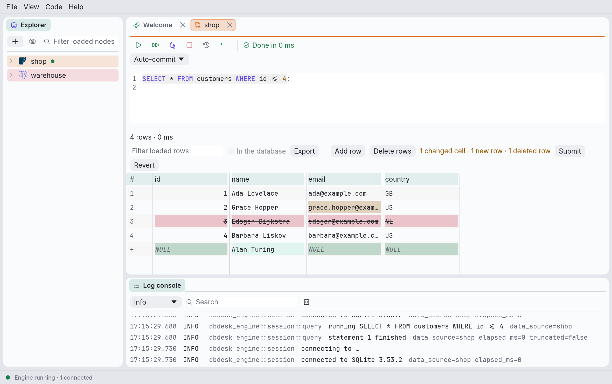
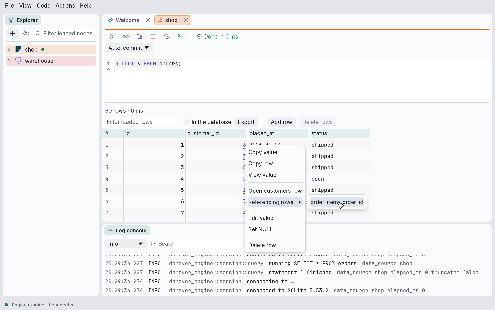
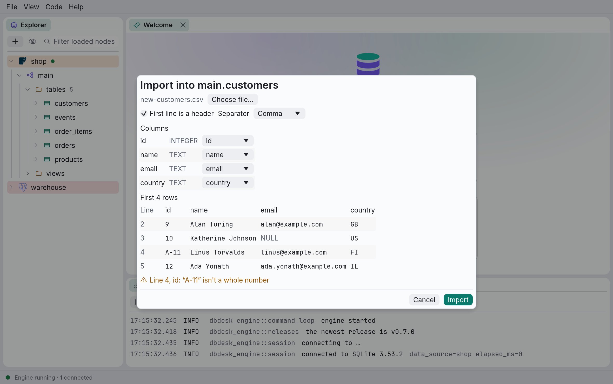

# Working with table data

The results grid is more than a view of a query. When the rows come from one table, you can
add, change and delete them, follow foreign keys from one table's rows to another's, sort and
filter every row in the database rather than only those loaded, export every row, and import a
CSV file into the table.

Editing needs a result whose rows stand for a table's rows: a `SELECT` from a single table (no
joins, `GROUP BY` or `DISTINCT`) that includes the table's primary key. **Open data** on a table
in the explorer gives you one. [Editing data](consoles.md#editing-data) explains when a result
is **Read-only**, and why.

## Adding, changing and deleting rows



- **Change a value** by double-clicking its cell (or selecting it and pressing F2 or Enter).
  Changed cells are tinted.
- **Add a row** with **Add row** in the grid's toolbar. The new row appears under the loaded
  ones, marked `+`. Each of its cells says what the database will put there if you leave it
  alone: `DEFAULT` (hover to see the default) or `NULL`. Type into the cells you want to set.
- **Delete rows** by right-clicking a row's cell and choosing **Delete row**, or by selecting
  cells in several rows and clicking **Delete rows**. Rows marked for deletion are struck
  through; **Restore row** in the same menu takes the mark away. A row you added and no longer
  want goes with **Remove row**.

The toolbar counts what is waiting, for example *1 changed cell · 1 new row · 1 deleted row*.
Nothing reaches the database until you click **Submit**; **Revert** forgets it all.

**Submit** writes everything at once, all or none: the deletions first, then the changes, then
the new rows, so a new row can take the key of one you deleted. If anything fails (a value
doesn't fit its column, a row changed since it was loaded, a key is already taken), nothing is
written, your changes stay as they were, and the message names the row: *Row 12* for a loaded
row, *New row 2* for one you added.

After a submit, deleted rows leave the grid and changed cells keep their values. If you added
rows, the query runs again, so they show what the database filled in for them, such as a
generated id.

On a **careful** data source, Submit first asks, naming the data source and what will happen:
*this inserts 1 row, updates 2 edited rows and deletes 1 row*. A **read-only** data source's
rows can't be changed. Every statement Submit sends is in the console's **History**, with the
values it replaced (see [The query history](history.md#what-a-statement-did)).

## Following foreign keys

A value in a foreign key column is underlined: it refers to a row of another table.



- **Open the row it refers to** with ⌘-click (Ctrl-click on Windows and Linux), or with **Open
  customers row** in the cell's menu. A new console opens with a query for that row, and runs
  it.
- **Find the rows that refer to this one** with **Referencing rows** in a row's menu. It lists
  the tables whose foreign keys point at this table, as *table.column*; pick one to open its
  rows that point at this row, again in a new console.

Each opens in a new tab, so the tab you came from is the way back. Following keys only reads,
so it works on read-only data sources and on tables without a primary key too. A key whose
value is `NULL` refers to nothing, so it isn't underlined; and a key is only followed when the
result includes all of its columns. An entry under **Referencing rows** is disabled, saying
which columns to add to the query, when the result lacks the ones the other table refers to.

## Sorting and filtering in the database

Clicking a column header, or typing in the filter, normally sorts and filters only the rows
already loaded, and the grid says so. To sort and filter every row, tick **In the database**
next to the filter. Then:

- clicking a column header sorts by it (ascending, descending, off), and
- pressing Enter in **Filter every row** keeps the rows where any value contains the text,
  ignoring case;

each by running the query again, wrapped in one that sorts and filters it:

```sql
SELECT * FROM (
SELECT * FROM orders
) AS dbrover_rows
WHERE … any value contains the text …
ORDER BY 3 DESC
```

The grid shows *Sorted and filtered by the database*, rows page in 500 at a time as usual, and
the rows can still be edited. Untick **In the database** to run the query as you wrote it again.

Only queries that start with `SELECT`, `WITH` or `VALUES` can be wrapped, and only when no two
columns have the same name (SQL Server can't wrap a `WITH` either). Otherwise the switch is
disabled; hover over it to see why. It is also disabled while changes are waiting to be
submitted, since running the query again would lose them. The database sorts by its own rules,
which may differ from the grid's: where `NULL`s go, for example.

## Exporting every row

**Export** in the grid's toolbar has two submenus, each listing every format:

- **Loaded rows**: the rows loaded so far, in the order and with the filter the grid shows them.
- **All rows**: every row the query returns. The query runs again, sorted and filtered if the
  database is doing that, and its rows are written to the file as they arrive, so even a very
  large result never has to fit in memory.

The formats:

| Format | What it writes |
| --- | --- |
| **CSV** | Comma-separated values as RFC 4180 describes them: a header line, fields quoted only where they need it, `NULL` as an empty field, lines ending in CRLF, UTF-8. |
| **CSV for Excel** | The same, starting with a byte order mark: without one, Excel reads a UTF-8 file's accents and other non-English letters wrongly. Excel set to a language whose list separator is a semicolon (much of Europe) puts each line in one column; import it with **Data › From Text/CSV** instead. |
| **Excel** | An Excel workbook (`.xlsx`): a bold header row, frozen and with filter buttons, columns as wide as their first values, and each cell typed (see below). |
| **TSV** | Tab-separated, as ⌘C copies cells: a header line, `NULL` written out, fields with tabs, line breaks or quotes quoted the way spreadsheets read them. |
| **Markdown** | A table for a pull request, an issue or a chat: pipes escaped, line breaks as `<br>`, `NULL` written out. |
| **SQL INSERT** | An `INSERT` a row into the table the rows came from, of its columns only. Numbers in numeric columns are written as numbers, every other value as a string, which the database turns into the column's type. |
| **JSON** | A list of objects, one a row, keyed by column name. Values are text, and `NULL` is `null`. A repeated column name gets `_2`, `_3`. |
| **JSON Lines** | The same objects, one a line, as data pipelines and `jq -c` read them. |
| **HTML** | A web page with the rows as a table, every value escaped, that prints with its header on each page. |
| **SQL UPDATE** | An `UPDATE` a row, setting each of the table's columns but the key, and naming the row by its primary key, as the grid's own edits do. |

**Excel** cells are numbers, dates or text, so that numbers sum and dates sort, without ever
changing a value:

- A column the database declares as a number, a boolean, a date or a timestamp gets numbers,
  booleans or dates; a text column stays text. PostgreSQL doesn't say what its columns are, so
  each value is looked at: a plain number becomes a number, and an ISO date or timestamp
  (`2024-01-31`, `2024-01-31 08:00:00`) a date, shown the same way.
- These always stay text, as Excel would change them: a number with a leading zero (`007`, a
  code), more than 15 digits (a long id, which Excel would round), a timestamp with a time zone
  or offset (Excel has none), a date before 1900, and a time with a fraction of a second finer
  than milliseconds.
- A sheet holds 1,048,576 rows. More rows go on in a second sheet, *Rows 2*, and so on, each
  with the header, and the export's message says how many sheets there are.
- A cell holds 32,767 characters; a longer value is cut there.

The SQL formats need to know the table: they are offered for rows the grid can edit (selected
from one table, with its whole primary key), and greyed out elsewhere, saying why. Their
statements are in the data source's own SQL, with its quoting; moving rows to a different kind
of database may need them edited.

Values are written as the database printed them, exactly as the grid shows them: dates and
numbers are never reformatted. To change how they look, format them in the query (`to_char`,
`FORMAT`, `strftime`).

While every row is being exported, the toolbar counts them (*Exporting… 125000 rows*), and
**Cancel export** stops it. A cancelled or failed export leaves no file behind, and never
replaces a file that was there: the rows go to a file named like the one you chose, plus
`.partial`, which takes its name only when complete.

Running the query again needs the console's connection, so a result that was still loading
more rows stops loading (its summary says `rest discarded`); the rows already in the grid stay.
The export runs in the console's open transaction, if there is one, and sees its temporary
tables.

## Importing a CSV file

Right-click a table in the explorer and choose **Import CSV…**, then pick the file.



1. **The file.** Say whether its **First line is a header** (on by default) and which
   **Separator** it uses: comma, semicolon or tab. **Choose file…** picks another.
2. **Columns.** Each of the table's columns takes its values from a column of the file, or
   *(default)* to leave it to the database. DbRover matches them by name when the file has a
   header (ignoring case), or by position when it doesn't; change any of them in its menu.
3. **The first rows** of the file show as they would go into the table, with `NULL` for empty
   values and `DEFAULT` for columns left to their default.
4. **Warnings** point at values in those first rows that probably won't fit: text in a number
   column, a date that isn't `YYYY-MM-DD`, an empty value for a column that can't be `NULL`.
   They are only warnings: the database decides.

**Import** then reads the whole file and inserts it in batches of 500 rows, all in one
transaction. The dialog counts the rows as they go in. If the database refuses a row, the whole
import is rolled back, nothing is imported, and the dialog names the line of the file:
*Line 703: duplicate key value violates unique constraint*. On DuckDB it names the lines of the
batch that failed instead. Empty values are imported as `NULL`; everything else is sent as text
for the database to convert to the column's type, as when you type into a cell.

A **careful** data source asks before importing. A **read-only** one can't be imported into,
and nor can a ClickHouse table, since ClickHouse has no transaction to undo a failed import
with; the dialog says so.
