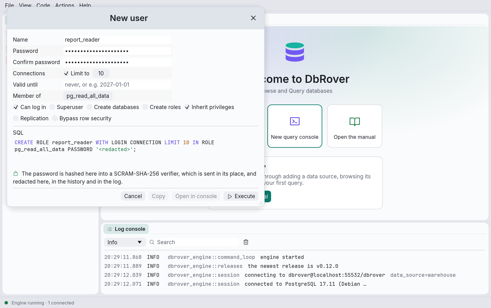

# Users and roles

On PostgreSQL the explorer also lists the server's roles and creates, changes and drops them.
PostgreSQL has one kind of object for both users and groups: a **role**, which is a **user**
when it may log in. The dialogs work like the [table helpers](objects.md): each one writes the
SQL, shows it, and runs it only when you click **Execute**, with the same
[safety levels and confirmations](objects.md#safety-levels-and-colours).

Other engines have no users or roles in the explorer yet: MySQL's `'name'@'host'` accounts and
SQL Server's logins are planned on their own.

## The roles folder

A PostgreSQL data source starts with a **roles** folder, before its databases, because roles
belong to the whole server rather than to one database. Each role says whether it can log in
and whether it is a superuser, and which roles it is a member of:

```text
roles
  app_readers
  report_reader    login, member of app_readers
  postgres         login, superuser
```

The roles PostgreSQL predefines (`pg_read_all_data`, `pg_monitor` and the rest) are
[system objects](explorer.md#system-objects), hidden until you click the eye button in the
explorer's toolbar.

| Right-click on | Menu items |
| --- | --- |
| A PostgreSQL data source, or its **roles** folder | **New › User…**, **New › Role…** |
| A role | **Copy name**, **Copy DDL**, **Edit…**, **Rename…**, **Drop…** |

**Copy DDL** copies the role's `CREATE ROLE` statement, rebuilt from what the catalog says
about it: its attributes, limit, expiry and memberships. Its password isn't in it.

## New user and New role

**New › User…** and **New › Role…** open the same dialog; New user starts with **Can log in**
ticked.



- **Name**.
- **Password** and **Confirm password**. Leave both empty for a role nobody logs in as.
- **Connections**: tick **Limit to** to cap how many connections the role may have open at
  once (`CONNECTION LIMIT`).
- **Valid until**: when the password stops working, as PostgreSQL reads a date or timestamp,
  e.g. `2027-01-01` (`VALID UNTIL`). Empty means never.
- **Member of**: the roles whose privileges it gets (`IN ROLE`). PostgreSQL's own roles are
  offered too: `pg_read_all_data` lets a role read every table, for example.
- The attributes, each with its keyword in its tooltip: **Can log in** (`LOGIN`),
  **Superuser**, **Create databases** (`CREATEDB`), **Create roles** (`CREATEROLE`),
  **Inherit privileges** (`INHERIT`, on unless you untick it), **Replication** and **Bypass
  row security** (`BYPASSRLS`).

The statement lists only what differs from PostgreSQL's defaults, e.g.
`CREATE ROLE report_reader WITH LOGIN CONNECTION LIMIT 10 IN ROLE pg_read_all_data PASSWORD
'<redacted>'`. The password comes last, so the expiry before it stays readable in the panel
and the history.

## How the password is sent

The password never leaves your computer as you typed it.

- **DbRover hashes it** into a SCRAM-SHA-256 verifier as soon as both fields match, the same way
  `psql`'s `\password` does, and sends the verifier in its place. PostgreSQL stores a verifier
  as it is, and checks the password against it when the user logs in.
- **The review panel shows `PASSWORD '<redacted>'`**, never the verifier: a verifier is not
  the password, but whoever holds it can try to guess the password offline.
- **Copy and Open in console are off** while the SQL holds a password. The redacted text would
  set a password nobody knows, and the real statement would put the verifier on the
  clipboard.
- **The query history and the log** keep the statement as the panel shows it, with
  `'<redacted>'` in place of the password, as they do for any statement holding one (see
  [Passwords stay out](history.md#passwords-stay-out)).

This needs PostgreSQL 10 or later, which accepts a verifier whatever its
`password_encryption` setting says.

## Edit a role

**Edit…** loads the role and fills the same fields, then writes what changed:

- one `ALTER ROLE` for the attributes, connection limit and expiry you changed;
- `REVOKE` for the roles it leaves, and `GRANT` for the ones it joins.

The password stays as it is unless you type a new one (hashed the same way) or tick **Remove
password** (`PASSWORD NULL`), after which password logins fail until a new one is set. With
nothing changed, there is nothing to execute.

## Rename a role

**Rename…** writes `ALTER ROLE … RENAME TO …`. A password stored as MD5 is cleared, because
PostgreSQL salts those with the role's name; the SCRAM passwords DbRover sets are kept.

## Drop a role

PostgreSQL refuses to drop a role that still owns something or holds privileges. **Drop…**
counts what the role owns and holds privileges on in the data source's database, names the
databases it owns and the roles that lose its privileges, and asks what to do with what it
owns:

- **Keep it**: just `DROP ROLE`, which fails if the role owns anything.
- **Give it to** another role: `REASSIGN OWNED BY … TO …`, then `DROP OWNED BY …` for the
  privileges left, then `DROP ROLE`. This also hands over the databases it owns.
- **Drop it**: `DROP OWNED BY …`, which drops the tables, views and other objects it owns, with
  their data, then `DROP ROLE`.

A role that owns something starts on **Give it to**, and **Execute** waits until you pick the
new owner. Everything runs in one transaction, so a refusal leaves the role and its objects as
they were. `REASSIGN OWNED` and `DROP OWNED` act only in the database the data source connects
to: what the role owns in another database still stops the drop, and the database's error says
so.

On a data source coloured red, you type the role's name before **Execute** can be clicked.
