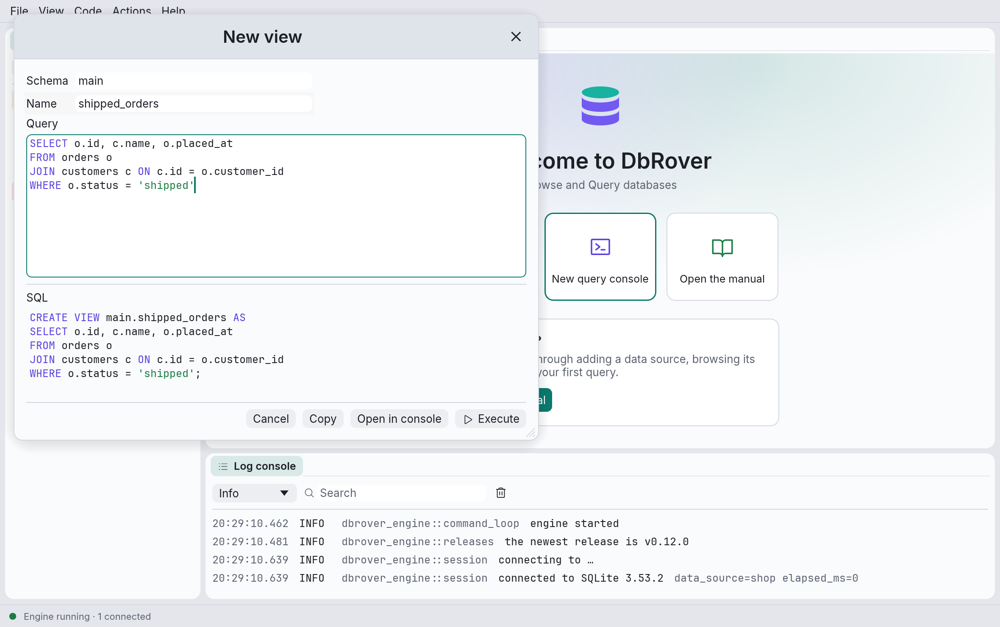

# Views and schemas

The explorer's helpers also create, change and drop views, materialized views and schemas.
They work like the [table helpers](objects.md): each dialog writes the SQL, shows it, and runs
it only when you click **Execute**, with the same **Open in console** and **Copy**, the same
[safety levels and confirmations](objects.md#safety-levels-and-colours), and every statement
kept in the query history.

## Where to find them

| Right-click on | Menu items |
| --- | --- |
| A data source whose schemas are databases (MySQL, MariaDB, ClickHouse) | **New › Schema…** |
| A database (PostgreSQL, SQL Server, DuckDB) | **New › Schema…** |
| A schema | **New › Table…**, **New › View…**, **New › Materialized view…** (PostgreSQL), **Drop schema…** |
| A schema's **views** folder | **New › View…**, **New › Materialized view…** (PostgreSQL) |
| A schema's **materialized views** folder (PostgreSQL) | **New › Materialized view…** |
| A view | **Edit…**, **Rename…**, **Copy DDL**, **Drop…** |
| A materialized view (PostgreSQL) | **Refresh…**, **Edit…**, **Rename…**, **Copy DDL**, **Drop…** |

- **SQLite** has no schema helpers: its schemas are database files attached to the connection,
  not something `CREATE SCHEMA` makes. Its views can't be renamed either: SQLite has no way to.
- **ClickHouse**'s materialized views are a different thing (they copy each insert into a
  table), so DbRover doesn't create, edit or drop them; **Copy DDL** copies theirs.
- As with tables, on PostgreSQL, SQL Server and DuckDB the helpers appear only inside the
  database the data source connects to.

## New view

Right-click a schema or its **views** folder, then **New › View…**.

- **Schema** and **Name**: where the view goes, and what it is called.
- **Query**: the `SELECT` the view saves, in an editor highlighted the way consoles are. A `;`
  at the end is left out of the statement.
- If a view of that name is already in the folder, a tick box offers to **replace** it instead,
  as **Edit…** would.

**New › Materialized view…** on PostgreSQL adds one choice: **Fill it now**. Unticked, the view
is created `WITH NO DATA`, empty until its first refresh, which is quicker when the query is
slow.

## Edit a view

**Edit…** on a view loads its definition, takes the query out of it, and puts that in the
editor. Change it, and the SQL shows how the database will save it:

- **PostgreSQL**, **MySQL**, **MariaDB**, **DuckDB** and **ClickHouse**: `CREATE OR REPLACE
  VIEW`. PostgreSQL refuses to drop, rename or retype a view's columns this way (only adding
  columns at the end works); its error says so, and **Open in console** lets you drop and
  create the view yourself.
- **SQL Server**: `ALTER VIEW`, which keeps the view's permissions.
- **SQLite**: it has neither, so the view is dropped and created again, in one transaction.
- **Materialized views** (PostgreSQL) have no `OR REPLACE` either: they are dropped and created
  again, in one transaction, and their indexes go with them. The dialog says so before you run
  it, and a view that other views read can't be dropped this way.

What DbRover takes out of the definition is the query alone: options written before `AS`, such
as SQL Server's `WITH SCHEMABINDING`, SQLite's column list, or MySQL's `DEFINER` and `SQL
SECURITY`, aren't kept. MySQL shows a view's query as it stored it, with every name qualified
and quoted. If DbRover can't find the query, the whole definition is in the editor, for you to
cut down.

## Refresh a materialized view

**Refresh…** runs the materialized view's query again and stores the new rows:
`REFRESH MATERIALIZED VIEW`. **Keep the old rows readable meanwhile (CONCURRENTLY)** lets
queries read the view while it refreshes; PostgreSQL allows it only on a view with a unique
index, so the tick box waits until the view's indexes show one.

## Rename, drop and copy views

- **Rename…** gives the view a new name in its schema: `ALTER VIEW … RENAME TO …` (or `ALTER
  MATERIALIZED VIEW`), `RENAME TABLE` on MySQL and ClickHouse, `sp_rename` on SQL Server. SQL
  Server keeps the old name in the view's stored definition, which **Show definition** and
  **Copy DDL** then show.
- **Drop…** drops the view; the tables it reads stay. On PostgreSQL, **Also drop what depends
  on it (CASCADE)** drops the views that read it too.
- **Copy DDL** copies the view's definition, the statement **Show definition** shows.

## New schema

**New › Schema…** on a database, or on the data source where its schemas are databases.

- **Name**.
- **Owner**, on PostgreSQL and SQL Server: the role or user that owns the schema
  (`AUTHORIZATION`). Left empty, you own it.
- On **MySQL**, **MariaDB** and **ClickHouse** the schemas in the tree are databases, so this
  writes `CREATE DATABASE`.

## Drop a schema

**Drop schema…** on a schema. The confirmation counts what the schema holds, from its folders
in the tree, and says what happens to it:

- **PostgreSQL** and **DuckDB** refuse to drop a schema that isn't empty, unless you tick
  **Also drop everything in it (CASCADE)**, which drops its tables, views, functions and the
  rest with it.
- **SQL Server** has no `CASCADE`: drop what is in the schema first.
- **MySQL**, **MariaDB** and **ClickHouse** drop the database and everything in it.

On a data source coloured red, you type the schema's name before **Execute** can be clicked.
