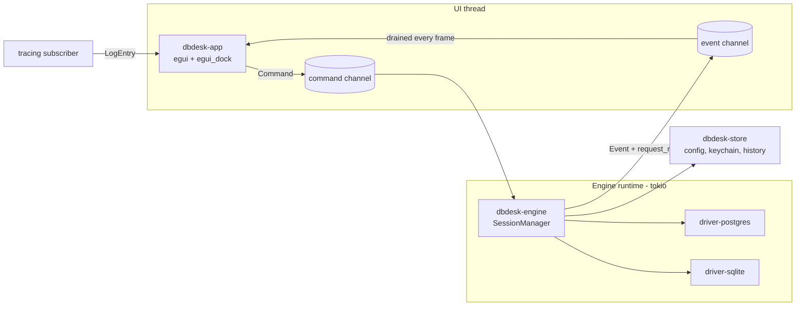

# Architecture

## Overview

dbdesk is a Cargo workspace with a thin UI crate on top of an engine that owns all I/O.
The UI and the engine talk only through two message types, `Command` (UI → engine) and
`Event` (engine → UI). Nothing in the UI crate awaits a future or touches a socket.



## Crates

| Crate | Responsibility | Depends on |
| --- | --- | --- |
| `dbdesk-core` | Domain types and the `Driver` / `Connection` traits. No I/O. | — |
| `dbdesk-sql` | Statement splitting, statement-under-cursor, later completion. Wraps `sqlparser`. | core |
| `dbdesk-driver-postgres` | `tokio-postgres` implementation of the driver traits. | core |
| `dbdesk-driver-sqlite` | `rusqlite` implementation, run on `spawn_blocking`. | core |
| `dbdesk-engine` | Session lifecycle, command handling, cancellation, event emission. | core, sql, store, drivers |
| `dbdesk-store` | Data source config (TOML), secrets (`keyring`), query history (SQLite). | core |
| `dbdesk-app` | `eframe` binary: panels, widgets, app state, keymap. | core, engine |

`dbdesk-app` depends on the engine only through its public `EngineHandle` (a command sender
and an event receiver), so the UI can be driven by a fake engine in tests.

## Threading model

- **UI thread**: `eframe` runs the egui loop on the main thread. Each frame it drains the event
  receiver with `try_recv`, applies events to `AppState`, then draws. It never blocks.
- **Engine runtime**: a multi-threaded `tokio` runtime started on a background thread at launch.
  The `SessionManager` task receives `Command`s and spawns one task per session.
- **Blocking drivers**: SQLite calls run inside `spawn_blocking` so they never stall the runtime.
- **Waking the UI**: after sending an `Event`, the engine calls `egui::Context::request_repaint()`
  so the UI redraws even when the user is idle. The engine receives a clone of the context at
  start-up, wrapped in a small `Repaint` trait so `dbdesk-engine` does not depend on egui.

Rationale and alternatives: [ADR-0003](adr/0003-ui-engine-message-passing.md).

## Messages

```rust
pub enum Command {
    Connect { data_source: DataSourceId },
    Disconnect { session: SessionId },
    TestConnection { config: ConnectionConfig },
    Introspect { session: SessionId, node: CatalogPath },
    Execute { session: SessionId, run: RunId, sql: String },
    FetchMore { session: SessionId, run: RunId },
    Cancel { session: SessionId, run: RunId },
}

pub enum Event {
    SessionStateChanged { session: SessionId, state: SessionState },
    CatalogLoaded { session: SessionId, node: CatalogPath, children: Vec<CatalogNode> },
    ResultStarted { run: RunId, statement: StatementIndex, columns: Vec<ColumnMeta> },
    RowsReceived { run: RunId, statement: StatementIndex, batch: RowBatch },
    StatementFinished { run: RunId, statement: StatementIndex, outcome: StatementOutcome },
    RunFinished { run: RunId, elapsed: Duration },
    ServerNotice { session: SessionId, notice: Notice },
    Error { context: ErrorContext, error: EngineError },
}
```

`RunId` ties all events of one execution together, so stale events from a cancelled run are
easy to drop in the UI.

## Driver abstraction

```rust
#[async_trait]
pub trait Driver: Send + Sync {
    fn kind(&self) -> DriverKind;
    async fn connect(&self, config: &ConnectionConfig, secret: Option<&Secret>)
        -> Result<Box<dyn Connection>, DriverError>;
}

#[async_trait]
pub trait Connection: Send {
    /// Starts a statement and returns a stream of row batches. Dropping the stream
    /// abandons the remaining rows.
    async fn execute(&mut self, sql: &str) -> Result<StatementStream<'_>, DriverError>;
    async fn children(&mut self, node: &CatalogPath) -> Result<Vec<CatalogNode>, DriverError>;
    fn cancel_handle(&self) -> Box<dyn CancelHandle>;
    fn take_notices(&mut self) -> Vec<Notice>;
}
```

Trait objects (rather than an enum over drivers) are chosen so that adding an engine means
adding a crate and one registration line. See [ADR-0002](adr/0002-native-drivers-behind-a-trait.md).

## Core data types

- `Value`: `Null | Bool | Int(i64) | Float(f64) | Numeric(Decimal) | Text | Bytes | Date | Time |
  Timestamp | TimestampTz | Uuid | Json | Array(Vec<Value>) | Other { type_name, text }`.
  `Other` is the fallback so an unknown column type never breaks a query; it shows the
  server's text representation.
- `ColumnMeta`: name, engine type name, nullable when known, `Value` kind used for alignment
  and sorting.
- `RowBatch`: `Vec<Vec<Value>>`, sized to the page size (default 500, same as DataGrip).
- `CatalogNode`: `{ path, kind, label, has_children }`. `kind` is an enum (`Database`, `Schema`,
  `Table`, `View`, `MaterializedView`, `Column`, `Index`, `Constraint`, `Function`, `Sequence`,
  `Trigger`, `Folder`) so the UI can pick icons and custom actions per kind.
- IDs (`DataSourceId`, `SessionId`, `RunId`) are newtypes, never raw `Uuid`/`u64`.

## Errors

- Each driver crate has its own `thiserror` enum, converted into `DriverError` in core, which
  keeps the engine-specific detail that matters to users: SQLSTATE, message, detail, hint, and
  error position in the statement (so the editor can underline it).
- The app uses `anyhow` only at the binary edge (start-up failures). Everything shown in the UI
  is a typed error.
- No `unwrap`/`expect` outside tests; clippy configured to deny `unwrap_used` and `expect_used`.
