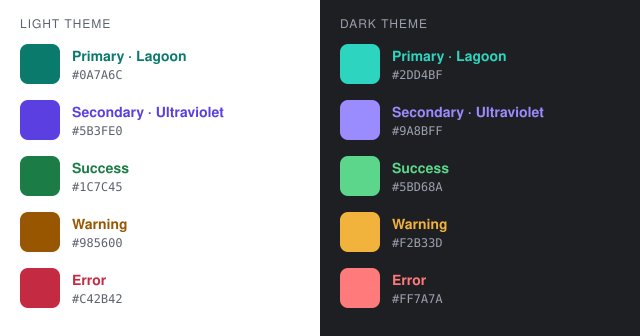

# Brand

## The mark

The mark is called **Strata**: the database cylinder, cut into a lid and two slabs. It was picked
from four concepts (a cylinder, a back-to-back *d|b* monogram, the workspace's panel layout, and
a desk with drawers) because it reads as "database" at a glance, even at 16 px where the others
turned into generic shapes.

Construction, on a 64-unit grid:

- The lid is an ellipse centred at (32, 16), 44 wide and 14 tall (`rx` 22, `ry` 7).
- Each slab is the band between two copies of the lid's lower curve, 11 units apart, with
  straight sides at x = 10 and x = 54. The slabs' top curves sit at y = 21 and y = 37.
- Every gap is 5 units, which is 1.25 px at 16 px: enough to stay a visible line in a tab icon.
  Keep it at least 4 units (one whole pixel at 16 px) if the mark is ever redrawn; below that the
  gaps blur into the colour around them and the mark becomes a plain blob.

The lid takes the primary colour and the slabs the secondary. The one-colour version keeps the
gaps, so it works as a single-ink stamp.

| File | Use |
| --- | --- |
| `assets/brand/logo.svg` | Full colour, on any background. Mid-tone colours that hold up on both light and dark pages. |
| `assets/brand/logo-mono.svg` | One colour, `currentColor`, for inline SVG that should follow the text colour. |
| `assets/brand/icon.svg` | The app icon: the mark in its dark-theme colours on a rounded tile with macOS margins. |
| `assets/brand/icon-*.png` | The app icon at 16–1024 px. The window icon is `icon-256.png`. |
| `assets/brand/logo-*.png` | The bare mark at 16–512 px. |
| `assets/brand/dbrover.icns` | The macOS icon set, for an app bundle. |
| `assets/brand/social-preview.png` | 1280×640 card for the repository's social preview (GitHub → Settings → General → Social preview). Its text is set in the bundled Inter. |

The PNGs and the `.icns` are generated: edit the SVGs, then run `assets/brand/export.sh`. It
needs `resvg` 0.48.1 (`cargo install resvg --version 0.48.1 --locked`) and macOS's `iconutil`.
Its output is byte-for-byte reproducible, so an unchanged SVG gives an empty diff.

The window icon is the tiled app icon rather than the bare mark, because the macOS Dock shows
whatever `ViewportBuilder::with_icon` receives, and a Dock icon without the standard tile and
margins looks out of place next to every other app.

## Palette

| Role | Light theme | Dark theme | Taken from |
| --- | --- | --- | --- |
| Primary (Lagoon) | `#0A7A6C` | `#2DD4BF` | The lid |
| Secondary (Ultraviolet) | `#5B3FE0` | `#9A8BFF` | The slabs |
| Success | `#1C7C45` | `#5BD68A` | |
| Warning | `#985600` | `#F2B33D` | |
| Error | `#C42B42` | `#FF7A7A` | |

The base is calm and neutral, and colour is used sparingly: the primary marks selection, focus
and the main action on a screen; the secondary marks secondary emphasis (keywords, links, the
active tab's underline); success, warning and error are only for status.

Each colour has a light-theme and a dark-theme variant because one shade can't be readable as
text on both a white and a near-black background. Every variant reaches WCAG AA (4.5:1) as text
on its theme's background, measured against white and `#F2F3F7` for light, and `#1E1F22` and
`#2B2D30` for dark. The closest pairs are the light primary on `#F2F3F7` (4.72:1) and the dark
secondary on `#2B2D30` (4.94:1). The success green sits away from the primary teal in hue so a
"connected" dot doesn't look like a selection.

The mark itself uses `#17B3A0` and `#7259F2` in `logo.svg`, halfway between the light and dark
variants, so a single file works on both GitHub themes. These two are for the logo only, never
for text.
