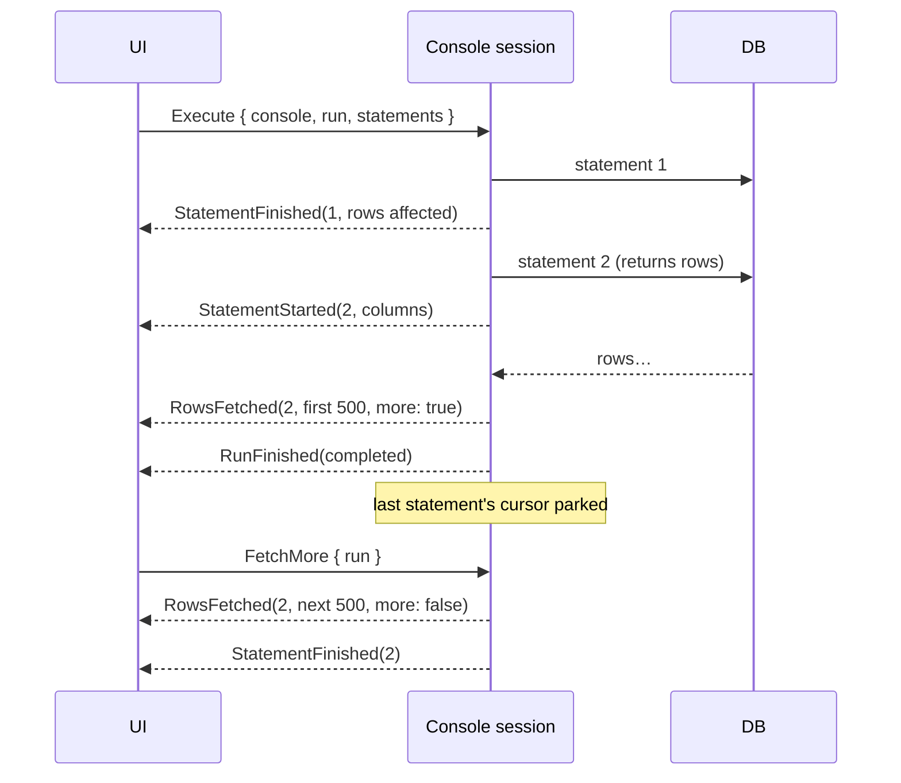

# SQL runner

The centre panel: query consoles as tabs, each with an editor on top and results below.

Status: implemented in M3, except where marked *planned*.

## Query console

- Opened from the explorer: right-click a data source → **New query console**, or a table, view
  or materialized view → **Open data** (a console with `SELECT * FROM <name>;`, run at once).
- Bound to one data source, with **its own connection**, separate from the explorer's and from
  other consoles. A long query or a half-read result in one tab never blocks another. The
  connection opens on the first run, and closing the tab closes it.
- Titled with the data source's name, numbered if there are several (`shop`, `shop (2)`).
- Toolbar: **Run**, **Run all**, **Cancel**, and the run status (connecting, running,
  done in N ms, failed, cancelled).
- *Planned (M4)*: contents saved as `.sql` files and reopened on start (see
  [Persistence](../persistence.md)); until then console tabs are dropped from the saved layout.
- *Planned*: header with data source colour, current schema switcher, transaction mode.

## Editor

egui's `TextEdit` (monospace, code-editor mode) with a custom layouter:

- Syntax highlighting from `dbdesk-sql`'s lexer, which is the same lexer that splits
  statements, so what looks like a string is exactly what the splitter treats as one.
  Keywords, strings, numbers, comments and quoted identifiers each get a colour, with
  separate palettes for light and dark themes.
- The tokens of a statement's error position are underlined in red until the text changes.

The editor is egui's weakest area (see [ADR-0001](../adr/0001-ui-toolkit-egui.md)). If it
becomes the bottleneck, the plan is a dedicated editor widget in its own crate.

*Planned*: line numbers, current-statement highlight, bracket matching, completion from the
cached catalog, formatting.

## Running SQL

| Action | Key | What runs |
| --- | --- | --- |
| Run | ⌘↵ | The selection (split into statements) if any, otherwise the statement at the cursor |
| Run all | ⇧⌘↵ | Every statement in the console, in order, stopping at the first failure |
| Cancel | ⌘. | Stops the running statement, or discards unread rows |
| Explain | ⌥⌘E | *Planned (M4)* |

Shortcuts work while the console's editor has focus, and are taken before the editor sees
them, so ⌘↵ runs instead of inserting a newline.

**Statement splitting** lives in `dbdesk-sql` and works on text as typed, without parsing:
- Semicolons inside strings, quoted identifiers, comments and PostgreSQL dollar-quoted bodies
  don't split.
- Neither do semicolons inside `BEGIN … END` in a `CREATE` statement (SQLite trigger bodies,
  `BEGIN ATOMIC` functions), or inside `CASE … END`.
- Unterminated strings and comments run to the end of the text.
- It returns byte ranges, which also gives "statement at the cursor": the statement containing
  the cursor, else the one just before it (the cursor usually sits after the `;`).

It is a hand-written lexer rather than `sqlparser`'s tokenizer, which the original design named.
That tokenizer rejects unterminated input and reports line and column instead of byte offsets.
The lexer also replaced `syntect` for highlighting: one lexer, no regex engine.

**Safety check** before running: an `UPDATE` or `DELETE` without a top-level `WHERE` opens a
"Run anyway?" dialog listing the statements, and nothing runs until it is answered. Only the
statement's first word is checked, so `WITH … DELETE` slips through. *Planned*: per-data-source
safety levels (confirm any non-`SELECT` on production).

## Execution

- **Results are text.** PostgreSQL runs over the simple query protocol, so the server formats
  every value, including types dbdesk knows nothing about, exactly as `psql` shows it. SQLite
  values are formatted the way the `sqlite3` shell does (`100.0`, blobs as `x'…'`, or their
  size past 64 bytes). A cell is `Option<String>`, with `None` for `NULL`. See
  [ADR-0004](../adr/0004-results-as-text.md).
- **Paging.** Each statement's first page (500 rows) is read. Only the run's last statement
  keeps its cursor open ("parked") for **Load more rows**, or for scrolling to the bottom of the
  grid. A cursor holds its connection, and the next statement needs it, so earlier statements'
  unread rows are discarded and their result says "rest discarded".
  - PostgreSQL: tokio-postgres stops reading the socket while nobody consumes the stream, and
    TCP backpressure then pauses the server, so unread rows cost nothing.
  - SQLite: the statement runs on a blocking-pool thread that steps rows only when a page is
    asked for, holding the connection's lock until the cursor is finished.
- **Discarding unread rows** (new run, Cancel, closing the console): the engine asks the
  database to stop first, then drains, so a huge result isn't read just to be thrown away.
- **Cancellation.** PostgreSQL sends an out-of-band cancel request, as `psql`'s Ctrl+C does.
  SQLite uses `sqlite3_interrupt`, plus a flag its statement thread checks before every step,
  because the interrupt only stops a step already in progress. The session keeps waiting for
  the statement to end after cancelling, so the connection is never left mid-result. A cancel
  between a script's statements stops the script.
  - *Hard-learned:* the engine polls the statement before the cancel signal (`biased` select).
    Otherwise a cancel could reach SQLite before its first step, be ignored, and leave an
    endless query running (the console test hung about 2 runs in 5 before the fix).
- **Errors** carry the database's message and, when reported, a byte position into the
  statement, which the editor underlines. PostgreSQL reports positions for most errors. SQLite
  reports them for syntax errors, not for unknown tables or columns.
- **Notices** (`RAISE NOTICE`, "already exists, skipping", …) from PostgreSQL go to the log
  console.
- **Transactions**: auto-commit. *Planned (M4)*: manual mode with commit/rollback.

## Result grid

- With several statements, a numbered tab per statement (failed ones in red) picks whose result
  is shown. The latest statement to return rows or fail is selected automatically.
- A summary line: `N rows, more available · 12 ms`, `N rows affected` (for INSERT, UPDATE,
  DELETE, MERGE, REPLACE, COPY), `Done` for DDL, or the error.
- Virtualized rows (`egui_extras::TableBuilder`): only visible rows are laid out, so many
  thousands of loaded rows scroll smoothly. Resizable columns and a row-number column.
- `NULL` in weak italics, numbers right-aligned (by looking at the text, because the text
  protocol doesn't say which columns are numeric), long text truncated with the full value on
  hover.
- Right-click a cell: Copy value, Copy row (tab-separated).
- *Planned (M4)*: cell selection, copy selection, export CSV/JSON, a cell viewer (JSON
  pretty-printed), client-side sort and filter. *Planned (M5)*: editing data.

## Open questions

- Store full result sets of past runs, or only the SQL in history? (Leaning: SQL + row count +
  duration only.)
- Should a script be able to keep several result cursors open, at the cost of one connection
  each?
