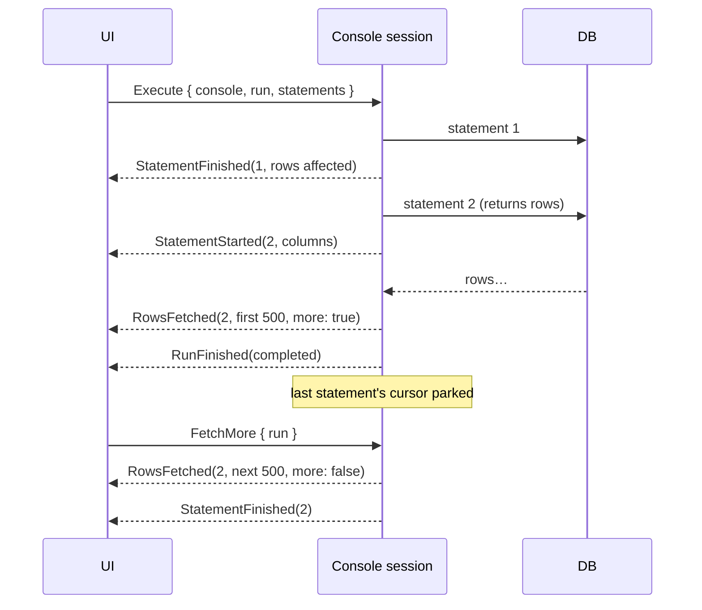

# SQL runner

The centre panel: query consoles as tabs, each with an editor on top and results below.

Status: implemented in M3 and M4, except where marked *planned*.

## Query console

- Opened from the explorer: right-click a data source → **New query console**, or a table, view
  or materialized view → **Open data** (a console with `SELECT * FROM <name>;`, run at once).
- Bound to one data source, with **its own connection**, separate from the explorer's and from
  other consoles. A long query or a half-read result in one tab never blocks another. The
  connection opens on the first run, and closing the tab closes it.
- Titled with the data source's name, numbered if there are several (`shop`, `shop (2)`).
- Toolbar: **Run**, **Run all**, **Explain**, **Cancel**, **History**, **Format**, and the run status
  (connecting, running, done in N ms, failed, cancelled). A second row holds the transaction
  mode (see [Transactions](#transactions)).
- **Saved as a file.** Each console is `consoles/<data-source-id>/<name>.sql` (`console.sql`,
  `console_2.sql`, …; see [Persistence](../persistence.md)). Edits are
  written a second after typing stops, and on quit, by the engine, never on the UI thread.
  Open console tabs are part of the saved layout and reopen with their text on start; a tab
  whose file or data source is gone is dropped.
- **Closing** a console keeps its file if anything was typed in it, and removes it otherwise
  (a fresh console, or one opened by **Open data** and left as it was). Kept files are offered
  in the data source's context menu under **Open saved console**.
- *Planned*: header with data source colour, current schema switcher, renaming consoles.

## Editor

egui's `TextEdit` (monospace, code-editor mode) with a custom layouter:

- Syntax highlighting from `dbdesk-sql`'s lexer, which is the same lexer that splits
  statements, so what looks like a string is exactly what the splitter treats as one.
  Keywords, strings, numbers, comments and quoted identifiers each get a colour, with
  separate palettes for light and dark themes.
- The tokens of a statement's error position are underlined in red until the text changes.

The editor is egui's weakest area (see [ADR-0001](../adr/0001-ui-toolkit-egui.md)). If it
becomes the bottleneck, the plan is a dedicated editor widget in its own crate.

- Line numbers in the left margin; a line that wraps is numbered once.
- The statement ⌘↵ would run (the one at the cursor) has a faint background, unless text is
  selected.

### Completion

- Typing a name (or a `.`) opens a list at the cursor; ⌃Space (`console.complete` in the
  [keymap](keymap.md)) opens it anywhere. ↑/↓ pick, Enter or Tab accept, Escape closes; a
  click elsewhere or typing a non-name character closes it too.
- **What the clause calls for** (`console/completion/context.rs`, read from the lexer's
  tokens up to the cursor, so half-typed SQL works):

  | Where | Offered |
  | --- | --- |
  | after `alias.` or `table.` | that table's columns (a CTE's or subquery's too) |
  | after `schema.` | that schema's tables and views |
  | `SELECT`, `WHERE`, `ON`, `GROUP BY`, `ORDER BY`, `HAVING`, `SET`, `RETURNING`, and inside their parentheses | columns of the statement's tables and subqueries, its aliases, functions, keywords |
  | `FROM`, `JOIN`, `UPDATE`, `INTO`, after a comma in `FROM` | CTEs, tables and views (schema-qualified outside `public`/`main`), schemas, keywords |
  | `INSERT INTO t (…)` | the columns of `t` |
  | right after a table and its alias | keywords (`WHERE`, `JOIN`, …) |
  | anywhere else (a statement's first word) | everything |

- **The statement's own names**: table aliases declared anywhere in the statement, CTEs
  (`WITH name [(columns)] AS (…)`), and subqueries in `FROM`/`JOIN` (`(…) [AS] alias
  [(columns)]`). Their columns are the explicit column list, or the query's select list:
  read by `sqlparser` (the syntax checker's parser) when the query parses, which a finished
  CTE usually does, and otherwise from its tokens (`expr AS name`, `t.name`, `expr name`).
  `*` and `t.*` expand to the catalog columns of the query's tables; unnamed expressions are
  left out. `VALUES` lists are `column1`, `column2`, … as both databases name them.
- **Functions**: the database's own, from the explorer's cached catalog where it has loaded a
  schema's functions (PostgreSQL lists them with their arguments, shown as the detail), then
  the common built-ins of the dialect (`Dialect::builtin_functions` in `dbdesk-sql`). They
  are inserted with their parentheses, the cursor between them, and only offered once
  something is typed.
- **Ranking** (`console/completion/ranking.rs`): candidates starting with the typed prefix,
  ignoring case, come first; then fuzzy matches, whose letters appear in order and whose
  skips land on the start of a word (`cid` → `customer_id`, `cus` doesn't match
  `cume_dist`), the fewer skipped letters the better. Within those, what was accepted lately
  (in any console, the last 50) comes first, then the order above. A name typed in full isn't
  offered again, so Enter still breaks the line. Keywords and functions follow the case being
  typed.
- **The list** shows each candidate with the explorer's icon for its kind (column, table,
  view, schema, function; keywords, aliases and CTEs have their own), and its detail: a
  column's type and table (`integer, primary key · customers`), `table · public`,
  `function · public(integer)`, `alias · orders`, `CTE`.
- Names come from the **explorer's cached catalog** for the console's data source, never from
  a query of their own. When the list needs a level that isn't cached (the schemas, a schema's
  tables, a referenced table's columns), the app loads it into that cache in the background,
  one level per answer, without expanding the explorer; the list says "Loading the catalog…"
  meanwhile. This connects the explorer's session, as expanding the data source would. A
  level that failed to load isn't retried until it's expanded in the explorer.
- System schemas (`pg_catalog`, `information_schema`) aren't offered. Names are quoted when
  they need it, with the same rule as Open data.

*Planned*: bracket matching, argument hints for functions.

### Formatting

| Action | Key | What it formats |
| --- | --- | --- |
| Format (`console.format`) | ⌥⌘L | The selection, else the statement at the cursor |
| Format all (`console.format-all`) | ⇧⌥⌘L | Every statement in the console |

Also on the toolbar (**Format**) and in the **Code** menu, which acts on the console whose tab
has focus.

- **Layout.** Queries and data changes (`SELECT`, `WITH`, `INSERT`, `UPDATE`, `DELETE`,
  `VALUES`) go clause by clause: each clause starts a line; a clause with several items
  (`SELECT a, b`, `SET`, `GROUP BY`, `VALUES` rows) puts each on its own line, one level in;
  `WHERE` and `HAVING` start a line per top-level `AND`/`OR`; subqueries are indented inside
  their parentheses; a `CASE` with several branches puts each `WHEN`/`ELSE` on its own line.
  Comparisons written without spaces get them (`a=1` → `a = 1`), and commas are followed by a
  space. Other statements (DDL, `DO` blocks, `GRANT`, …) keep their line breaks, except that a
  `CREATE TABLE`'s columns go one per line and a query after `AS` is laid out as above.
- **Settings** (View → Settings…, saved in `settings.toml`): keyword case (upper, lower, as
  typed) and indent width (1 to 8 spaces).
- **What never changes.** The formatter works on `dbdesk-sql`'s tokens and only changes the
  whitespace between them and the case of keywords. Strings, dollar-quoted bodies, quoted
  names and comments come out byte for byte; a line comment always ends its line. Whitespace
  is never put between two operator characters (`::`, `->>`, `<=`), between a word and a
  string or quoted name that may be its prefix (`B'1010'`, `x'ff'`, `U&"…"`), or inside a
  parameter (`$1`, `:name`), and only removed before `,`, `;`, `)` and after `(`.
- **Checked before it is applied.** The output is lexed again and compared with the input
  (`dbdesk_sql::same_meaning`): same tokens, keywords ignoring case, and the spacing rules
  above. If they differ, nothing changes and the toolbar says **Not formatted**. A test runs
  this over a corpus of PostgreSQL and SQLite statements in every setting, and checks that
  formatting twice changes nothing.
- **Selections** are narrowed to the tokens wholly inside them, so a selection that starts in
  the middle of a string never formats half of it. A selection that isn't a whole query (say,
  `c FROM t`) only gets its keywords' case changed.
- **The cursor stays on its token**, at the same distance from its start.
- **One undo step.** The text before and after are recorded as undo points, so ⌘Z restores
  the console as it was.

**Why not `sqlformat`.** The `sqlformat` crate (0.5) was evaluated first. It changes what some
statements mean: it reformats dollar-quoted function bodies, puts spaces inside string literals
(`ESCAPE '\'` becomes `ESCAPE ' \ '`), splits prefixed literals (`B '1010'`, `U & 'd\0061t'`)
and SQLite's bracketed names (`[ my col ]`), and loses its layout after operators it doesn't
know (`#>>`). It also gives no way to keep the cursor on its token. Our own formatter is a few
hundred lines over the lexer that already highlights and splits statements, so what it
treats as a string is exactly what the editor shows as one. The trade-off: its layout rules
are fewer than `sqlformat`'s, and statements other than queries keep their line breaks.

### Problems while typing

Errors are underlined with a red wave and warnings with an amber one, from the palette's error
and warning colours. Hovering over one shows its message (and, for a lint warning, the rule's
id). The toolbar counts them (**1 error, 2 warnings**); clicking the count, or F8
(`console.next-problem`), moves the cursor to the next one, ⇧F8 (`console.previous-problem`)
to the previous one, wrapping around.

**Syntax errors** come from [`sqlparser`](https://crates.io/crates/sqlparser) 0.63 with its
PostgreSQL or SQLite dialect, one statement at a time (as `dbdesk-sql` splits them), mapped
from the parser's line and column to the token it points at. A statement that ends early is
marked at its last token ("expected an expression at the end of the statement").

- **Only data queries and changes are parsed** (`SELECT`, `WITH`, `VALUES`, `INSERT`,
  `UPDATE`, `DELETE`, SQLite's `REPLACE`). DDL, `DO` blocks, `COPY`, `PRAGMA` and other
  vendor statements are where the parser falls short of the databases, and **a false error is
  worse than a missed one**, so they get none.
- **Known gaps.** A corpus of valid statements in `dbdesk-sql`'s tests found the constructs
  `sqlparser` rejects although the database accepts them. A statement using one is not
  checked: PostgreSQL `ROWS FROM (…)`, `FOR NO KEY UPDATE` / `FOR KEY SHARE`,
  `BETWEEN SYMMETRIC`, `JOIN … USING (…) AS alias`, the XML functions (`xmlelement(name …)`),
  and SQLite `INDEXED BY`, `NOT INDEXED` and `a IS b` between any two expressions. A
  statement the parser wrongly rejects is a bug to add there.
- **The database overrules the parser**: when it accepts a statement (see below), a parser
  error on it is dropped.
- *Why `sqlparser`:* it is maintained, has both dialects, and needs no database. Its tokenizer
  isn't used for anything else (see the lexer note under Running SQL).

**Lint rules** (warnings), each with an id that `settings.toml` (or View → Settings…) can
switch off:

| Id | Flags |
| --- | --- |
| `null-comparison` | `= NULL`, `<> NULL`, `!= NULL`, which are never true: use `IS [NOT] NULL`. Assignments in `UPDATE … SET` are left alone. |
| `update-without-where` | An `UPDATE` without a top-level `WHERE` (the same check as the "Run anyway?" dialog). |
| `delete-without-where` | A `DELETE` without a top-level `WHERE`. |
| `select-star-in-insert` | `INSERT … SELECT *`, which depends on the order of the source's columns. |
| `unknown-table` | A table or view the explorer's cached catalog doesn't have. |
| `unknown-column` | `alias.column` where the alias's table, in the cached catalog, has no such column. |

The two catalog rules never guess: a name is only reported when the catalog level that
would hold it is loaded (all of the schema's tables and views; a table's columns), and
they never load anything themselves. Unqualified names need every schema's tables loaded.
Names the console defines are left alone: CTEs, tables and views created by `CREATE` anywhere
in the console, `SELECT … INTO` targets, table functions (`generate_series(…)`), the row
qualifiers `excluded`, `new` and `old`, and system catalogs (`pg_*`, `sqlite_*`, `pragma_*`).
Unqualified columns aren't checked: output aliases, subqueries and correlated names make that
a guess.

**Asking the database** (on by default, `lint.ask_database`). Decided worth it: only the
database knows about temporary tables, the search path and types, and it is authoritative
where the parser and the cached catalog aren't. After a check, a connected console sends its
data queries and changes to its **own connection** with `Command::ValidateStatements`, which
prepares each without running it (`Connection::validate`):

- PostgreSQL: tokio-postgres's `prepare`, an unnamed statement through the extended protocol
  (Parse and Describe), which parses and analyses but executes nothing; dropping it closes it.
- SQLite: `sqlite3_prepare` without a step. Statements other than queries and changes are never
  prepared, because some `PRAGMA`s take effect while being prepared.
- **Never disturbs the console:** the session skips everything while a result has unread rows
  (preparing would wait for them or discard them) or a transaction is open (on PostgreSQL a
  rejected statement would abort it), and it never connects: a console that hasn't run
  anything isn't asked about. Answers are cached per statement text and forgotten after each
  run, a commit or rollback, or a reconnect.
- Rejections show as "The database says: …": syntax errors and other failures as errors,
  unknown names (SQLSTATE `42P01`, `42703`, `42883`, `42704`, `3F000`; SQLite's "no such …")
  as warnings, since a table may be created by an earlier statement of the same script.
  SQLite gives no position for unknown names, so the name its message ends with (`no such
  table: shipments`) is marked where the statement mentions it.

**Keeping the UI frame cheap.** Checks wait until typing pauses (300 ms). Results are
cached per statement text, so an edit re-parses only the statement it touched, and a frame
spends at most 4 ms parsing before carrying on in the next one. Measured on an M-series Mac,
checking a statement takes about 13 µs in a release build (84 µs in debug), so a 1,000-statement
console (78 KB) checks from cold in about 13 ms, over four frames.

## Running SQL

| Action | Key | What runs |
| --- | --- | --- |
| Run | ⌘↵ | The selection (split into statements) if any, otherwise the statement at the cursor |
| Run all | ⇧⌘↵ | Every statement in the console, in order, stopping at the first failure |
| Cancel | ⌘. | Stops the running statement, or discards unread rows |
| Explain | ⌥⌘E | The statement at the cursor (or the first one selected), prefixed with `EXPLAIN` (PostgreSQL, MariaDB), `EXPLAIN QUERY PLAN` (SQLite) or `EXPLAIN FORMAT=TREE` (MySQL 8.0.16 and later, once the console knows its server: `Dialect::explain_prefix`). SQL Server has no prefix: the run carries `RunPurpose::Explain`, and the engine switches `Dialect::explain_setting` (`SET SHOWPLAN_XML ON`) on in a batch of its own before the statement and off after it, whatever happens |

Shortcuts work while the console's editor has focus, and are taken before the editor sees
them, so ⌘↵ runs instead of inserting a newline. These are the defaults; `keymap.toml` can
change them (see [Keymap](keymap.md)).

**Statement splitting** lives in `dbdesk-sql` and works on text as typed, without parsing:
- Semicolons inside strings, quoted identifiers, comments and PostgreSQL dollar-quoted bodies
  don't split.
- Neither do semicolons inside `BEGIN … END` in a `CREATE` statement (SQLite trigger bodies,
  `BEGIN ATOMIC` functions), or inside `CASE … END`.
- Unterminated strings and comments run to the end of the text.
- It returns byte ranges, which also gives "statement at the cursor": the statement containing
  the cursor, else the one just before it (the cursor usually sits after the `;`).

It is a hand-written lexer rather than `sqlparser`'s tokenizer, which the original design named.
That tokenizer rejects unterminated input and reports line and column instead of byte offsets.
The lexer also replaced `syntect` for highlighting: one lexer, no regex engine.

**Safety check** before running: an `UPDATE` or `DELETE` without a top-level `WHERE` opens a
"Run anyway?" dialog listing the statements, and nothing runs until it is answered. Only the
statement's first word is checked, so `WITH … DELETE` slips through. *Planned*: per-data-source
safety levels (confirm any non-`SELECT` on production).

## Execution

- **Results are text.** PostgreSQL runs over the simple query protocol, so the server formats
  every value, including types dbdesk knows nothing about, exactly as `psql` shows it. SQLite
  values are formatted the way the `sqlite3` shell does (`100.0`, blobs as `x'…'`, or their
  size past 64 bytes). A cell is `Option<String>`, with `None` for `NULL`. See
  [ADR-0004](../adr/0004-results-as-text.md).
- **Paging.** Each statement's first page (500 rows) is read. Only the run's last statement
  keeps its cursor open ("parked") for **Load more rows**, or for scrolling to the bottom of the
  grid. A cursor holds its connection, and the next statement needs it, so earlier statements'
  unread rows are discarded and their result says "rest discarded".
  - PostgreSQL: tokio-postgres stops reading the socket while nobody consumes the stream, and
    TCP backpressure then pauses the server, so unread rows cost nothing.
  - SQLite: the statement runs on a blocking-pool thread that steps rows only when a page is
    asked for, holding the connection's lock until the cursor is finished.
- **Discarding unread rows** (new run, Cancel, closing the console): the engine asks the
  database to stop first, then drains, so a huge result isn't read just to be thrown away.
- **Cancellation.** PostgreSQL sends an out-of-band cancel request, as `psql`'s Ctrl+C does.
  SQLite uses `sqlite3_interrupt`, plus a flag its statement thread checks before every step,
  because the interrupt only stops a step already in progress. The session keeps waiting for
  the statement to end after cancelling, so the connection is never left mid-result. A cancel
  between a script's statements stops the script.
  - *Hard-learned:* the engine polls the statement before the cancel signal (`biased` select).
    Otherwise a cancel could reach SQLite before its first step, be ignored, and leave an
    endless query running (the console test hung about 2 runs in 5 before the fix).
- **Errors** carry the database's message and, when reported, a byte position into the
  statement, which the editor underlines. PostgreSQL reports positions for most errors. SQLite
  reports them for syntax errors, not for unknown tables or columns.
- **Notices** (`RAISE NOTICE`, "already exists, skipping", …) from PostgreSQL go to the log
  console.
- **History**: every statement a console runs is recorded (see [Query history](#query-history)).

## Transactions

Each console has a mode, **Auto-commit** (the default) or **Manual commit**:

- **Auto-commit**: each statement commits on its own, unless the user opens a transaction with
  their own `BEGIN`.
- **Manual commit**: before the first statement that isn't itself transaction control
  (`BEGIN`, `COMMIT`, `ROLLBACK`, `SAVEPOINT`, …), the engine sends `BEGIN`. Changes stay
  pending until **Commit** or **Rollback**.
- **Pending indicator**: "● Transaction open", or "● Transaction failed" on PostgreSQL after
  an error inside the transaction (only a rollback is accepted then; Commit of a failed
  transaction is reported as the rollback it is). It shows in either mode, so a `BEGIN` typed
  in auto-commit mode is noticed too. The mode can't change while a transaction is open.
- **Status from the database**: `Connection::transaction_status` asks the driver. SQLite
  answers from `sqlite3_get_autocommit`. tokio-postgres doesn't expose the status the protocol
  sends after each statement, so the driver compares `now()` (the transaction's start) with
  `statement_timestamp()`, and reads `in_failed_sql_transaction` as failed. MySQL reads the
  `SERVER_STATUS_IN_TRANS` flag of the server's reply to `DO 0`. SQL Server reads `@@TRANCOUNT`,
  and `XACT_STATE() = -1` as failed. Transactions are opened with
  `Dialect::begin_transaction` (`BEGIN TRANSACTION` on SQL Server, where `BEGIN` opens a
  block), and grid edits inside one use `Dialect::edits_savepoint`. The engine asks after
  statements that control transactions or fail, not after every statement.
- **Implicit commits**: MySQL commits DDL and account statements at once, with whatever the
  open transaction held (`Dialect::implicit_commit_verbs`; `CREATE`/`DROP TEMPORARY TABLE` are
  exempt). In manual mode, or with a transaction open, the "Run anyway?" dialog warns first
  (`commits_implicitly`, `hazard_dialog::ReviewContext`).
- **Warnings**: closing a console, disconnecting its data source (which closes its consoles'
  connections too) or quitting with a transaction open asks "Roll back open transactions?"
  first. Closing a connection is what rolls back; there is no "commit and close".

## Query history

- Every statement a console runs goes to `history.sqlite` (schema in
  [Persistence](../persistence.md)) with its start time, duration, row count and outcome (ok,
  error, cancelled). The explorer's own catalog queries and the engine's implicit `BEGIN` are
  not recorded.
- **History** in a console's toolbar opens a window over the data source's statements, newest
  first (up to 500; the search narrows them). The search matches anywhere in the SQL,
  ignoring ASCII case. **Insert** (or a double-click) puts a statement at the console's cursor
  on a line of its own.
- The history is written by one thread from the blocking pool, so a search sent after a run
  finishes sees that run's statements; the window refreshes after every run.

## Result grid

- With several statements, a numbered tab per statement (failed ones in red) picks whose result
  is shown. The latest statement to return rows or fail is selected automatically.
- A summary line: `N rows, more available · 12 ms`, `N rows affected` (for INSERT, UPDATE,
  DELETE, MERGE, REPLACE, COPY), `Done` for DDL, or the error.
- Virtualized rows (`egui_extras::TableBuilder`): only visible rows are laid out, so many
  thousands of loaded rows scroll smoothly. Resizable columns and a row-number column.
- A header row tinted with the primary colour, striped rows, and cells in JetBrains Mono.
- `NULL` in weak italics, numbers right-aligned (by looking at the text, because the text
  protocol doesn't say which columns are numeric), long text truncated with the full value on
  hover.
- **Selection**: click a cell to select it; shift-click or drag to select a rectangle. ⌘C (when
  no text field has focus) or **Copy selection** copies it as TSV, rows in the order shown,
  `NULL` as `NULL`, values with tabs, line breaks or quotes quoted the way spreadsheets read
  them back.
- Right-click a cell: Copy selection, Copy value, Copy row (tab-separated), View value.
- **Cell viewer**: double-click a cell (or press Space on a selected one) to see its whole value
  in a window. JSON objects and arrays are pretty-printed, keeping their key order; Copy copies
  the value as stored.
- **Sort and filter, client-side**: click a column header to sort (ascending, descending, off),
  and type in **Filter loaded rows** to keep rows with a cell containing the text (ignoring
  case). Both work on the rows loaded so far only, never re-query, and say so: "Sorted and
  filtered here, not by the database: N of M loaded rows". Numbers sort by value when both
  cells look numeric (the same guess that right-aligns them), `NULL` first. The `#` column keeps
  each row's position in the result.
- **Export**: **Export → CSV…/JSON…** asks where (the platform's save dialog, via `rfd`) and
  the engine writes the rows as shown (sorted and filtered). CSV is RFC 4180 with a header and
  `NULL` as an empty field; JSON is an array of objects with keys in column order (repeated
  names get `_2`, `_3`), values as strings or `null`, since cells are text.
- The editor and the grid are split by a line that can be dragged; each keeps at least a fifth
  of the console's height.
## Editing data

- **What can be edited**: the rows of a `SELECT` from a single table (no joins, set
  operations, `GROUP BY` or `DISTINCT`), when the table has a primary key and the result has
  every key column. Only columns of that table (each named once in the result) can be edited.
  Anything else says "Read-only" in the grid's toolbar, with the reason on hover.
- **How the table is found**: the statement names it; the engine resolves that name on the
  explorer's connection with `Connection::describe_table` (`to_regclass` on PostgreSQL, so
  the search path and case folding apply; `pragma_table_list` on SQLite) and returns its real
  schema, columns and primary key. The explorer's connection keeps the console's open result
  undisturbed.
- **Editing**: double-click an editable cell, select it and press F2 or Enter
  (`grid.edit-cell`), or use **Edit value** in its context menu; Enter or clicking away keeps
  the text, Escape drops it. **Set NULL** sets `NULL` (an emptied cell is an empty string).
  Changed cells are tinted and show their new value; "N changed cells" offers **Submit** and
  **Revert**.
- **Adding and deleting rows** (W5a): **Add row** adds an empty row under the loaded ones,
  tinted, each cell showing `DEFAULT` (the column's default on hover) or `NULL` until typed
  into. **Delete row** in a cell's context menu, or **Delete rows** in the toolbar for the
  selected cells' rows, marks rows for deletion: struck through and tinted, with **Restore
  row**. The toolbar counts it all: "1 changed cell · 1 new row · 1 deleted row".
- **Submitting** runs, on the console's own connection, one `DELETE … WHERE <key>` per deleted
  row, then one `UPDATE … SET … WHERE <key> = <value as loaded>` per changed row, then one
  `INSERT` per added row (with only the columns typed into; `DEFAULT VALUES`, or
  `() VALUES ()` on MySQL, for a row left at its defaults), so a key a deleted row frees can be
  reused. They are built by `dbdesk_sql::RowSql`. All or none: in a transaction of their own,
  or behind a savepoint inside the console's open transaction (so in manual commit mode they
  stay pending with the rest). Each must change exactly one row; otherwise (the row changed or
  went since it was read, or a value doesn't fit the column) everything is rolled back, the
  changes stay pending, and the error names the row ("Row 12: …", "New row 2: …"). Each
  statement sent is recorded in the history. Deleted rows then leave the grid; if rows were
  added, the statement runs again, so the values the database chose for them show.
  Discarding unread rows is the price: the connection can't hold a cursor and run the
  changes.
- **Values are text**, as the grid holds them ([ADR-0004](../adr/0004-results-as-text.md)):
  each goes back as a string literal, which PostgreSQL converts to the column's type and
  SQLite stores by the column's affinity. So whatever displays can be edited as it displays
  (`t` for a boolean, `{1,2}` for an array). SQLite blobs shown as `x'…'` would be stored as
  that text; don't edit them.
- *Planned*: a key binding for Submit.

## Open questions

- Store full result sets of past runs, or only the SQL in history? Settled in M4: only the SQL,
  with its row count, duration and outcome.
- Should a script be able to keep several result cursors open, at the cost of one connection
  each?
