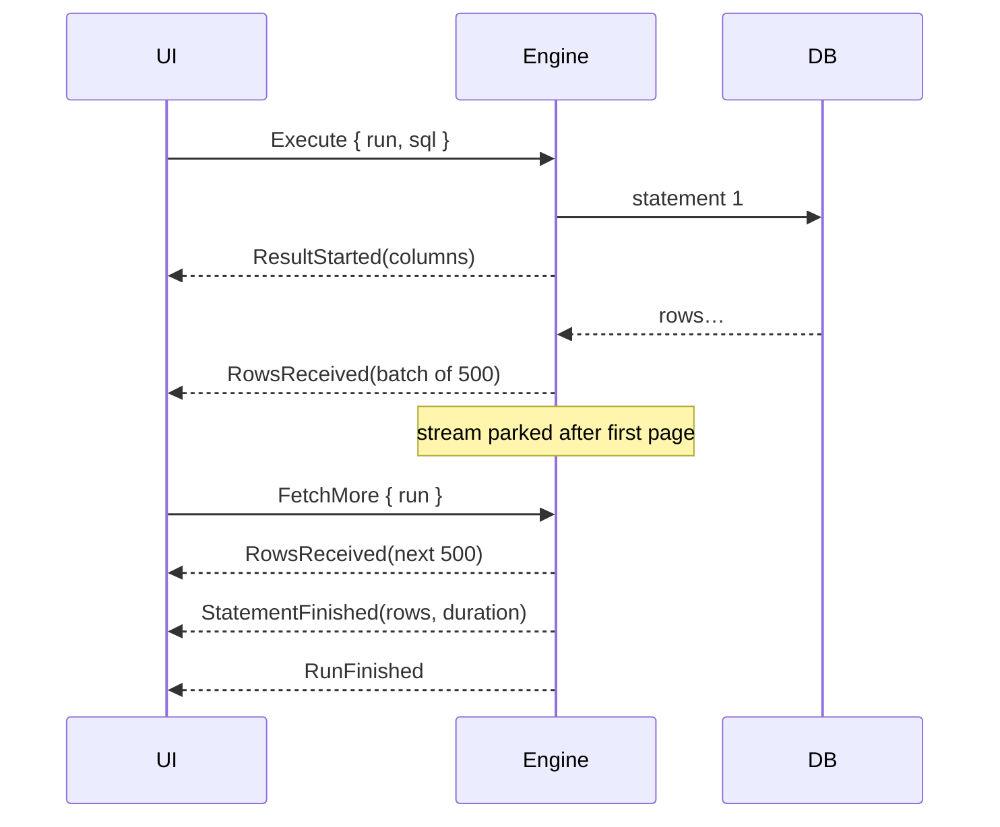

# SQL runner

The centre panel: query consoles as tabs, each with an editor on top and results below.

## Query console

- Bound to one data source. Opening a console creates (or reuses) a session for it.
  One session per console, as in DataGrip, so a long query in one tab never blocks another.
- Header shows data source name and colour, current schema (switchable), and transaction mode.
- Contents are saved to disk as `.sql` files (see [Persistence](../persistence.md)), so closing
  the app never loses a scratch query.

## Editor

v1 builds on egui's `TextEdit` with a custom layouter:

- Syntax highlighting with `syntect` (SQL grammar), recomputed only for changed lines.
- Line numbers, current-statement highlight, bracket matching.
- Error underline at the position reported by the server.

The editor is egui's weakest area (see [ADR-0001](../adr/0001-ui-toolkit-egui.md)). If it
becomes the bottleneck, the plan is a dedicated editor widget in its own crate, so it can be
replaced without touching the rest of the app.

Later: completion from the cached catalog (tables, columns, keywords), multi-cursor, formatting.

## Running SQL

| Action | Default key | What runs |
| --- | --- | --- |
| Run statement | ⌘↵ | Selection if any, otherwise the statement under the cursor |
| Run script | ⌘⇧↵ | Every statement in the console, in order, stopping at the first error |
| Cancel | ⌘. | The current run |
| Explain | ⌥⌘E | `EXPLAIN` (or `EXPLAIN QUERY PLAN`) of the current statement |

**Statement splitting** lives in `dbdesk-sql` and uses the `sqlparser` tokenizer, so semicolons
inside strings, comments, quoted identifiers and Postgres dollar-quoted bodies don't split.
It must not need a successful *parse*: half-written SQL is the normal state of an editor.
The splitter returns byte ranges, which also gives "statement under cursor" for free.

**Safety checks** before execution, driven by the data source's safety level:
- `UPDATE`/`DELETE` without `WHERE` → confirm dialog.
- Production-flagged data sources → confirm any non-`SELECT` statement.

## Execution flow

- **Paging**: the engine reads one page (default 500 rows) and parks the row stream in the session.
  Scrolling to the end of the grid (or clicking "Load more") sends `FetchMore`. A new run or
  cancel drops the parked stream.
  - Postgres: `query_raw` returns a `RowStream` over the extended protocol, so rows arrive
    incrementally rather than all at once.
  - SQLite: the `Statement` stays prepared in the blocking task; `FetchMore` steps it further.
- **Cancellation**: Postgres uses `Client::cancel_token()` (out-of-band cancel request);
  SQLite uses `InterruptHandle::interrupt()`. Cancel is best-effort; the UI marks the run as
  "cancelling" until `RunFinished` arrives.
- **Transactions**: auto-commit by default. Manual mode (explicit commit/rollback buttons,
  pending-transaction indicator in the header) comes in M4.

## Result grid

- One result tab per statement that returns rows; DML shows "N rows affected" in the log console
  and a status line instead.
- Virtualized rows (`egui_extras::TableBuilder` or `egui_table`): only visible rows are laid out,
  so 100k loaded rows scroll smoothly.
- Resizable columns, `NULL` rendered distinctly, numbers right-aligned, long text truncated with
  a cell viewer on double-click (pretty-printed for JSON).
- Client-side sort and filter over loaded rows only, clearly labelled as such. Server-side
  sort/filter (rewriting the query with `ORDER BY`/`WHERE`) is a later feature.
- Copy cell / row / selection as TSV; export as CSV or JSON (M4).
- Data editing (generate `UPDATE` from edited cells, needs a primary key) is M5.

## Open questions

- Store full result sets of past runs, or only the SQL in history? (Leaning: SQL + row count + duration only.)
- How to show multiple result sets from a script: tabs per statement, or one tab with a
  statement picker?
