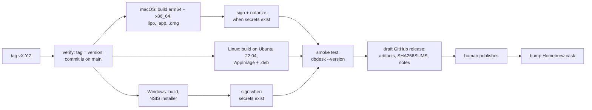

# Release binaries

Status: **R1 released** as v0.1.0 on 2026-10-23, followed by v0.2.0 (MySQL and MariaDB, TLS,
the update notice), v0.3.0 (SQL Server), v0.4.0 (projects, and links that open), v0.5.0
(installing updates, the read-only MCP server), v0.6.0 (DuckDB and ClickHouse), v0.7.0
(portable configuration, safety levels, MCP permissions), v0.8.0 (SSH tunnels, creating and
changing tables, indexes, views and schemas), v0.9.0 (adding and deleting rows, foreign
keys, sorting and filtering in the database, exporting every row, importing CSV) and v0.10.0
(PostgreSQL users and roles, the history as an audit trail, .sql files, statement parameters,
find and replace). R3's update
notice is built, ahead of R2 (see [R3](#r3--updates)).
Decisions settled on 2026-10-23 (see [Decisions](#decisions)).

Today the only way to run dbdesk is to install Rust and build it from source (see the manual's
[Install](../book/src/install.md) chapter). That is fine for its author and a wall for anyone
else. This plan replaces it with downloads that install like any other desktop app.

## What users get

| Platform | Download | Installs with |
| --- | --- | --- |
| macOS 11+, Apple silicon and Intel | `dbdesk-<version>.dmg`, one universal app | Drag to Applications, or `brew install --cask navasvarela/tap/dbdesk` |
| Linux x86_64 | `dbdesk-<version>-x86_64.AppImage` | Download, `chmod +x`, run; works on most distributions |
| Linux x86_64, Debian/Ubuntu | `dbdesk_<version>_amd64.deb` | `sudo apt install ./dbdesk_<version>_amd64.deb` |
| Windows 10+ x86_64 | `dbdesk-<version>-setup.exe` | Run the installer |

Every release also has `SHA256SUMS`, and release notes generated from the Conventional Commits
since the previous release. ARM Linux and ARM Windows wait until someone asks.

## Pipeline

Pushing a tag `vX.Y.Z` on `main` runs `.github/workflows/release.yml`:



1. **Verify.** The tag must match the workspace version in `Cargo.toml`, and its commit must be
   on main. CI isn't run again: main only takes pull requests whose required checks passed, with
   every database server, so the commit has already been through it.
2. **Build.**
   - **macOS** on an Apple-silicon runner: `aarch64-apple-darwin` and `x86_64-apple-darwin`
     binaries, joined into a universal binary with `lipo`. One download, no "which Mac do I
     have?" question.
   - **Linux** on `ubuntu-22.04`, the oldest supported runner: binaries link against the glibc
     they're built with, so building old keeps the AppImage running on older distributions.
   - **Windows** on `windows-2022`.

   Each job links DuckDB's prebuilt library rather than compiling it: the static library for
   each macOS architecture and for Linux, and the DLL on Windows, which the installer puts
   beside `dbdesk.exe`. `packaging/duckdb/fetch.sh` downloads it from DuckDB's GitHub release
   and checks it against `packaging/duckdb/SHA256SUMS`. See
   [DuckDB's prebuilt libraries](duckdb-prebuilt.md).
3. **Package** with `cargo-packager`, configured under `[package.metadata.packager]` in
   `crates/dbdesk-app/Cargo.toml`: the `.app` bundle, the AppImage and `.deb`, and an NSIS
   installer. The bundle uses the existing `assets/brand/dbdesk.icns` and icon PNGs, and carries
   the licences of dbdesk, its fonts and DuckDB (with DuckDB's third-party notices) in
   `Resources/licenses/`. The `.dmg` comes from
   `packaging/macos-dmg.sh` instead of `cargo-packager`'s `dmg` format: that one runs
   `create-dmg`, whose `hdiutil convert` step failed on macOS 26 even outside any sandbox, and
   which is a known source of flaky runs on GitHub's macOS runners. A plain `hdiutil create`
   of a folder with the app and an Applications shortcut works; only the custom Finder window
   layout is lost.
4. **Sign** when the signing secrets are configured, and skip with a note in the release
   otherwise. macOS: Developer ID signing, then notarization with `notarytool` and stapling.
   Windows: Authenticode.
5. **Smoke test** every packaged artifact on its own runner by starting the binary inside it
   with `--version`, a new flag that prints the version and exits before opening a window. It
   catches broken bundles, missing libraries and a binary that won't start, cheaply. The Windows
   job also installs silently and starts the installed copy with no DuckDB on `PATH`, so a
   missing `duckdb.dll` fails it.
6. **Draft a GitHub release** with the artifacts, `SHA256SUMS` and the notes. A person looks at
   the draft and publishes it, so a release never goes out unseen.
7. **After publishing,** a second job updates the Homebrew cask (version and checksum) in the
   tap repository.

## Tooling

| Need | Choice | Why |
| --- | --- | --- |
| Bundles and installers | [`cargo-packager`](https://github.com/crabnebula-dev/cargo-packager) | Built for desktop apps: `.app`, `.dmg`, AppImage, `.deb`, NSIS and WiX from one config, plus an updater for later. |
| Release notes, `CHANGELOG.md` | [`git-cliff`](https://git-cliff.org) | Groups Conventional Commits (`feat`, `fix`, breaking `!`) into readable notes, which `CONTRIBUTING.md` already requires. |
| Third-party licences | [`cargo-about`](https://github.com/EmbarkStudios/cargo-about) | Generates the licence notices of every dependency to ship with the app; the bundled fonts' OFL and Inter licences are added alongside. |
| Dependency inventory | [`cargo-auditable`](https://github.com/rust-secure-code/cargo-auditable) | Embeds the dependency list in the binary, so `cargo audit bin` can check a released build for vulnerable crates later. |

**Why not `dist` (cargo-dist):** it is excellent for command-line tools (shell and PowerShell
installers, Homebrew formulas, MSI), but it doesn't build `.app` bundles or DMGs, which a Mac
GUI app needs. **Why not hand-written scripts:** `.app` layout, `Info.plist`, DMG building,
AppImage and NSIS are each a small project; `cargo-packager` already does all of them.

## Release build

```toml
[profile.release]
lto = "thin"
codegen-units = 1
strip = "symbols"
```

Measured before and after in the PR that adds it: binary size and start-up time. Symbols are
stripped from what ships; crash reports can come later with separately uploaded debug info if
they are ever needed.

## DuckDB

Releases and CI link DuckDB's own prebuilt library instead of compiling its C++ engine, which
took 10–14 minutes per build on the runners. `packaging/duckdb/fetch.sh <rust-target> <dir>`
downloads it from DuckDB's GitHub release, refuses it unless its SHA-256 matches
`packaging/duckdb/SHA256SUMS`, and prints the variables that make `libduckdb-sys` link it; the
build also passes `--cfg dbdesk_prebuilt_duckdb` in `RUSTFLAGS`. macOS and Linux link the
static library into `dbdesk`. Windows links the DLL, which the installer puts beside
`dbdesk.exe`. A plain `cargo build` still compiles DuckDB; `CONTRIBUTING.md` shows how to use
the prebuilt library locally. The packages carry DuckDB's licence and its third-party notices
as `licenses/DuckDB-LICENSE` and `licenses/DuckDB-THIRD-PARTY.txt`. Why, and what was
measured: [DuckDB's prebuilt libraries](duckdb-prebuilt.md).

To upgrade DuckDB:

1. Bump `duckdb` in the workspace `Cargo.toml`. The crate's version encodes DuckDB's:
   1.10506.x is DuckDB 1.5.6.
2. Add the new release's archives to `packaging/duckdb/SHA256SUMS`, one line per archive. Take
   each checksum from the downloaded file, and compare it with the digest GitHub records
   (`gh release view vX.Y.Z -R duckdb/duckdb --json assets`).
3. Run `packaging/duckdb/update-licenses.sh X.Y.Z` and commit what changes.
4. Update the version `links_duckdb_1_5_6_with_parquet_and_json` expects, and its name.

## Platform details

**macOS**
- **Bundle settings:** id `io.github.navasvarela.dbdesk`, minimum macOS 11. The bundle sets
  `NSHighResolutionCapable`, and the menu bar shows "dbdesk", not the binary name.
- **Gatekeeper:** it blocks unsigned apps downloaded from the internet. Without signing, users
  have to approve dbdesk in System Settings › Privacy & Security after the first failed launch.
- **Keychain:** passwords live in the Keychain, and macOS ties "Always Allow" to the app's code
  signature. An unsigned (ad-hoc signed) build gets a new signature on every release, so after
  each update the user is asked again for every saved password. A Developer ID signature stays
  the same across releases, and the prompts happen once.

**Linux**
- **Passwords:** stored through the Secret Service (GNOME Keyring, KWallet). Desktop
  distributions run one; minimal window managers may not, and the manual's troubleshooting
  chapter will say how to start one.
- **System libraries:** the app needs `libxkbcommon`, Wayland or X11, and OpenGL from the
  system, all present on desktop distributions. No OpenSSL: TLS, when it comes, should use
  `rustls` so there is nothing to link.
- **Desktop integration:** the `.deb` and the AppImage include a `.desktop` file and icons, so
  dbdesk appears in the application menu.

**Windows**
- **Untested.** dbdesk has never been built or run on Windows. Before it can ship there, CI
  needs a Windows job running the test suite (the Postgres tests skip there, as on macOS).
- **Passwords:** go to the Windows Credential Manager through the same `keyring` crate.
- **SmartScreen:** it warns about unsigned installers ("Windows protected your PC") until a
  signature builds reputation.

## Prerequisites in the app

- **`--version`:** a flag that prints `dbdesk <version> (<commit>)` and exits, for the smoke
  test and for bug reports. The same text goes in a Help › About dialog.
- **Licence files, first.** The repository is public but has none yet, and without one nobody
  may legally use, copy or redistribute the code or the binaries: MIT OR Apache-2.0 (see
  [Decisions](#decisions)).
- **A Windows CI job** (above).
- **The manual's Install chapter,** rewritten around the downloads, with "build from source"
  kept as a section for contributors.

## Versioning

- SemVer from the workspace `version`, starting at **0.1.0**: M0–M5 and the D1–D3 design work.
- While in 0.x, a breaking change to a saved file (the `!` commits in `CONTRIBUTING.md`) bumps
  the minor version and is called out first in the release notes; anything else bumps the patch.
- Releasing is done by a person: bump the version in a `build: release 0.x.y` PR, which also
  updates `CHANGELOG.md` from `git-cliff`, merge it, then tag the merge commit.

## Cutting a release

1. Merge a `build: release 0.x.y` pull request that bumps `version` in the workspace
   `Cargo.toml` (and, from R2, updates `CHANGELOG.md`).
2. Tag the merge commit and push the tag:

   ```bash
   git tag -a v0.x.y -m "dbdesk 0.x.y" && git push origin v0.x.y
   ```

3. Watch **Actions › Release**. It refuses a tag that doesn't match the version, and builds
   nothing if the tagged commit isn't on main.
4. Open the draft on the releases page, check the assets and notes, and publish it.

To try the packaging without releasing, run **Actions › Release › Run workflow** on any
branch. It builds and smoke-tests everything and keeps the packages as workflow artifacts.
Pull requests that change packaging do the same automatically.

To start attaching the Windows installer, after it has been tried on a real Windows machine,
set the repository variable `WINDOWS_RELEASES` to `true`
(**Settings › Secrets and variables › Actions › Variables**).

## Milestones

### R1 — First downloadable build

Built: `--version` and Help › About, the release profile (19.5 MB → 14.6 MB on macOS), the
licence files, Windows in CI, `cargo-packager` settings, `release.yml`, and the Install chapter.
The `.app` and `.dmg` were built and smoke-tested locally on macOS; the Linux and Windows
packages are first built by CI. Not done yet: the first tagged release, and trying it on a
clean machine, which is the exit check below.

- `--version`, the About dialog, the release profile, `LICENSE`, third-party notices.
- A Windows CI job.
- `release.yml` producing **unsigned** macOS and Linux artifacts as a draft release, with
  smoke tests and `SHA256SUMS`. It builds the Windows installer too, but attaches it only once
  it has been tried on a real Windows machine.
- The Install chapter rewritten.

**Exit:** someone with a clean Mac and a clean Linux machine, who doesn't have Rust installed,
installs dbdesk from the release page and opens a SQLite file.

### R2 — Trusted installs

- macOS Developer ID signing and notarization, Windows signing, and the Homebrew cask in a tap.
- Release notes and `CHANGELOG.md` from `git-cliff`.

**Exit:** installing shows no Gatekeeper or SmartScreen warning, and an update doesn't
re-prompt for Keychain access.

### R3 — Updates

- An in-app "a new version is available" notice, then the `cargo-packager` updater, which
  checks a signed `latest.json` on the releases page.

**Exit:** a user on an older version is offered the new one and updates without visiting
GitHub.

**Status:** the notice is built. At start-up (unless switched off in **View → Settings…**)
and from **Help › Check for updates…**, the engine asks GitHub's API for the newest published
release (`releases/latest`, which skips drafts and prereleases) and the app compares its tag
with the running version. A newer one shows as a link in the status bar that leads to the
release page. The notice needed no signing, so it came before R2.

The updater is built too. **Install and restart** in the update dialog downloads and installs
the new release with `cargo-packager-updater`, then **Restart now** quits through the usual
checks for open transactions and starts the new copy:
- **The manifest.** The release job writes `latest.json` with one signed package per platform
  and attaches it to the release. The app reads it from `releases/latest/download/latest.json`,
  which only ever resolves to a published release.
- **The packages.** On macOS, the universal `.app.tar.gz` replaces the app bundle, asking for an
  administrator password if the bundle isn't writable. On Linux, the AppImage replaces itself.
  The `.deb`, Windows and builds from source are not updated in place; the dialog says why and
  links to the release page.
- **Signing.** Update packages are signed with a minisign key of their own, separate from Apple
  or Windows code signing, so this works before R2:
  - The private key and its password are the repository secrets
    `CARGO_PACKAGER_SIGN_PRIVATE_KEY` and `CARGO_PACKAGER_SIGN_PRIVATE_KEY_PASSWORD`, and a
    backup is kept outside GitHub.
  - The public key is `UPDATE_PUBLIC_KEY` in `crates/dbdesk-app/src/updates.rs`. A package with
    another signature is refused before anything is replaced.
  - **Rotating the key** means shipping the new public key in a release signed with the old
    one. If the old key is lost, every installed copy must be updated by hand once.
- **Checked before merging** with a scratch copy of `dbdesk.app` on macOS. The updater found a
  local `latest.json`, verified the package's signature, and replaced the bundle. A package
  signed with another key was refused, and the old bundle was left as it was.

## Decisions

Settled on 2026-10-23:

| Question | Decision | Consequence |
| --- | --- | --- |
| Where the downloads live | **A public repository.** It was made public on 2026-10-23. | Releases, the Homebrew tap and the D4 website all work on GitHub's free plan. It went public before the licence files existed, so adding them is R1's first and most urgent step: until then the code is visible but nobody may use it. |
| Licence | **MIT OR Apache-2.0**, the Rust ecosystem's usual pair. | `LICENSE-MIT` and `LICENSE-APACHE` at the root, `license = "MIT OR Apache-2.0"` in the workspace manifest, and the README says so. Bundled fonts keep their own licences (OFL for JetBrains Mono, Inter's licence). |
| macOS signing | **Unsigned in R1, signed and notarized in R2.** | R1's release notes and Install chapter explain how to open an unsigned app, and warn that updates re-ask for saved passwords. Enrol in the Apple Developer Program ($99 a year) before R2. |
| Windows | **CI job now, installer once tried on a real machine.** | R1 adds Windows to CI and the release workflow builds the installer, but it is attached to releases only after someone has run it on Windows. Signing (around $10 a month) is decided then. |
| Homebrew | Not asked yet; planned for R2. | `navasvarela/homebrew-tap`, once the repository is public. |
