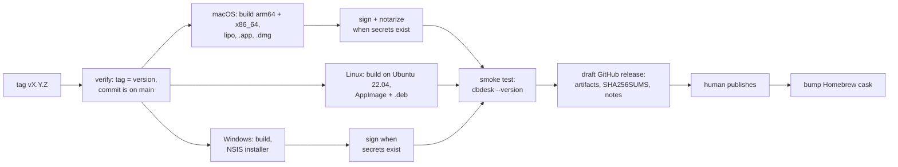

# Release binaries

Status: **R1 released** as v0.1.0 on 2026-10-23, followed by v0.2.0 (MySQL and MariaDB, TLS,
the update notice), v0.3.0 (SQL Server), v0.4.0 (projects, and links that open), v0.5.0
(installing updates, the read-only MCP server), v0.6.0 (DuckDB and ClickHouse), v0.7.0
(portable configuration, safety levels, MCP permissions), v0.8.0 (SSH tunnels, creating and
changing tables, indexes, views and schemas), v0.9.0 (adding and deleting rows, foreign
keys, sorting and filtering in the database, exporting every row, importing CSV), v0.10.0
(PostgreSQL users and roles, the history as an audit trail, .sql files, statement parameters,
find and replace), v0.11.0 (a native look on macOS: the menu bar, an integrated title bar,
the system font and accent colour) and v0.12.0 (modifying tables, custom actions, snippets and
themes in files). R3's update
notice is built, ahead of R2 (see [R3](#r3--updates)).
Decisions settled on 2026-10-23 (see [Decisions](#decisions)).

Today the only way to run dbdesk is to install Rust and build it from source (see the manual's
[Install](../book/src/install.md) chapter). That is fine for its author and a wall for anyone
else. This plan replaces it with downloads that install like any other desktop app.

## What users get

| Platform | Download | Installs with |
| --- | --- | --- |
| macOS 11+, Apple silicon and Intel | `dbdesk-<version>.dmg`, one universal app | Drag to Applications, or `brew install --cask navasvarela/tap/dbdesk` |
| Linux x86_64 | `dbdesk-<version>-x86_64.AppImage` | Download, `chmod +x`, run; works on most distributions |
| Linux x86_64, Debian/Ubuntu | `dbdesk_<version>_amd64.deb` | `sudo apt install ./dbdesk_<version>_amd64.deb` |
| Windows 10+ x86_64 | `dbdesk-<version>-windows-x64-setup.exe` | Run the installer; it installs for the current user, without administrator rights |

Every release also has `SHA256SUMS`, and release notes generated from the Conventional Commits
since the previous release. ARM Linux and ARM Windows wait until someone asks.

## Pipeline

Pushing a tag `vX.Y.Z` on `main` runs `.github/workflows/release.yml`:



1. **Verify.** The tag must match the workspace version in `Cargo.toml`, and its commit must be
   on main. CI isn't run again: main only takes pull requests whose required checks passed, with
   every database server, so the commit has already been through it.
2. **Build.**
   - **macOS** on an Apple-silicon runner: `aarch64-apple-darwin` and `x86_64-apple-darwin`
     binaries, joined into a universal binary with `lipo`. One download, no "which Mac do I
     have?" question.
   - **Linux** on `ubuntu-22.04`, the oldest supported runner: binaries link against the glibc
     they're built with, so building old keeps the AppImage running on older distributions.
   - **Windows** on `windows-2022`.

   Each job links DuckDB's prebuilt library rather than compiling it: the static library for
   each macOS architecture and for Linux, and the DLL on Windows, which the installer puts
   beside `dbdesk.exe`. `packaging/duckdb/fetch.sh` downloads it from DuckDB's GitHub release
   and checks it against `packaging/duckdb/SHA256SUMS`. See
   [DuckDB's prebuilt libraries](duckdb-prebuilt.md).
3. **Package** with `cargo-packager`, configured under `[package.metadata.packager]` in
   `crates/dbdesk-app/Cargo.toml`: the `.app` bundle, the AppImage and `.deb`, and an NSIS
   installer. The bundle uses the existing `assets/brand/dbdesk.icns` and icon PNGs, and carries
   the licences of dbdesk, its fonts and DuckDB (with DuckDB's third-party notices) in
   `Resources/licenses/`. The `.dmg` comes from
   `packaging/macos-dmg.sh` instead of `cargo-packager`'s `dmg` format: that one runs
   `create-dmg`, whose `hdiutil convert` step failed on macOS 26 even outside any sandbox, and
   which is a known source of flaky runs on GitHub's macOS runners. A plain `hdiutil create`
   of a folder with the app and an Applications shortcut works; only the custom Finder window
   layout is lost.
4. **Sign** when the signing secrets are configured, and skip with a note in the release
   otherwise. macOS: Developer ID signing, then notarization with `notarytool` and stapling.
   Windows: Authenticode, planned for after the app's rename (see
   [Signing the Windows installer](#signing-the-windows-installer)). Separately, every update
   package, the Windows installer included, is signed with the update key (see
   [R3](#r3--updates)).
5. **Smoke test** every packaged artifact on its own runner by starting the binary inside it
   with `--version`, a new flag that prints the version and exits before opening a window. It
   catches broken bundles, missing libraries and a binary that won't start, cheaply. The Windows
   job also installs silently and starts the installed copy with no DuckDB on `PATH`, so a
   missing `duckdb.dll` fails it.
6. **Draft a GitHub release** with the artifacts, `SHA256SUMS` and the notes. A person looks at
   the draft and publishes it, so a release never goes out unseen.
7. **After publishing,** a second job updates the Homebrew cask (version and checksum) in the
   tap repository.

## Tooling

| Need | Choice | Why |
| --- | --- | --- |
| Bundles and installers | [`cargo-packager`](https://github.com/crabnebula-dev/cargo-packager) | Built for desktop apps: `.app`, `.dmg`, AppImage, `.deb`, NSIS and WiX from one config, plus an updater for later. |
| Release notes, `CHANGELOG.md` | [`git-cliff`](https://git-cliff.org) | Groups Conventional Commits (`feat`, `fix`, breaking `!`) into readable notes, which `CONTRIBUTING.md` already requires. |
| Third-party licences | [`cargo-about`](https://github.com/EmbarkStudios/cargo-about) | Generates the licence notices of every dependency to ship with the app; the bundled fonts' OFL and Inter licences are added alongside. |
| Dependency inventory | [`cargo-auditable`](https://github.com/rust-secure-code/cargo-auditable) | Embeds the dependency list in the binary, so `cargo audit bin` can check a released build for vulnerable crates later. |

**Why not `dist` (cargo-dist):** it is excellent for command-line tools (shell and PowerShell
installers, Homebrew formulas, MSI), but it doesn't build `.app` bundles or DMGs, which a Mac
GUI app needs. **Why not hand-written scripts:** `.app` layout, `Info.plist`, DMG building,
AppImage and NSIS are each a small project; `cargo-packager` already does all of them.

## Release build

```toml
[profile.release]
lto = "thin"
codegen-units = 1
strip = "symbols"
```

Measured before and after in the PR that adds it: binary size and start-up time. Symbols are
stripped from what ships; crash reports can come later with separately uploaded debug info if
they are ever needed.

## DuckDB

Releases and CI link DuckDB's own prebuilt library instead of compiling its C++ engine, which
took 10–14 minutes per build on the runners. `packaging/duckdb/fetch.sh <rust-target> <dir>`
downloads it from DuckDB's GitHub release, refuses it unless its SHA-256 matches
`packaging/duckdb/SHA256SUMS`, and prints the variables that make `libduckdb-sys` link it; the
build also passes `--cfg dbdesk_prebuilt_duckdb` in `RUSTFLAGS`. macOS and Linux link the
static library into `dbdesk`. Windows links the DLL, which the installer puts beside
`dbdesk.exe`. A plain `cargo build` still compiles DuckDB; `CONTRIBUTING.md` shows how to use
the prebuilt library locally. The packages carry DuckDB's licence and its third-party notices
as `licenses/DuckDB-LICENSE` and `licenses/DuckDB-THIRD-PARTY.txt`. Why, and what was
measured: [DuckDB's prebuilt libraries](duckdb-prebuilt.md).

To upgrade DuckDB:

1. Bump `duckdb` in the workspace `Cargo.toml`. The crate's version encodes DuckDB's:
   1.10506.x is DuckDB 1.5.6.
2. Add the new release's archives to `packaging/duckdb/SHA256SUMS`, one line per archive. Take
   each checksum from the downloaded file, and compare it with the digest GitHub records
   (`gh release view vX.Y.Z -R duckdb/duckdb --json assets`).
3. Run `packaging/duckdb/update-licenses.sh X.Y.Z` and commit what changes.
4. Update the version `links_duckdb_1_5_6_with_parquet_and_json` expects, and its name.

## Platform details

**macOS**
- **Bundle settings:** id `io.github.navasvarela.dbdesk`, minimum macOS 11. The bundle sets
  `NSHighResolutionCapable`, and the menu bar shows "dbdesk", not the binary name.
- **Gatekeeper:** it blocks unsigned apps downloaded from the internet. Without signing, users
  have to approve dbdesk in System Settings › Privacy & Security after the first failed launch.
- **Keychain:** passwords live in the Keychain, and macOS ties "Always Allow" to the app's code
  signature. An unsigned (ad-hoc signed) build gets a new signature on every release, so after
  each update the user is asked again for every saved password. A Developer ID signature stays
  the same across releases, and the prompts happen once.

**Linux**
- **Passwords:** stored through the Secret Service (GNOME Keyring, KWallet). Desktop
  distributions run one; minimal window managers may not, and the manual's troubleshooting
  chapter will say how to start one.
- **System libraries:** the app needs `libxkbcommon`, Wayland or X11, and OpenGL from the
  system, all present on desktop distributions. No OpenSSL: TLS, when it comes, should use
  `rustls` so there is nothing to link.
- **Desktop integration:** the `.deb` and the AppImage include a `.desktop` file and icons, so
  dbdesk appears in the application menu.

**Windows**
- **Tested in CI** on `windows-2022`, where the Postgres tests skip, as on macOS. The release
  job installs the installer silently and starts the installed copy. v0.12.0's installer was
  also tried on a real Windows machine on 2026-10-28: it installs and dbdesk works.
- **The installer** is cargo-packager's NSIS template in per-user mode: `%LOCALAPPDATA%\dbdesk`,
  registered under `HKCU`, with an `uninstall.exe` beside `dbdesk.exe`, a Start menu shortcut,
  and no administrator rights. Installing again finds the previous location in the
  registry and installs over it, which is what updates rely on (see
  [R4](#r4--windows-parity)).
- **Passwords:** go to the Windows Credential Manager through the same `keyring` crate.
- **SmartScreen:** it blocks the unsigned installer's first run ("Windows protected your PC"),
  as it did on that machine, and does so again for every new release while they are unsigned;
  the manual's Install chapter shows how to get past it (**More info › Run anyway**). Updates
  aren't stopped: the installer dbdesk downloads for an update carries no mark of the web.
  Signing is an open decision, see [Signing the Windows installer](#signing-the-windows-installer).

## Prerequisites in the app

- **`--version`:** a flag that prints `dbdesk <version> (<commit>)` and exits, for the smoke
  test and for bug reports. The same text goes in a Help › About dialog.
- **Licence files, first.** The repository is public but has none yet, and without one nobody
  may legally use, copy or redistribute the code or the binaries: MIT OR Apache-2.0 (see
  [Decisions](#decisions)).
- **A Windows CI job** (above).
- **The manual's Install chapter,** rewritten around the downloads, with "build from source"
  kept as a section for contributors.

## Versioning

- SemVer from the workspace `version`, starting at **0.1.0**: M0–M5 and the D1–D3 design work.
- While in 0.x, a breaking change to a saved file (the `!` commits in `CONTRIBUTING.md`) bumps
  the minor version and is called out first in the release notes; anything else bumps the patch.
- Releasing is done by a person: bump the version in a `build: release 0.x.y` PR, which also
  updates `CHANGELOG.md` from `git-cliff`, merge it, then tag the merge commit.

## Cutting a release

1. Merge a `build: release 0.x.y` pull request that bumps `version` in the workspace
   `Cargo.toml` (and, from R2, updates `CHANGELOG.md`).
2. Tag the merge commit and push the tag:

   ```bash
   git tag -a v0.x.y -m "dbdesk 0.x.y" && git push origin v0.x.y
   ```

3. Watch **Actions › Release**. It refuses a tag that doesn't match the version, and builds
   nothing if the tagged commit isn't on main.
4. Open the draft on the releases page, check the assets and notes, and publish it.

To try the packaging without releasing, run **Actions › Release › Run workflow** on any
branch. It builds and smoke-tests everything and keeps the packages as workflow artifacts.
Pull requests that change packaging do the same automatically.

The Windows installer is attached while the repository variable `WINDOWS_RELEASES` is `true`
(**Settings › Secrets and variables › Actions › Variables**). It has been since v0.12.0, whose
installer was then tried on a real Windows machine; setting it to anything else leaves the
installer and its `latest.json` entry out of a release.

## Signing the Windows installer

An unsigned installer installs and runs, but Microsoft Defender SmartScreen blocks its first
run with "Windows protected your PC" until the user clicks **More info › Run anyway**. That is
what happened when v0.12.0's installer was first tried on a real Windows machine. Where Windows
11's Smart App Control is on, it blocks unsigned programs that have no reputation outright, and
in managed companies a policy can take **Run anyway** away.

**What signing changes,** according to Microsoft's
[SmartScreen reputation](https://learn.microsoft.com/windows/apps/package-and-deploy/smartscreen-reputation)
page (read on 2026-10-28):

- SmartScreen looks at two things: the publisher's certificate and the file's hash. A file is
  warned about until one of them has enough positive reputation, whether it is signed or not.
- **Unsigned,** every release starts from no reputation, so each new version warns again.
- **Signed,** the warning names the verified publisher, and reputation builds on the
  certificate, so later releases signed by the same identity can stop being warned about.
  Microsoft gives no threshold; for a new app it speaks of several weeks and hundreds of clean
  installs from a wide audience. Changing the certificate or the identity starts it again.
- **EV certificates no longer skip the warning.** Microsoft says paying for EV to avoid
  SmartScreen is no longer justified, so it isn't among the options.
- **Only the Microsoft Store removes the warning** from the first download, for MSIX packages,
  which Microsoft signs itself. An EXE or MSI installer submitted to the Store is not
  re-signed and must already be signed.

So none of the signing options below removes the warning for the first releases. Each one puts
a name on it, lets it fade over weeks of downloads, and lets Smart App Control allow dbdesk
once that reputation exists. Since 2023 a public code-signing key must live in a hardware
module, so the options are signing services, certificates kept in a vendor's cloud, or a
smart card, which a GitHub-hosted runner can't use.

**Planned after the rename.** Signing waits until the app has its new name, so the first
certificate, and the reputation it builds, carry that name. Until then releases go out
unsigned. Whichever option is chosen, its steps go in the windows job of the release workflow:
`dbdesk.exe` signed before it is packaged, the installer after, both signatures checked, and
only then the update signature over the final bytes (see [R4](#r4--windows-parity)). A draft
with Azure Artifact Signing's steps was written and dropped in
[#199](https://github.com/navasvarela/dbdesk/pull/199), should Azure ever be the choice.

| Option | Cost | Open to an individual in Spain? | SmartScreen | Fit |
| --- | --- | --- | --- | --- |
| [Azure Artifact Signing](https://learn.microsoft.com/azure/artifact-signing/) (formerly Trusted Signing) | $9.99 a month (Basic: 5,000 signatures; see the [pricing page](https://azure.microsoft.com/pricing/details/artifact-signing/)), on a paid Azure subscription | **No.** Individuals must be in the US or Canada. Organizations may be in the EU (Spain included), the UK, the US, Canada and a few more, with a business identifier; validation takes 1–20 business days. | Names the validated organization; reputation builds with downloads. | Microsoft's own action signs in CI with an app registration's secret, and the key never leaves Microsoft's hardware. |
| [SignPath Foundation](https://signpath.org) | Free for open source | Yes: its terms set no country or individual limits. It accepts OSI-licensed projects it chooses, asks executables to have "a certain verifiable reputation", wants a "Code signing policy" page on dbdesk.org and multi-factor authentication for the team, and someone approves each release's signing by hand. | Names **SignPath Foundation**, not dbdesk. Its certificate is shared with the other projects it signs; Microsoft doesn't say how that affects a new file, so don't count on it. | Signing requests go through SignPath's GitHub Action, from artifacts the workflow uploads. |
| An OV certificate in a vendor's cloud (for example Certum's or SSL.com's cloud signing) | Roughly €50–€150 a year, plus a per-signature or cloud fee with some vendors | Yes, after identity validation. Certum's cheaper Open Source certificate (from €69) comes on a smart card, which CI can't use. | Names the maintainer; reputation builds with downloads and carries over while the same identity signs. | Each vendor has its own signing tool, and unattended CI signing often needs a one-time-password secret or a paid tier. |
| [Microsoft Store](https://learn.microsoft.com/windows/apps/package-and-deploy/code-signing-options) with an MSIX package | Free for individual developers since 2025 | Yes. | **No warning** for copies installed from the Store. | A project of its own: a new MSIX package, Store certification for every release, and Store updates instead of dbdesk's for those copies. The installer on GitHub would stay unsigned. |

**Recommendation**, for a maintainer who is an individual in Spain: apply to **SignPath
Foundation**. It is free, takes no key or account to look after, and its terms don't exclude
anyone by country. The cost is its name on the signature instead of dbdesk's, an approval for
each release, and the risk that it turns down a new program with little reputation yet. If it
does, or to have dbdesk's own name on the installer, buy an **OV certificate kept in a
vendor's cloud**, the paid option open to an individual in Spain. **Azure Artifact Signing**,
the cheapest paid option, becomes the choice only if the app is ever published by a registered
organization. Whatever is chosen, expect SmartScreen
to keep warning for the first weeks; the manual tells users how to get past it, and only the
Store would remove it. Decided by the maintainer; nothing has been bought or signed up for
(see [Decisions](#decisions)).

## Milestones

### R1 — First downloadable build

Built: `--version` and Help › About, the release profile (19.5 MB → 14.6 MB on macOS), the
licence files, Windows in CI, `cargo-packager` settings, `release.yml`, and the Install chapter.
The `.app` and `.dmg` were built and smoke-tested locally on macOS; the Linux and Windows
packages are first built by CI. Not done yet: the first tagged release, and trying it on a
clean machine, which is the exit check below.

- `--version`, the About dialog, the release profile, `LICENSE`, third-party notices.
- A Windows CI job.
- `release.yml` producing **unsigned** macOS and Linux artifacts as a draft release, with
  smoke tests and `SHA256SUMS`. It builds the Windows installer too, but attaches it only once
  it has been tried on a real Windows machine.
- The Install chapter rewritten.

**Exit:** someone with a clean Mac and a clean Linux machine, who doesn't have Rust installed,
installs dbdesk from the release page and opens a SQLite file.

### R2 — Trusted installs

- macOS Developer ID signing and notarization, Windows signing, and the Homebrew cask in a tap.
- Release notes and `CHANGELOG.md` from `git-cliff`.

**Exit:** installing shows no Gatekeeper warning, the Windows installer names its publisher
and SmartScreen's warning fades as its reputation builds (no date can be promised; see
[Signing the Windows installer](#signing-the-windows-installer)), and an update doesn't
re-prompt for Keychain access.

### R3 — Updates

- An in-app "a new version is available" notice, then the `cargo-packager` updater, which
  checks a signed `latest.json` on the releases page.

**Exit:** a user on an older version is offered the new one and updates without visiting
GitHub.

**Status:** the notice is built. At start-up (unless switched off in **View → Settings…**)
and from **Help › Check for updates…**, the engine asks GitHub's API for the newest published
release (`releases/latest`, which skips drafts and prereleases) and the app compares its tag
with the running version. A newer one shows as a link in the status bar that leads to the
release page. The notice needed no signing, so it came before R2.

The updater is built too. **Install and restart** in the update dialog downloads and installs
the new release with `cargo-packager-updater`, then **Restart now** quits through the usual
checks for open transactions and starts the new copy:
- **The manifest.** The release job writes `latest.json` with one signed package per platform
  and attaches it to the release. The app reads it from `releases/latest/download/latest.json`,
  which only ever resolves to a published release.
- **The packages.** On macOS, the universal `.app.tar.gz` replaces the app bundle, asking for an
  administrator password if the bundle isn't writable. On Linux, the AppImage replaces itself.
  On Windows, the installer is kept and runs once dbdesk has quit (see
  [R4](#r4--windows-parity)). The `.deb`, portable Windows copies and builds from source are not
  updated in place; the dialog says why and links to the release page.
- **Signing.** Update packages are signed with a minisign key of their own, separate from Apple
  or Windows code signing, so this works before R2:
  - The private key and its password are the repository secrets
    `CARGO_PACKAGER_SIGN_PRIVATE_KEY` and `CARGO_PACKAGER_SIGN_PRIVATE_KEY_PASSWORD`, and a
    backup is kept outside GitHub.
  - The public key is `UPDATE_PUBLIC_KEY` in `crates/dbdesk-app/src/updates.rs`. A package with
    another signature is refused before anything is replaced.
  - **Rotating the key** means shipping the new public key in a release signed with the old
    one. If the old key is lost, every installed copy must be updated by hand once.
- **Checked before merging** with a scratch copy of `dbdesk.app` on macOS. The updater found a
  local `latest.json`, verified the package's signature, and replaced the bundle. A package
  signed with another key was refused, and the old bundle was left as it was.

### R4 — Windows parity

Since v0.12.0 every release has the Windows installer. It was tried on a real Windows machine
on 2026-10-28: it installs and dbdesk works, but Microsoft Defender SmartScreen blocked the
unsigned installer at first, until **More info › Run anyway**. A Windows copy is still second
class: it can't update itself (the dialog sends it to the release page), its installer isn't
signed, and the website and manual still say Windows builds aren't offered. In layers, one PR
each:

- **R4a — Plan:** this section.
- **R4b — Updates on Windows:** **Install and restart** downloads the new installer and checks
  its signature, then **Restart now** quits the usual way and runs the installer, which replaces
  dbdesk and starts the new version. A copy the installer didn't put there (a portable copy, a
  build from source) keeps the release page.
- **R4c — The signed installer in the manifest:** the release workflow signs the installer with
  the update key, as it does the macOS and Linux packages, and `latest.json` gains a
  `windows-x86_64` entry.
- **R4d — Authenticode signing, after the rename:** not in this stack. Signing is set up once
  the app has its new name, so the certificate carries it from the start, most likely through
  SignPath Foundation or an OV certificate kept in a vendor's cloud. Until then releases stay
  unsigned. The options, their costs and a recommendation are an [open decision](#decisions)
  for the maintainer.
- **R4e — Site and manual:** the Windows download card, the hero's download button for Windows
  visitors, the manual's Install chapter with what SmartScreen shows for an unsigned installer,
  this document's Windows notes, and the demo note.

Decisions:

- **The installer runs after dbdesk has quit.** `cargo-packager-updater` installs an NSIS
  update by starting the installer and calling `std::process::exit` straight away, from the
  engine's thread. That would skip the questions about open transactions and unsaved consoles,
  and the saving of the layout. So on Windows dbdesk does the download and signature check with
  the updater, keeps the installer, and starts it from `main` once the app has stopped, the
  same place it already restarts the new copy on macOS and Linux.
- **Passive mode, then restart:** the installer runs with `/P /R`, the arguments
  `cargo-packager-updater` itself uses by default. `/P` shows only a progress bar and asks
  nothing; `/R` starts dbdesk when it's done.
- **Per-user installs.** The installer already installs for the current user, into
  `%LOCALAPPDATA%\dbdesk`, without administrator rights (cargo-packager's default). This is now
  written in `Cargo.toml`, because updates depend on it: an update needs no elevation, and the
  installer finds the previous location in the registry and installs over it.
- **Installed or portable** is decided by the uninstaller the installer writes beside
  `dbdesk.exe`. Without one, the copy says it can't replace itself and offers the release page.
- **Order of signatures.** The update signature comes last, over the bytes users download.
  When Authenticode arrives (R4d), it goes first, since it changes the file it signs: the
  binary before it is packaged, the installer after.
- **Windows visitors to dbdesk.org get the installer** from the hero's download button, as Mac
  and Linux visitors get theirs.

Risks:

- **The install itself can't run in CI.** CI can't click through a restart on a desktop, so the
  updater's logic is tested with fixed feeds and fake installers, the staging and the check for
  an installed copy with unit tests, and the release job keeps installing silently and starting
  the installed copy. The full update is tried by hand on a Windows machine before it is relied
  on (the exit below).
- **Copies from v0.12.0 and earlier can't update themselves.** They predate this, so each
  needs one new installer from the release page; the manual says so.
- **The passive installer closes every running `dbdesk.exe`,** other windows of dbdesk
  included, without asking them about open transactions. dbdesk has one window per process
  and quits its own first, so this only matters with two copies open at once.
- **SmartScreen keeps blocking the first run of a downloaded installer,** as it did on the first
  real Windows machine. Unsigned, every release starts again from no reputation; signing only
  lets the warning fade over weeks, as the certificate builds reputation (see R4d). Updates
  aren't affected: the installer dbdesk downloads itself carries no "downloaded from the
  internet" mark, so Windows doesn't stop it.
- **The kept installer stays in the temporary folder** after the update. Each update overwrites
  the last one, so there is only ever one.

**Status:** built, waiting for the next release and a Windows machine to try the update on
(the exit below). Authenticode is planned for after the rename (R4d). What the release
workflow now does on Windows, and what was checked:
- **The installer is the update package.** The windows job signs
  `dbdesk-<version>-windows-x64-setup.exe` with the update key after renaming it, uploads the
  `.sig` with it, and the release job adds `windows-x86_64` (format `nsis`) to `latest.json`
  whenever the installer is attached, failing the release if its signature is missing.
- **Checked before merging** on a Mac: a throwaway key signed a stand-in installer with the
  workflow's command, the release job's manifest script listed it, and
  `cargo-packager-updater`, asked for `windows-x86_64` from a local server, found the update,
  read its format as NSIS, downloaded it and verified the signature. With another key it
  refused it. The manifest script also failed, as it should, without the Windows signature.
- **Not checked:** the installer running over an installed copy and starting the new version,
  which needs a Windows desktop.

**Exit:** on a Windows machine, a copy installed from a release's installer is offered the next
release, **Install and restart** downloads it, **Restart now** asks about open transactions
first, then the installer's progress bar shows and the new version starts. A portable copy
says why it can't update and links to the release page. dbdesk.org offers Windows visitors the
installer, and the manual says what SmartScreen shows and how to get past it.

## Decisions

Settled on 2026-10-23, except the row marked open:

| Question | Decision | Consequence |
| --- | --- | --- |
| Where the downloads live | **A public repository.** It was made public on 2026-10-23. | Releases, the Homebrew tap and the D4 website all work on GitHub's free plan. It went public before the licence files existed, so adding them is R1's first and most urgent step: until then the code is visible but nobody may use it. |
| Licence | **MIT OR Apache-2.0**, the Rust ecosystem's usual pair. | `LICENSE-MIT` and `LICENSE-APACHE` at the root, `license = "MIT OR Apache-2.0"` in the workspace manifest, and the README says so. Bundled fonts keep their own licences (OFL for JetBrains Mono, Inter's licence). |
| macOS signing | **Unsigned in R1, signed and notarized in R2.** | R1's release notes and Install chapter explain how to open an unsigned app, and warn that updates re-ask for saved passwords. Enrol in the Apple Developer Program ($99 a year) before R2. |
| Windows | **CI job now, installer once tried on a real machine.** | R1 adds Windows to CI and the release workflow builds the installer, but it is attached to releases only after someone has run it on Windows. Attached since v0.12.0. Tried on a real Windows machine on 2026-10-28: it installs and works, and SmartScreen blocked the unsigned installer at first. |
| Windows signing | **Open**, for the maintainer. Recommended for an individual in Spain: SignPath Foundation, then an OV certificate in a vendor's cloud if it declines; Azure Artifact Signing only for an organization (see [Signing the Windows installer](#signing-the-windows-installer)). | Planned for after the app's rename. Until then releases are unsigned and SmartScreen blocks the installer's first run; the manual says how to get past it. The chosen option's steps then go in the release workflow's windows job. |
| Homebrew | Not asked yet; planned for R2. | `navasvarela/homebrew-tap`, once the repository is public. |
