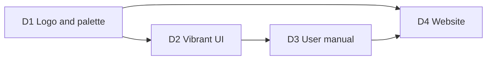

# Roadmap

Each milestone ends with something usable and a short demo note in this file. Milestones are
sized for evenings-and-weekends pace; the order matters more than the dates.

## M0 — Foundations

- Cargo workspace with the crates from [Architecture](architecture.md), mostly empty.
- CI (fmt, clippy `-D warnings`, test).
- `eframe` window with an `egui_dock` layout: explorer (left), console tabs (centre),
  log console (bottom). Layout persisted.
- `tracing` → log console pipeline working with app events.
- Engine runtime started, `Command`/`Event` channels wired, repaint on event.

**Exit:** the app opens, shows three panels, logs "engine started" in the log console.

**Demo note:** done. `cargo run -p dbdesk-app` opens the docked layout, and the status bar shows
"Engine running". The log console shows "engine started" with level/search filters, and the
same entries go to `logs/dbdesk.<date>.log`. The layout survives restarts; **View → Reset layout**
restores the default. An egui_kittest test drives the whole app headlessly.

## M1 — Data sources and sessions

- New / edit / delete data source dialog for Postgres and SQLite.
- `data_sources.toml` read/write, passwords in keychain.
- Connect, disconnect, test connection; status dot in the tree.
- Connection lifecycle in the log console.
- Driver conformance suite started (connect, simple query).

**Exit:** I can add my local Postgres and a SQLite file, connect to both, and see it logged.

**Demo note:** done. In the explorer, **+** opens the data source dialog for PostgreSQL or
SQLite, with **Test connection**. Data sources are saved to `data_sources.toml` and passwords to
the OS keychain. Double-click (or the context menu) connects and disconnects. The status dot
shows disconnected / connecting / connected / failed, and the tooltip shows the server version
or the error. Connection lifecycle and timings appear in the log console. Covered by driver
conformance tests against a real Postgres 17 and SQLite, headless engine tests, and a UI test
that adds a SQLite data source through the dialog.

Follow-ups left out of M1:

- ~~TLS for Postgres (`sslmode`).~~ Done in DB0: `disable`, `prefer`, `require` and
  `verify-full` with an optional CA file, on rustls.
- ~~A file picker for SQLite paths.~~ Done: **Browse…** and **New…** (create an empty database).
- Prompting for a password when none is saved or the keychain is unavailable.
- Noticing when an established connection drops (the session still shows "connected").
- Duplicate data source; colour and safety level per data source.
- Preserving comments in `data_sources.toml` (`toml_edit`).

## M2 — Connection explorer

- Lazy catalog tree down to columns, indexes, constraints for both drivers.
- Refresh subtree, filter loaded nodes, hide system schemas.
- Show definition for views and functions.

**Exit:** I can browse a real work schema without waiting on the UI.

**Demo note:** done. Expanding a data source connects it and loads the tree one level at a time,
with a spinner per loading node. PostgreSQL shows databases (others open their own connection
on demand), schemas, tables, views, materialized views, functions and sequences, then columns,
indexes, constraints and triggers per table. SQLite shows schemas, tables and views, then
columns, indexes, foreign keys and triggers. The filter box matches loaded nodes, the
**System** checkbox shows system schemas and tables, Refresh reloads a subtree, and Show
definition opens the source in a read-only window. Covered by a catalog walk over a fixture with
every object kind on both drivers, an engine test that connects on first expand, and a UI test
that clicks down to a table's columns.

Follow-ups left out of M2:

- `CREATE TABLE` DDL for Postgres tables (no `pg_get_tabledef`; see the explorer doc's open
  questions).
- Counts on folders, and row estimates on tables.
- Keyboard navigation and selection in the tree.
- A per-data-source "show system objects" setting (it is global now).
- Detecting dropped connections (still from M1).

## M3 — SQL runner

- Query console tabs with highlighting and statement-under-cursor.
- Run statement / selection / script, with `dbdesk-sql` splitting.
- Streaming result grid with paging and `FetchMore`.
- Cancellation for both drivers.
- Errors with position underline; Postgres notices in the log console.
- Safety confirmations for `UPDATE`/`DELETE` without `WHERE`.

**Exit:** I use dbdesk instead of `psql` for a day of ordinary queries.

**Demo note:** built; the exit criterion (a day of real use) is still to be tried. Right-click a
data source → **New query console**, or a table → **Open data**. Each console has its own
connection:
- **Editing:** SQL is highlighted by `dbdesk-sql`'s lexer.
- **Running:** ⌘↵ runs the selection or the statement at the cursor; ⇧⌘↵ runs everything,
  stopping at the first failure. ⌘. cancels on both drivers.
- **Results:** the grid shows 500 rows; **Load more rows** or scrolling to the bottom loads the
  next 500.
- **Errors:** the error's position is underlined in the editor.
- **Safety:** `UPDATE`/`DELETE` without `WHERE` asks "Run anyway?".
- **Notices:** PostgreSQL notices appear in the log console.

Covered by:
- Driver checks for execution (paging, NULL, abandoning a result, error positions) and
  cancellation on PostgreSQL 17 and SQLite.
- Headless console engine tests (scripts, paging, failures, cancel, a new run discarding unread
  rows).
- Console state tests, and a UI test that opens a table's data and loads the next page.

Writing that UI test found a real bug: "Load more rows" was drawn below a grid that takes all
the space, so it couldn't be clicked; it now sits in the summary line. A stress run found a
cancel race that left endless SQLite queries running; see "Hard-learned" in the SQL runner doc.

Follow-ups left out of M3 (most belong to M4 anyway):

- Explain (⌥⌘E), manual transactions, persisted consoles, query history, export.
- Cell selection and copying ranges, a cell viewer, client-side sort and filter.
- Line numbers, current-statement highlight, completion.
- Per-data-source safety levels (confirm any change on production).
- Positions for SQLite's "no such table/column" errors (SQLite doesn't report them).

## M4 — Daily-driver polish

- Console files persisted; reopen where I left off.
- Query history with search.
- Manual transaction mode.
- Copy as TSV, export CSV/JSON.
- `EXPLAIN` action.

**Exit:** I use dbdesk instead of my usual database tool for a week, and keep a list of what I
missed.

**Demo note:** built; the exit criterion (a week of real use) is still to be tried.
- **Consoles are files:** each console is `consoles/<data-source-id>/console.sql` (then
  `console_2.sql`, …), saved a second after typing stops and on quit. Quit with consoles open
  and they come back with their text. Closed consoles you typed in are under the data source's
  **Open saved console** menu.
- **History:** **History** in a console searches every statement run on its data source, with
  time, outcome, duration and rows; **Insert** puts one back at the cursor.
- **Transactions:** switch a console to **Manual commit**, run an `INSERT`, and the toolbar
  shows "● Transaction open" until **Commit** or **Rollback**. Closing the console,
  disconnecting or quitting first asks whether to roll it back.
- **Explain:** ⌥⌘E (or **Explain**) shows the plan of the statement at the cursor.
- **Grid:** click, shift-click or drag to select cells, ⌘C copies them as TSV; click a header to
  sort and type to filter the loaded rows (labelled as such); double-click or Space opens a
  cell in a viewer that pretty-prints JSON; **Export → CSV…/JSON…** saves the rows as shown.
- **Editor:** line numbers, and the statement ⌘↵ would run is shaded.

Covered by:
- Store tests for console files, the history (ordering, `LIKE` escaping) and CSV/JSON export.
- A driver check for transaction status on PostgreSQL 17 and SQLite.
- Headless engine tests: console files across a restart, history records and search, manual
  mode with rollback, a user's own `BEGIN` and disconnecting, committing a failed PostgreSQL
  transaction, and exports.
- Console and grid state tests (sorting, filtering, selection, TSV, statement insertion,
  Explain error positions), and UI tests that restore a console from its file and save an
  edit, insert from the history, roll back in manual mode and confirm closing, explain, and
  sort, view and export rows.

Writing those UI tests found two older layout bugs: the default layout gave the explorer 80% of
the width (egui_dock's split fraction is the first node's share), and in a short console the
resizable results panel drew its contents under the editor, which took their clicks. Editor
and results are now split by hand.

Follow-ups left out of M4:

- Renaming consoles, and deleting saved ones from the UI.
- Pruning old history entries; searching all data sources at once.
- "Commit and close" in the rollback warning.
- Sorting and filtering in the database (re-running the query with `ORDER BY`/`WHERE`).
- Copying a selection with its column headers; exporting all rows, not only loaded ones.
- A visual check of the editor gutter and grid under the new theme (UI tests can't see paint).

## M5 — Personalisation

Picked after M4, in this order, one PR each: `keymap.toml`, autocompletion from the cached
catalog, editing data in the grid.

**Keymap demo note:** built. **View → Keymap…** lists every action with its id and shortcut;
**Create keymap.toml** writes a file with every default commented out, and **Reload** applies
edits. A typo in the file is listed as a problem (and counted in the status bar) instead of
discarding the rest. Covered by store and engine tests for reading, creating and reloading the
file, parser and conflict tests, and a UI test that runs a statement with a rebound key.

**Completion demo note:** built. Typing in a console suggests columns of the tables the
statement names, tables, schemas and keywords from the explorer's cached catalog, loading
what's missing in the background; ⌃Space asks anywhere, `alias.` lists that table's columns.
Covered by tests for finding the prefix, qualifier and table references, ranking candidates,
reading and requesting catalog levels, accepting a candidate, and a UI test that completes a
column on a fresh connection.

**Grid editing demo note:** built. Open a table's data, double-click a cell (or F2), type, and
**Submit** writes one `UPDATE` per changed row, all or none; in manual commit mode they join
the open transaction. Results that aren't one table's rows, or lack its primary key, say
"Read-only" and why. Covered by a `describe_table` conformance check on both drivers, engine
tests for all-or-none edits in a transaction or a savepoint (SQLite and PostgreSQL), tests for
deciding what's editable and generating `UPDATE`s, and a UI test that edits and submits a
cell.

The original candidates:

- `keymap.toml`, themes, fonts.
- Custom catalog actions (`actions.toml`) and snippets.
- Autocompletion from the cached catalog.
- SSH tunnels (`russh`).
- Editing data in the grid.
- MySQL driver; a driver for the `db-data-structures` engine.

## SQL tools

Three additions to the query console, one PR each: a formatter, a syntax checker and linter,
and context-aware completion.

**Formatter demo note:** built. Type `select id,name from users where active=true` and press
⌥⌘L (or **Format**, or **Code → Format**): the statement is laid out clause by clause with
upper-case keywords and the cursor stays on its token; ⌘Z takes it back in one step. ⇧⌥⌘L
formats the whole console. **View → Settings…** switches keywords to lower case or as typed,
and the indent width, saved in `settings.toml`. The formatter is our own, over the lexer,
because `sqlformat` changed string literals and dollar-quoted bodies (see the SQL runner doc).
Covered by a corpus of PostgreSQL and SQLite statements formatted in every setting, whose
tokens must come out identical (ignoring whitespace and keyword case) and stable when formatted
twice; layout, cursor-mapping and safety-check tests; settings file and engine tests; and a UI
test that formats with ⌥⌘L, undoes it, and formats again from the Code menu after switching to
lower case.

**Linter demo note:** built. Type `select * from orders where id = null;` and, once typing
pauses, `= null` gets an amber wave; hover for "= NULL is never true; use IS NULL". An
unfinished `select id from orders where` gets a red one, and the toolbar says
**1 error, 1 warning**; F8 jumps between them. Run something so the console connects, and its
statements are also prepared (never run) on its own connection: a misspelt column then shows
the database's own message. Rules are switched off in View → Settings…. Syntax errors come
from `sqlparser`, only for data queries and changes, with a list of constructs it wrongly
rejects found by a corpus of valid statements. Covered by that corpus and lint tests in
`dbdesk-sql`, a `validate` conformance check on both drivers, engine tests that validation
never connects, never disturbs unread rows and skips open PostgreSQL transactions, problem
and catalog-lint tests, and a UI test that hovers a warning and an error.

**Completion demo note:** built, extending M5's completion. `SELECT * FROM cus` offers the
`customers` table, not columns; `JOIN customers c ON c.` lists its columns with their types;
`INSERT INTO orders (cu` offers only `orders`' columns; `WITH big AS (SELECT id AS big_id
FROM orders) SELECT * FROM big WHERE big_` offers `big_id`, read from the CTE by the parser
(the lexer when it doesn't parse); `coal` gives `coalesce()` with the cursor inside. `cid`
fuzzy-matches `customer_id`, and what you accepted lately rises to the top in every console.
The list has the explorer's icons and each candidate's type. Covered by context, derived
table, ranking, function and projection tests, and a UI test that completes a table after
`FROM` (where the column of the same prefix isn't offered) and an alias's column after its
dot. Fixed on the way: the list never grew past the height of its first frame.

## Release track

Downloads that install like any other desktop app, instead of building from source. The full
plan, including the decisions it needs first, is in [Releasing](releasing.md).

- **R1 — First downloadable build:** unsigned macOS (universal `.dmg`) and Linux (AppImage,
  `.deb`) builds attached to a draft GitHub release by a tag-triggered workflow; Windows in CI,
  its installer attached once tried on a real machine. Also `--version`, the MIT OR Apache-2.0
  licence files, and the Install chapter rewritten.
- **R2 — Trusted installs:** macOS signing and notarization, Windows signing, a Homebrew cask,
  generated release notes.
- **R3 — Updates:** an in-app update notice, then automatic updates.

**Update notice demo note:** built, ahead of R2. Start a build older than the newest release,
and the status bar says "dbdesk 0.2.0 is available"; click it for the version you have and
**Open release page**. **Help › Check for updates…** asks on demand and says "You're up to
date" otherwise. The check at start-up can be switched off in **View → Settings…**
(`[updates] check_on_start` in `settings.toml`); a failed automatic check is only logged. The
engine asks GitHub's `releases/latest` through a `ReleaseFeed` trait, so tests use a fixed feed
and never the network. Covered by version comparison and state tests, an engine test of both
answers, a dialog test, and a UI test that finds a newer release at start-up and an up-to-date
one on request.

## Database track

More engines, in order of how many people use them. The full plan, with the rankings, what
each engine needs and the open decisions, is in [More databases](databases.md).

- **DB0 — Groundwork:**
  - dialect facts gathered in one module;
  - TLS for network connections, PostgreSQL first;
  - one data source form shared by every server engine;
  - one CI container per engine.
- **DB1 — MySQL and MariaDB:** one driver on `mysql_async`, with cancel by `KILL QUERY` and
  `SHOW CREATE` definitions.
- **DB2 — SQL Server:** `tiberius`, SQL Server logins first, `GO` batches, XML plans.
- **DB3 — DuckDB:** files and in-memory data sources for querying CSV and Parquet, if the
  bundled engine keeps the downloads small enough.
- **DB4 — ClickHouse:** the official `clickhouse` crate over HTTP and HTTPS, results streamed
  in a self-describing format, cancel by `query_id`, no transactions and a read-only grid.
- **DB5 — Oracle:** after R2, because its client needs Oracle's own library installed
  separately.

**DB0 demo note:** built in #26, #27 and #28. Run `docker compose up -d --wait`: besides the
usual PostgreSQL, a second one on port 55443 refuses unencrypted connections. Add it as a data
source with **TLS** `disable` and **Test connection** fails with *pg_hba.conf rejects connection
… no encryption*; pick `require` and it connects. Pick `verify-full` and it fails with
*UnknownIssuer*, until **CA file** points at `docker/postgres-tls/ca.crt`. Browsing, running
and ⌘. cancel all work over TLS. Old `data_sources.toml` files load with `prefer`, and the TLS
choice is a `[data_source.tls]` table. Underneath, every per-dialect fact (lexer rules,
`sqlparser` dialect, known parser gaps, functions, `EXPLAIN` prefix, system names) is a method
in `dbdesk-sql`'s `dialect` module: non-test matches on `Dialect`, `DriverKind` or
`ConnectionConfig` went from 31 in 16 files to 19 in 5. Host, port, database, user, password
and TLS are one `ServerConfig` in core and one `ServerFields` section in the dialog, which a
new server engine reuses. CI starts every compose service and exports the URLs listed in
`test-servers.env`, so a new engine's container touches those two files only. Covered by the
TLS driver tests against both servers (encrypted per `pg_stat_ssl`, cancel and browsing over
TLS, each refusal), serde tests for old and new files, form tests for every TLS mode, and a UI
test that picks `verify-full` with a CA file and saves it.

**DB1 demo note:** built in #32, #35, #36 and #37. `docker compose up -d --wait` now also
starts MySQL 8.4 (port 55306) and MariaDB 11.4 (port 55307). **+** → **MySQL / MariaDB** opens
the shared server form (`localhost:3306`, database `mysql`, user `root`); **Test connection**
says "Connected to MySQL 8.4.…" or "MariaDB 11.4.…", over TLS by default. The explorer lists
each database as a schema, with tables, views, functions, procedures and events, and columns,
indexes, constraints and triggers under tables; **Show definition** gives `SHOW CREATE …`,
tables included. Run `SELECT 1 FROM DUAL WHERE SLEEP(60) = 0` and ⌘. stops it through
`KILL QUERY` on a second connection. **Open data** on a table and edit a cell: the `UPDATE`
uses backticks and doubles backslashes. Scripts split on `DELIMITER //`, `"text"` is a string,
`#` starts a comment, and ⌥⌘E explains as a tree on MySQL 8. In manual commit mode, `CREATE
TABLE` asks first, since MySQL commits it and the open transaction at once. Underneath:
`Quoting` and the default schema became per-dialect and per-config facts, the conformance suite
uses SQL all three engines accept, and its describe check follows the server's
`lower_case_table_names`. Covered by the whole conformance suite on both servers in CI, driver
tests for the catalog, definitions and TLS, an engine test of grid edits in MySQL's form, lexer,
splitter, syntax-check and formatter corpora for the dialect, a UI test that adds a MySQL data
source, and unit tests for the implicit-commit warning and the tree explain.

**DB2 demo note:** built in #39, #42 and #44, the first milestone delivered as a
native stack of pull requests. `docker compose up -d --wait` now also starts SQL Server 2022 (port 51433; on an
Apple-silicon Mac it runs emulated, slowly). **+** → **SQL Server** opens the shared server form
(`localhost:1433`, database `master`, user `sa`); **Test connection** says "Connected to SQL
Server 16.0.…", encrypted by default. The explorer lists every database the login may open, then
schemas, then tables, views, functions, procedures, sequences and synonyms, with columns,
indexes, constraints and triggers under tables; **Show definition** gives the stored source of
views, routines and triggers. Run `WAITFOR DELAY '00:01:00'` and ⌘. stops it with TDS's own
cancel, which needs no permission; the console stays usable. Scripts split on `GO` lines, a
procedure's body runs to the next `GO`, `[names]` and `N'…'` are single tokens, and `SELECT TOP
(10)` formats on one line. ⌥⌘E switches `SHOWPLAN_XML` on around the statement and off after it,
and **View value** shows the plan indented. **Open data** on a table and edit a cell: the `UPDATE`
uses brackets and an `N'…'` literal, so `Zoë 李` survives. Underneath: `tiberius` is pinned to
tiberius-rs/tiberius#460's commit, which fixes its cancel (0.13.0 left the client a reply behind
after one); validation asks `sp_describe_first_result_set`, since `SET NOEXEC ON` lets a
misspelt table through; and the conformance suite takes a `Spelling` for `#temporary` tables and
`BEGIN TRANSACTION`. Covered by the whole conformance suite against SQL Server in CI, driver
tests for the catalog, definitions, TLS modes, value formatting and cancelling a result still
arriving, engine tests of grid edits and explain, lexer, splitter, syntax-check and formatter
corpora for the dialect, and a UI test that adds a SQL Server data source. Not tried: connecting
to Azure SQL, for want of an account.

## Object helpers track

Dialogs that write, show and run the SQL to create and change tables, views and users, from a
**New** submenu and object actions in the explorer. The full plan is in
[Creating and changing database objects](entity-helpers.md).

- **E0 — Groundwork:**
  - object specs and a DDL builder per dialect in `dbdesk-sql`;
  - each dialect's capabilities;
  - a review-and-run panel that shows the SQL before anything runs;
  - `ApplyDdl` in one transaction where the engine allows it;
  - confirmations for destructive actions.
- **E1 — Tables:** New table (columns, keys, checks), Rename, Truncate, Drop, and Copy DDL,
  which also gives PostgreSQL tables their missing `CREATE TABLE`.
- **E2 — Views:** New view and materialized view with the console's editor, Edit, Refresh,
  Rename, Drop.
- **E3 — Users and roles (PostgreSQL):**
  - a Roles folder in the tree;
  - New user and New role, with passwords hashed into a SCRAM verifier and kept out of the
    history and logs;
  - Edit, Rename, Drop.
- **E4 — Modify table:** `ALTER TABLE` from a changed table, with SQLite's table rebuild last.

## MCP track

An MCP server, so AI assistants can browse and query dbdesk's data sources, grouped into
projects with permissions per project. The full plan is in [MCP server](mcp-server.md).

- **P0 — Projects:**
  - data sources grouped into projects in `projects.toml`, shown as groups in the explorer;
  - useful without MCP.

  **P0 demo note:** built. In the explorer, right-click a data source → **Move to project ›** →
  **New project…**, type `Analytics`, and the data source sits under a foldable **Analytics**
  header, with the rest under **No project**. **Rename…** and **Delete…** are on the header's
  menu; deleting moves its data sources to No project and deletes none. Typing a project's
  name in the filter shows all its data sources. Restart the app and the grouping is still
  there: projects live in `projects.toml` (with the MCP defaults written out, and every project
  off for MCP), membership in an optional `project` id on each data source. A
  `data_sources.toml` from 0.2.0 loads unchanged. A project keeps the slug made from its first
  name through renames, so MCP client configurations won't break. Covered by store tests (the
  file format, slugs, broken files refused), engine tests (create, rename, move, delete,
  restart, a broken `projects.toml` never overwritten), a serde test of a 0.2.0 file, and a
  kittest UI test of the whole flow.
- **MCP1 — Read-only server:**
  - `dbdesk mcp --project <slug>` over stdio, with catalog, describe, query and explain tools;
  - read-only transactions, row and time limits, and every call logged and recorded in the
    history.

  **MCP1 demo note:** built. In `projects.toml`, set `mcp_enabled = true` on a project, then add
  `dbdesk mcp --project <slug>` to an MCP client (the manual's "Connecting an AI assistant"
  has the JSON). The assistant gets six read-only tools: `list_data_sources`, `list_objects`,
  `describe_table`, `get_definition`, `query` and `explain`. Ask it to describe a table and
  query it: rows come back as text cells, at most 500, with `truncated` when there were more.
  Ask it to run `WITH gone AS (DELETE FROM t RETURNING *) SELECT * FROM gone` and dbdesk
  refuses it before sending; `SELECT f()` on a function that inserts is refused by the
  database's read-only transaction (SQLSTATE 25006). Both refusals are in
  `dbdesk-mcp.YYYY-MM-DD.log`, and every statement sent is in the query history with `source =
  'mcp'`. Covered by the classifier's corpus per dialect, the history's two-process WAL test,
  `dbdesk-mcp`'s stdio test (a real server process against SQLite, PostgreSQL, MySQL and
  MariaDB), and tests of the `mcp` subcommand on the real binary.

- **MCP2 — Permissions:**
  - an `execute` tool, gated by the project's `write`, `schema` and `admin` permissions, which
    fall back to global defaults that only read;
  - statements classified by the parser;
  - an optional separate MCP login per data source.
- **MCP3 — In the app:** project settings, Copy MCP configuration, MCP statements marked in the
  history, and a manual chapter.

## Hackability track

Customisation without rebuilding dbdesk, from files to commands to plugins. The full plan is in
[Hackability](hackability.md), and the decision in
[ADR 0005](adr/0005-customisation-files-commands-then-wasm.md).

- **H1 — Files:** `actions.toml` (SQL actions on tree nodes and grid selections, bindable in the
  keymap), `snippets.toml` and `theme.toml`.
- **H2 — Commands:** actions that run your own programs, with no shell and never a secret,
  getting the selection on stdin and sending output to the viewer, a console or the log.
- **H3 — WebAssembly plugins (later):** sandboxed and capability-based, over the same extension
  points, started once at least three real needs outgrow H1 and H2.

## Well-rounded track

The gaps that keep dbdesk from being an everyday tool. The full plan is in
[A well-rounded app](well-rounded.md).

- **W1 — Portable configuration:**
  - export and import data sources and projects, with no secrets, and a preview that matches
    entries by id;
  - paths that travel, and `${VARIABLE}` placeholders;
  - a password prompt on first connect.
- **W2 — Safety per data source:** Normal, Careful (confirm every change) and Read-only
  (enforced as for MCP).
- **W3 — Connections you can rely on:** SSH tunnels with `russh`, and noticing and reconnecting
  dropped connections.
- **W4 — History as an audit trail:**
  - where each statement came from, and grid edits with the values they replaced;
  - retention, a search across data sources, and export.
- **W5 — Power in the grid:**
  - insert and delete rows, and follow foreign keys;
  - sort and filter in the database;
  - export every row, and import a CSV.
- **W6 — Files and parameters:** open and save `.sql` files, `:name` parameters, find and
  replace.

## Design and documentation track

Runs alongside the feature milestones rather than after them: each item is usable on its own.
They build on each other in this order, because each one reuses what the one before it made:

### D1 — Logo and brand palette

- A logo mark that works from 16 px (tab icon, favicon) up to a hero image: a simple, bold
  shape, readable in one colour, drawn as SVG.
- A small palette derived from it: one primary accent, one secondary accent, and the success,
  warning and error colours, each with light- and dark-theme variants. D2 builds the UI theme
  from these values, so the logo and the app clearly belong together.
- Exports: `assets/brand/logo.svg` (full colour), `logo-mono.svg` (one colour), a PNG set for
  the window icon (eframe's `ViewportBuilder::with_icon`) and the macOS `.icns`.
- Process: three or four concepts side by side, pick one, refine it.

**Exit:** the dbdesk window, the README and the repository's social preview show the logo.

**Demo note:** built in #7. The mark is "Strata", a database cylinder cut into a lid and two
slabs, picked from four concepts; [brand.md](brand.md) has its construction, the files and the
palette with its contrast ratios. `assets/brand/export.sh` regenerates every PNG and the
`.icns` reproducibly. The window and the README show the logo. The social preview is a
repository setting rather than a file: `assets/brand/social-preview.png` is uploaded under
**Settings → General → Social preview**, and has to be uploaded again whenever it changes.

### D2 — A more colourful, vibrant UI

egui's default look is deliberately neutral grey. This replaces it with a theme of dbdesk's own:

- **Theme module.** `Visuals` built from the D1 palette for light and dark mode: accent-tinted
  selection, hover and active states, panel and tab-bar colours, and an `egui_dock` style to
  match. The theme follows the system setting, with an override in the View menu.
- **Colour that carries meaning:**
  - A colour per data source, shown on its explorer row, its console tabs and a band along the
    top of the console (the colour planned in M1's follow-ups; it lands here).
  - Coloured icons per catalog node kind.
  - Status dots and run status in the palette's success, warning and error colours.
- **Icons.** An icon font (Phosphor, via `egui-phosphor`) for toolbar buttons, tree nodes and
  menus, instead of text-only buttons.
- **Typography.** Inter for the UI and JetBrains Mono for SQL and results, bundled (both
  under the SIL Open Font License).
- **Syntax and grid colours** retuned to the palette; a zebra-striped grid with a tinted
  header.
- **Contrast:** text stays at WCAG AA contrast against its background in both themes, checked
  by a unit test over the palette.

**Exit:** before/after screenshots of each panel in both themes are in the PR, and the app
still reads well in both.

**Demo note:** built in #10, with before/after screenshots of each panel in both themes.
Decisions, including why icons have a font family of their own, are in
[look-and-feel.md](features/look-and-feel.md).

### D3 — User manual

- **mdBook** in `book/`, written for someone who has never seen dbdesk. Chapters:
  1. Install and first launch
  2. Data sources: adding, testing, passwords and the keychain
  3. Explorer: browsing, filtering, definitions
  4. Query consoles: running, results, cancelling, errors
  5. Keyboard shortcuts
  6. Where dbdesk keeps its files
  7. Troubleshooting (TLS, keychain prompts, logs)
- **Screenshots generated, not hand-taken.** egui_kittest's snapshot feature renders the
  app headlessly (wgpu), against a fixture database. Running one test regenerates every image,
  so they never go stale.
- **Kept in step with the code.** Each milestone's PR updates the chapters it affects, and CI
  builds the book (`mdbook build`, plus a link check) so a broken page fails the PR.

**Exit:** the manual covers everything up to the current milestone, and builds in CI.

**Demo note:** built in #11, covering everything up to M5: data sources and the keychain,
the explorer, consoles (saved consoles, transactions, history, completion, sorting, filtering,
export and grid editing), the keymap, files and troubleshooting. All eleven images are rendered
by one ignored test (`screenshots::regenerate_screenshots`), and CI builds the book with
`mdbook-linkcheck2`.

### D4 — Website on GitHub Pages

- A landing page with the logo, a one-paragraph pitch, screenshots from D3, and links to the
  manual, the source and (later) downloads. Plain HTML/CSS in `site/`, styled with the D1
  palette. No framework needed for one page.
- The manual (D3) is published under `/manual/` on the same site.
- **Deployment:** a GitHub Actions workflow builds the landing page and the book on every push
  to `main` and publishes them with `actions/deploy-pages`. PRs only build, so a broken site
  fails the PR without going live.
- **Hosting:** GitHub Pages from this repository, which is public, so the free plan covers it.
  (While it was private, Pages would have needed a paid plan or a separate public repository.)

**Exit:** the site is live, linked from the README, and redeploys on every merge to `main`.

**Demo note:** built. <https://navasvarela.github.io/dbdesk/> is one hand-written page in
`site/` (HTML and CSS, the app's palette and bundled fonts, dark first with a light theme), with
the manual under `/manual/`. `site/build.sh` assembles both, copying the logo, fonts and database
logos from `assets/` rather than keeping second copies. `.github/workflows/pages.yml` builds it
on pull requests that touch it (checking the landing page's links with lychee, offline, and the
manual's with mdbook-linkcheck2) and publishes it on every push to `main`. The Welcome tab's
**Open the manual** now opens the published manual. The Download button goes to the releases
page, which is empty until the first release is published.
